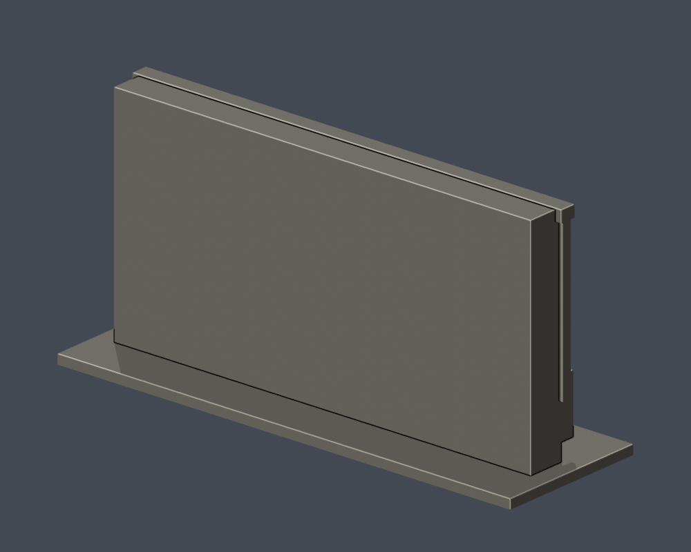

# 國立臺北商業大學｜學生活動中心西向主立面段（2023年實拍近似）

**局部立面模型，不是全館，也不是2026年現況測繪。** 外觀根據2023年9月2日公開實拍建立；原照片與PDF未包含於此包。正面朝校園球場。背面平整面是**人工切面**，不是建築真正背立面；模型12毫米主體厚度是列印與展示選擇，不能還原真實建築進深。已知另有改建規劃，尚未建立拆除／新建完成證據。

| 模型預覽 | 模型預覽 | 模型預覽 |
| :---: | :---: | :---: |
|   |  |  |

## 外觀範圍
- 保留7個主要大跨、8道主分界、上層密集垂直遮陽、下方窄窗帶、大片實牆、低矮出挑入口雨棚與階梯。
- 窗片細框僅作有背牆連接的淺細分，沒有把玻璃細框當成主結構柱。
- 圖片外側樹木遮挡處，重複構件節奏為近似。每跨7片上層遮陽片是150毫米尺度可辨的簡化，不保證原建築逐根數量；空調、招牌文字、樹木、細扶手未做。
- 未建立整棟屋頂、內部樓層、背面、兩側長立面。頂部平檐有照片依據，後方切面上的平頂不宣称真實屋面。
- 各方向比例均由照片估計，沒有實測尺寸或固定建築比例尺。

## 列印與尺寸
- 單位：毫米。含底座150 × 48 × 73.2 mm；底座朝下。
- 雨棚、窗帶及豎片端部可能需要支撐；用切片軟體核對懸垂和工具路徑後再列印。細節已做與牆連接及加粗。
- 原STL單一連通水密表面；數位QA不是實體試印，也不是Cura／Prusa工具路徑驗證，不能保證無支撐可印。

## 檔案與重建
- [model.stl](model.stl)：實際列印網格；[scene.blend](scene.blend)：由此STL匯入的可編修三角網格。
- [build_model.py](build_model.py)：自行撰寫參數建模，不含下載第三方3D。
- [sources.json](sources.json)：公開來源與支持範圍；[validation.json](validation.json)、[contour-validity-check.json](contour-validity-check.json)、[thin-feature-check.json](thin-feature-check.json)：QA。
- previews的所有PNG由交付STL渲染，非外觀示意圖。top圖只是局部切面模型頂視。

Python 3.12環境安裝requirements.txt後，依序執行：

```sh
python build_model.py
blender -b -t 2 -P render_preview.py
python validate_model.py
python check_contour_validity.py
python check_thin_features.py
python check_manifest.py
```

輪廓採0.2mm步距、z起始0.071mm；任何個別或合成多邊形無效均直接失敗，不修補後冒稱通過。0.8mm形態opening採canonical fail-closed v3，僅是輔助薄件篩檢。
