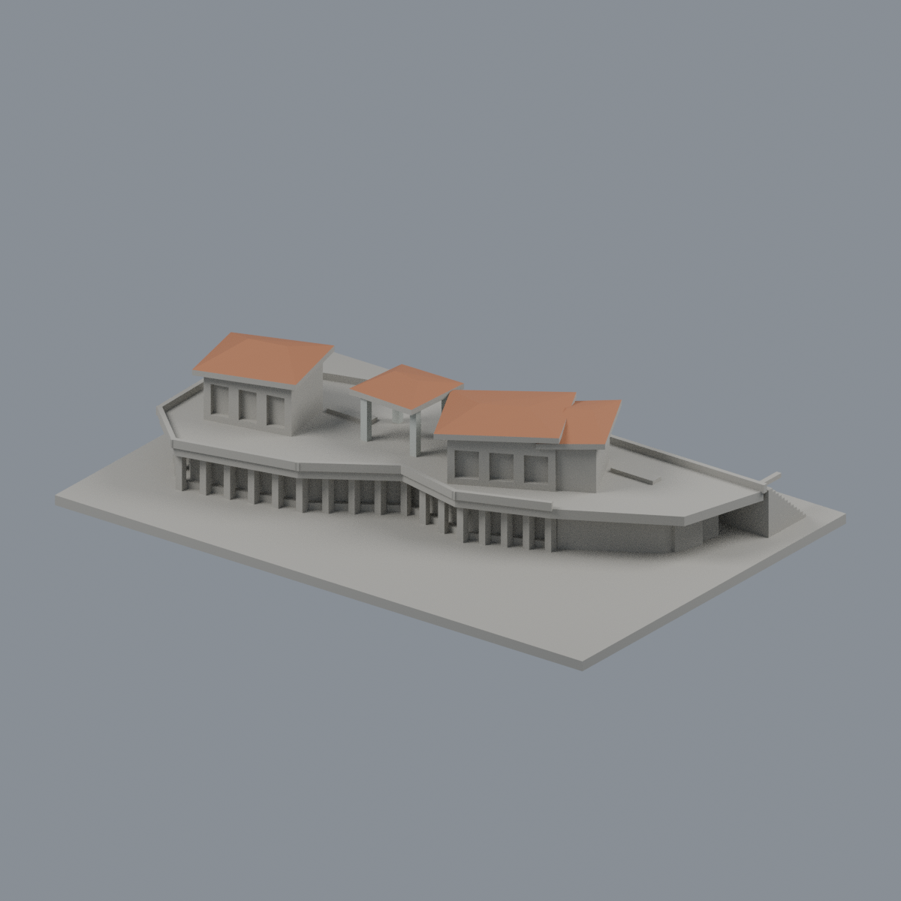
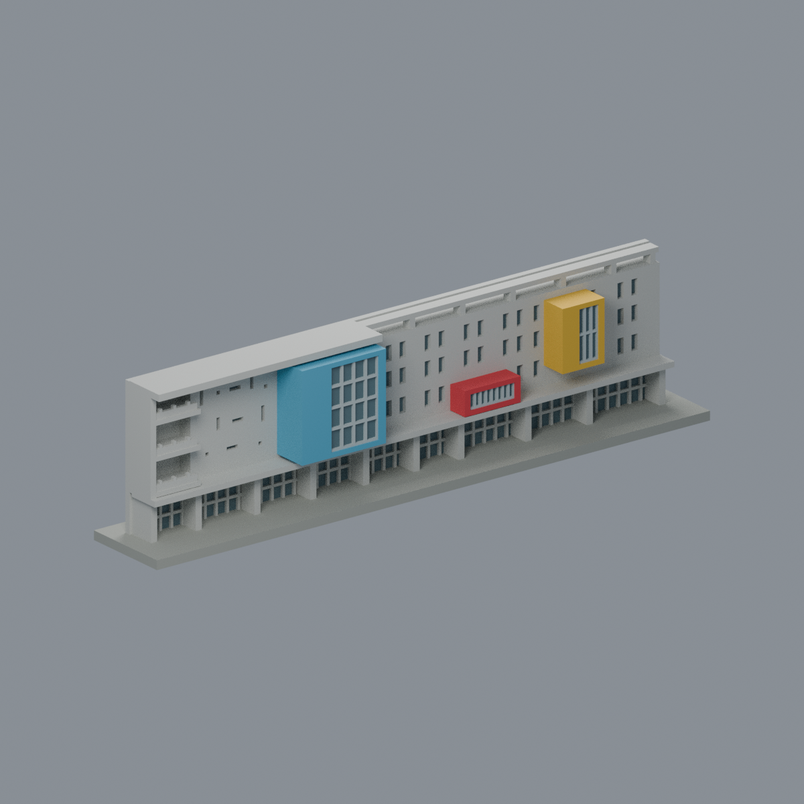

# 三峽校區

首批2件，不代表校區全部建物。

| 心湖會館 | 圖書資訊大樓：圖書館主體段 |
|---|---|
|  |  |
| [模型、STL與正背圖](buildings/ntpu-mind-lake-hall/) | [模型、STL與正背圖](buildings/ntpu-library-main-block-segment/) |

每件資料夾含獨立腳本、STL、可編輯Blend、實際STL正背/頂圖、來源與fail-closed檢查。圖書館為局部主體段；資訊中心後棟仍待建模。

[逐項續接清單](../inventory/CONTINUE.zh-TW.md) · [數位審核](../qa/) · [返回學校圖鑑](../README.md)

## 新增：綜合體育館彩色凸窗入口立面段

本校目前 **3 套**，套件數不等於整棟建築數，非全校完成。此體育館立面段與既有圖書館、心湖會館不同；不是全體育館。

依2019建築師正面照與校方低斜角照片建立的彩色凸窗入口立面薄切段，非完整四棟體育館。藍深凸窗有左實牆及右玻璃回折，黃窄凸窗、紅色低入口框、左凹陽台與穿空梁均為幾何；7材質3MF/Blend/STL，任意照片尺度及背面展示切面明列。原始單殼拓撲與252層截面通過，但0.75mm窗櫺局部0.8mm侵蝕失敗如實保留；須支撐與細節評估，未實印。

[模型、來源與 QA](buildings/ntpu-gym-colored-bay-entry-facade-segment/README.md)
