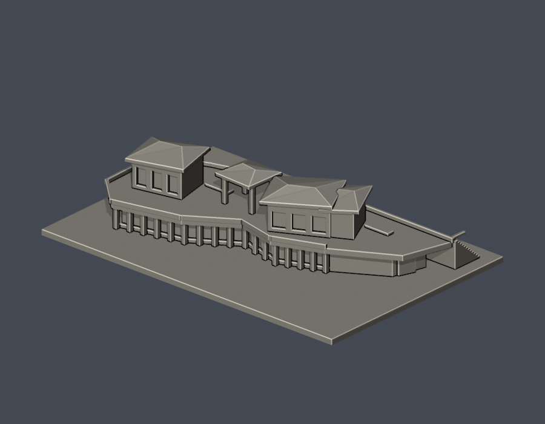

# 三峽校區

本輪2件，不代表校區全部建物。

| 心湖會館 | 圖書資訊大樓：圖書館主體段 |
|---|---|
|  |  |
| [模型、STL與正背圖](buildings/ntpu-mind-lake-hall/) | [模型、STL與正背圖](buildings/ntpu-library-main-block-segment/) |

每件資料夾含獨立腳本、STL、可編輯Blend、實際STL正背/頂圖、來源與fail-closed檢查。圖書館為局部主體段；資訊中心後棟仍待建模。

[逐項續接清單](../inventory/CONTINUE.zh-TW.md) · [數位審核](../qa/) · [返回學校圖鑑](../README.md)
