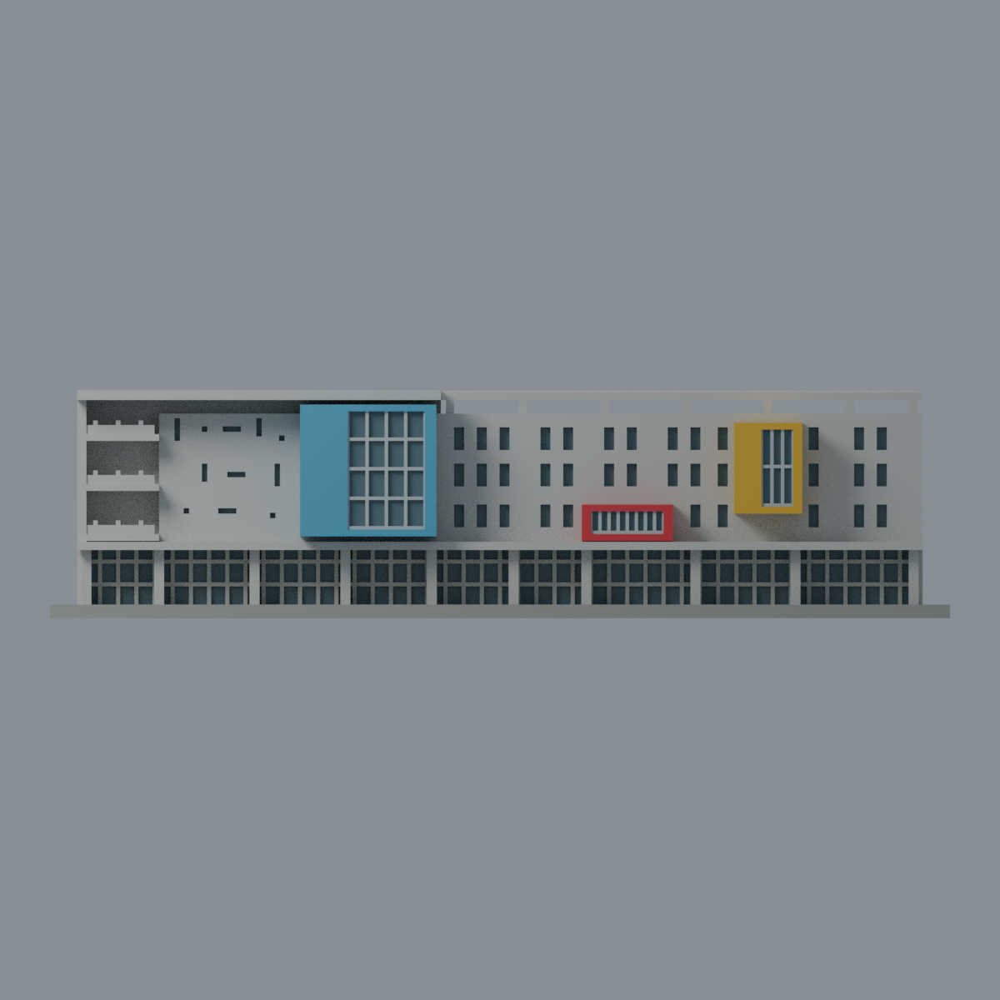
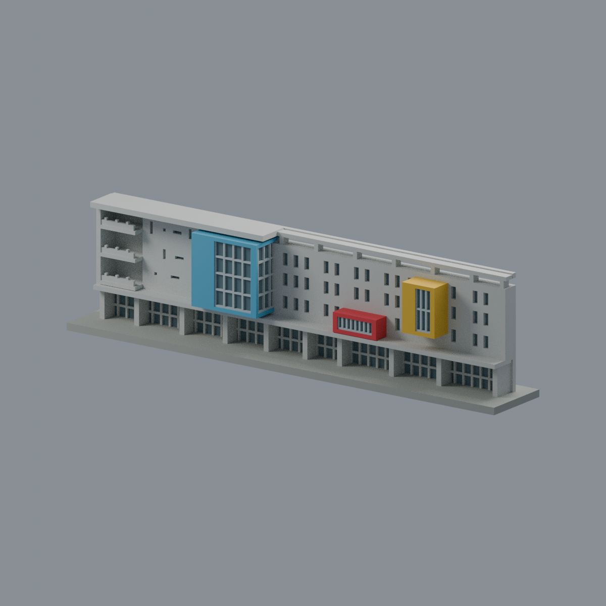
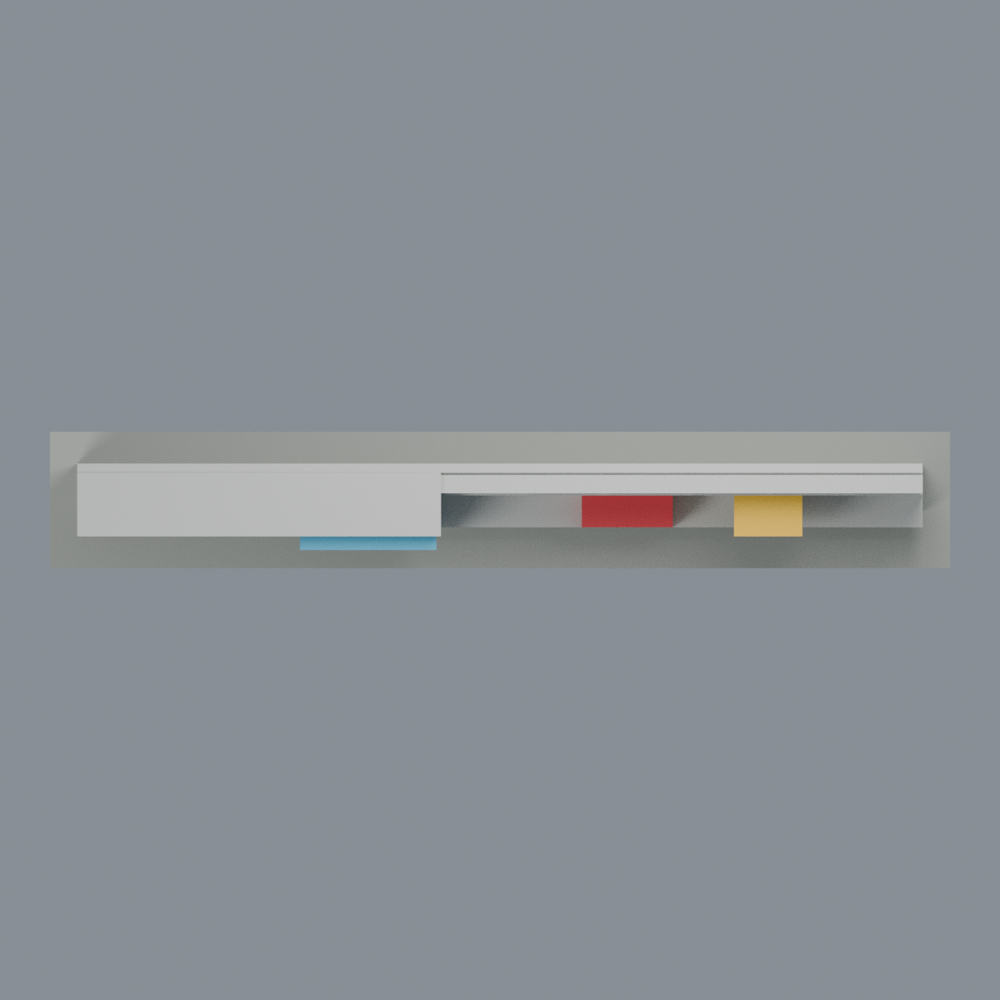
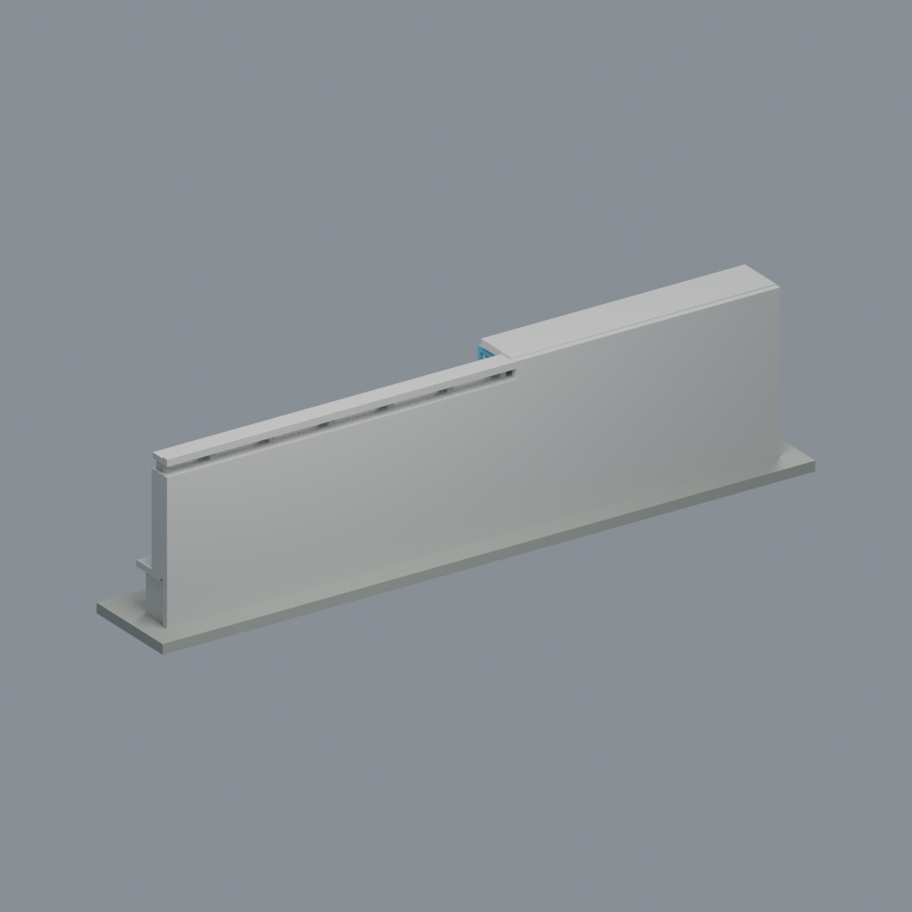

# 國立臺北大學綜合體育館彩色凸窗入口立面段

## 模型預覽

| 模型預覽 | 模型預覽 | 模型預覽 |
| :---: | :---: | :---: |
|  |  |  |

三峽校區的 **新建模立面薄切段**，不是完整體育館／四棟量體。依 2019 建築師作品攝影與校方低角度實景，保留藍色深凸窗、紅色低入口框、黃色窄凸窗、左三層凹陽台、右上穿空梁與底層凹入玻璃廊。

## 下載與編輯
- `model.3mf`：7 個逐面可編輯材質；非多噴頭／AMS 配置。
- `scene.blend`：與 STL 相同三角網格；材質可直接編輯。
- `model.stl`：單一連通、封閉的單色幾何。
- `build_model.py`、`render_model.py`：可重建幾何、材質與五張實際網格預覽。

展示尺寸 **198 × 30 × 50.2 mm**；照片比例近似，非實測比例或 BIM。背面及端部是任意平整展示切面，不能當作真實建築後立面／平面。未建模不可見屋頂、地下層、其餘四棟量體、坡道、樹木、人物、招牌。玻璃為不透明凹入面；窗櫺、層高與欄杆有列印尺度簡化。官方 2025-12-15 是發布日期，不代表照片拍攝日期。

## 製造限制
原始 STL 拓撲、252 層截面和所有整體分量 0.8 mm 侵蝕通過；**這不表示細節皆可列印**。獨立局部侵蝕實測顯示 0.75 mm 藍窗窗櫺會消失；其他細窗、欄杆也可能因噴嘴與縮放合併。凸窗底、陽台、穿空梁有懸挑／橋接，須自行切片判斷支撐與方向。沒有實體試印、FFF 切片、強度認證。

## 重建
Python 3.12，見 `requirements.txt`；`python build_model.py`；`python qa_model.py --out .`；`python check_features.py`；`python verify_exchange.py`（需 lib3mf）；`blender -b -t 4 --python render_model.py`；`blender -b --python verify_scene.py`。

五視圖： [正面斜視](previews/front.png) · [正立面](previews/elevation.png) · [右斜視](previews/right_oblique.png) · [俯視](previews/top.png) · [任意展示背切面](previews/rear.png)。

| 模型預覽 | 模型預覽 | 模型預覽 |
| :---: | :---: | :---: |
| 正立面  | 右斜視  | 俯視  |
| 任意展示背切面  |  |  |

資料來源與限制見 [SOURCES.md](SOURCES.md)、[QA.md](QA.md)。參考照片不在套件內；此套件只授權自行產生的模型／程式，不授權原建築或第三方照片。
