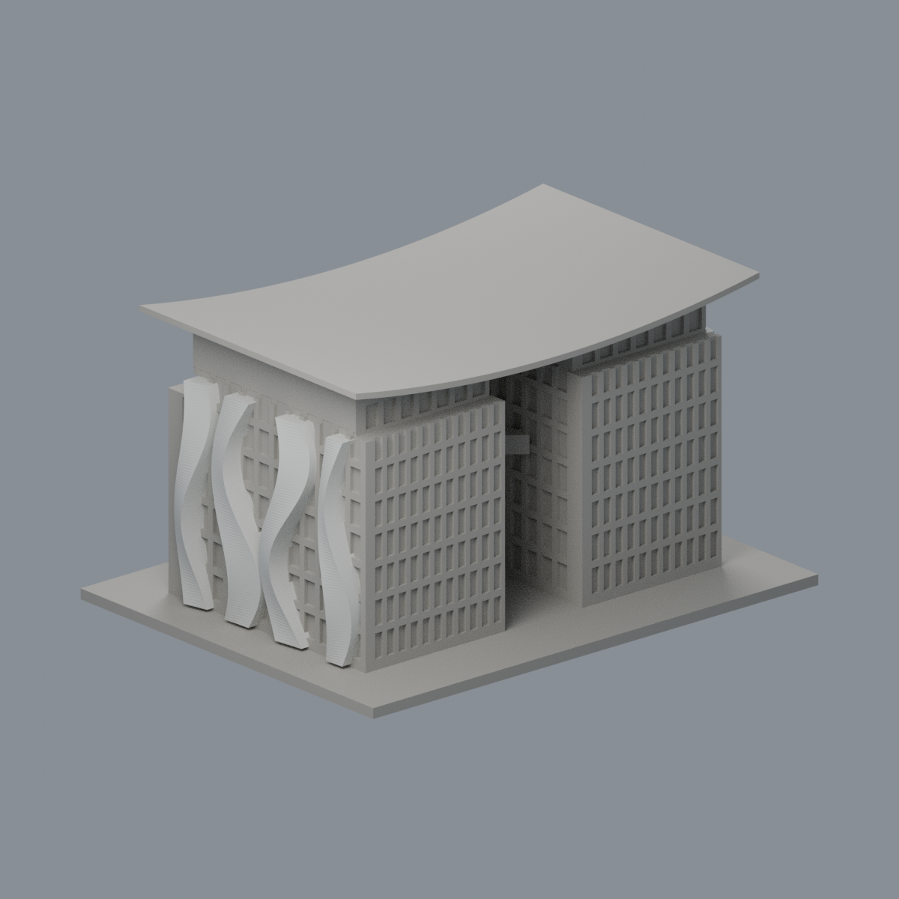
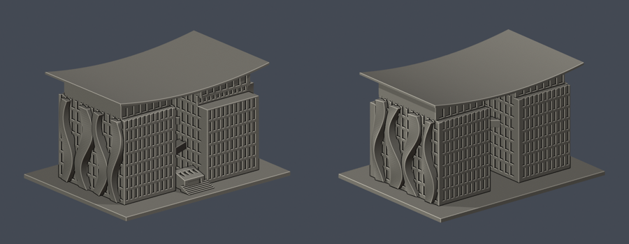

# 圖書資訊大樓：圖書館主體段

## 2 材質外觀版（2026-10-21）

| 正面與來源支持區域 | 兩側外皮有來源／幕牆中性 |
|---|---|
|  |  |

[來源界線與四視角](appearance/README.md) · [表面色 3MF](appearance/ntpulib-appearance.3mf) · [可編輯場景](appearance/scene.blend)

依五張設計者實照與原 loft 面平面精確定位兩側白 S 外皮，共 4379 個完整原面；混合幕牆、三座斜橋、屋頂及地坪中性，不宣稱整棟玻璃或現況還原。 原 STL 與歷史 QA 不變；這是外觀改善，不是新增幾何。[原單色正面](previews/front.png)／[原單色背面](previews/rear.png)


局部主體段；非全圖資大樓。依公開竣工實拍手工參數化重建的建築外觀近似模型，沒有抓取現成3D mesh，也不是測繪或工程用模型。

## 模型與下載




- [STL](model.stl)
- [可編輯 Blender 場景](scene.blend)：匯入實際交付STL的三角網格，單位毫米
- [參數化重建腳本](build_model.py) 與 [相依版本](requirements.txt)
- [公開來源與採用特徵](sources.json)

尺寸（含底座）：150 × 115 × 82.942398 mm；最長150mm。本件獨立縮放，與其他館舍不是同一比例。

## 保留的外觀

- 南北雙翼間26mm寬開放穿堂
- 三層斜向跨橋與屋頂X構件；橋位、跨度和曲率依照片近似
- 淺上翹曲面大屋頂及退縮頂層
- 兩側不相同的立體扭曲波形帶；外表面隨高度起伏
- 正面前突較低量體與小入口階梯

## 範圍與不確定處

- 明確不含後方低層資訊中心、通湖平台及附屬樓梯
- 本件為圖書館雙翼主體段，不能視為圖資大樓全棟測繪
- 波形外皮採連接實體基牆的加厚近似，非懸浮薄殼
- 立面玻璃以凹刻簡化，非透明片；曲帶、橋體、屋頂進深均為照片估算
- 官方資料指地上7層、35.95m，但本件各向尺寸不是嚴格測繪比例
- 來源為2013落成後與2014刊登系列；照片無逐張攝影年月，不能稱2026現況測量

## 重建與檢查

以Python 3.12安裝requirements.txt，依序執行：

```sh
python build_model.py
blender -b -t 2 -P render_preview.py
python validate_model.py
python check_contour_validity.py
python check_thin_features.py
python verify_package.py
```

- 原始STL的法向量、繞序、正體積、水密、每邊兩面、vertex link單環及單一連通表面都有檢查；沒有以修復後的STL代替輸入證據。
- 獨立暫存路徑重建的STL SHA必須一致；saved Blend實際網格也要與交付STL幾何一致。
- [validation.json](validation.json)、[0.2mm逐層檢查](contour-validity-check.json)與[0.8mm參考寬度篩檢](thin-feature-check.json)分開提供；斷言失敗即非零退出，不能忽略。
- 輪廓採0.2mm層距、起點z=0.071mm，逐層檢查degree 2閉合及個別/組合Polygon有效性。
- 薄特徵以canonical shared-edge法，1mm層距、0.4mm半徑形態opening輔助檢查，不等於全面最小壁厚。

## 列印注意

毫米匯入，底座朝下。露臺、屋簷、跨橋等懸挑處可能需要支撐；請在Cura、PrusaSlicer等實際切片器逐層查看橋接、支撐可移除性、細部與首層黏著。欄杆、玻璃格柵等已做粗化或凹刻，勿再任意縮小。

本件沒有實體試印，也沒有Cura/Prusa的實際工具路徑驗證；數位幾何通過不保證所有機器、材質、噴嘴或設定都可直接印成功。

## 版本

2026-10-13 修訂版已通過外觀覆核並凍結；獨立幾何審核結果另附。來源照片與原始PDF不在公開包重新散布。
