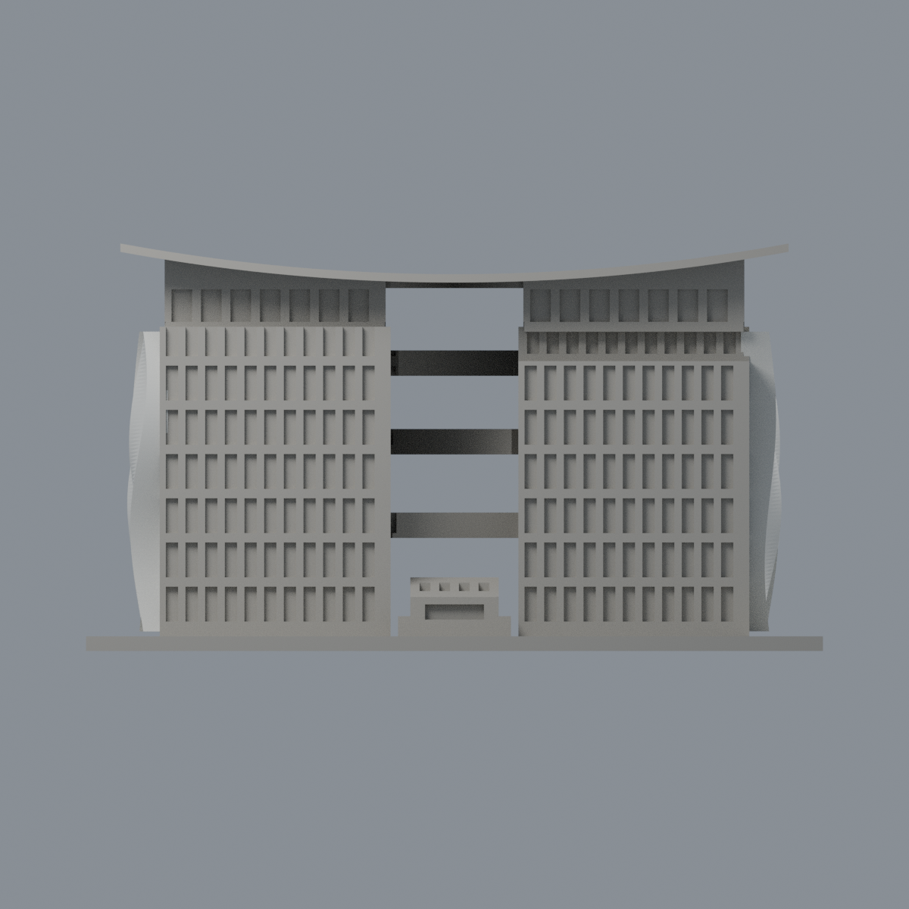
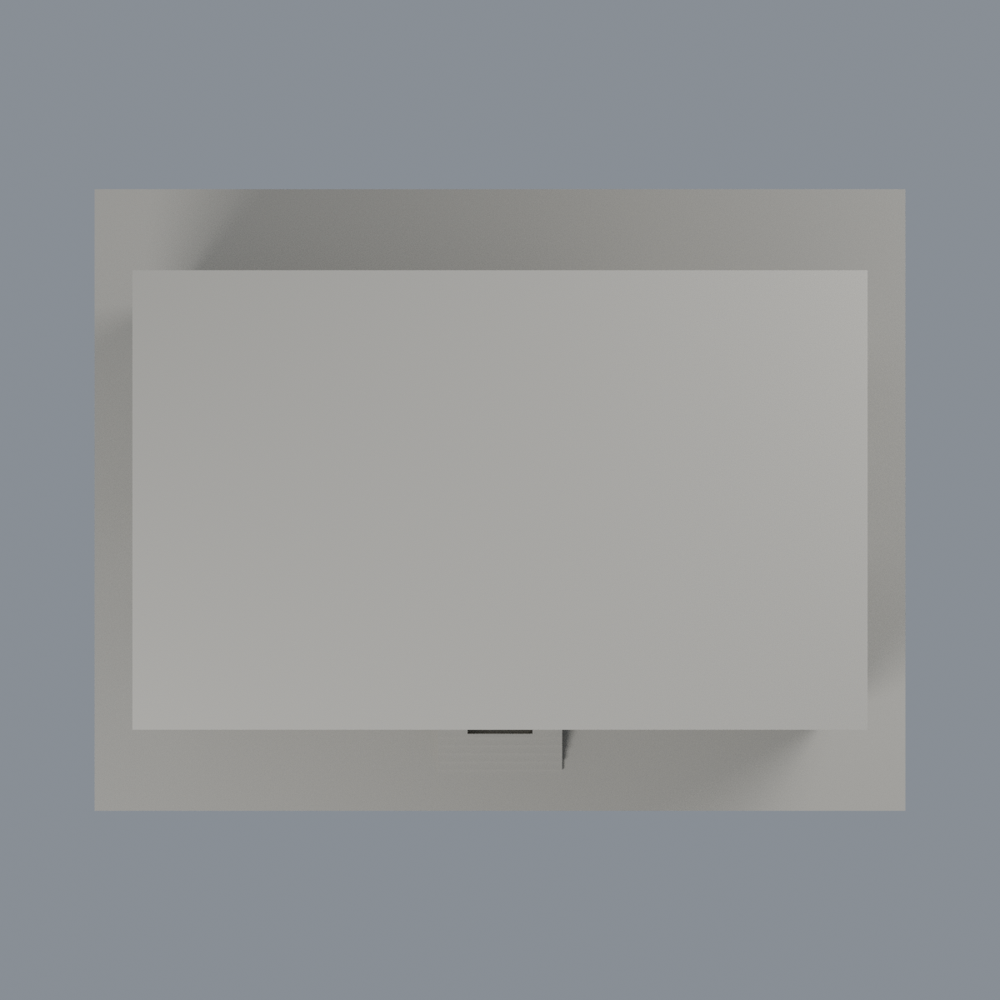

# 臺北大學圖書館主體段白 S 外皮限定配色：二材質外觀版

沿用原 **18,858 三角面／9,299 頂點**，不改原 STL 位元、座標、面序或幾何；這是既有模型外觀改版，不增加模型包數。

| 正面 | 兩側外皮有來源／混合幕牆中性 |
|---|---|
|  |  |
|  |  |

[表面色 3MF](ntpulib-appearance.3mf) · [可編輯 Blender](scene.blend) · [材質色表](palette.json) · [逐面指派與依據](face-materials.json) · [原 STL](../model.stl)

## 來源與配色邊界

親看[廖國誠建築師事務所圖書館作品頁](https://liaoarch.wixsite.com/liaoarchitect/library)的五張完整建成實照、原單色預覽與生成器。[精確照片 URL、SHA 與檔案檢查](qa/source-review.json)。五張均無相機 Original／Modified 日期，不把網站頁腳 2015、上傳路徑或雜誌出版日當成拍攝時間；不宣稱 2026 現況。原照片私有研究，不入包。本次未檢閱原來源表另列的雜誌照片，不能聲稱已核其內容。

- 僅圖書館主體段，並非後方圖資低樓全群。只對兩側合計八條原有 S 形立體外皮採淡白材料代理；照片分別支持兩側，而不是無來源鏡射。沒有新增磁磚縫、金屬板縫或材質貼圖，也不由照片斷言精確金屬成分。
- 由原生成器八條 float32 loft 的每片三角平面與全頂點重心座標定位；同平面凸四邊形另驗證凸性與面積後接受原 Boolean 跨對角重三角化。容差 0.00005 mm／重心座標 0.00005，不新增或切割任何三角。左側 2,204 面、右側 2,175 面，共 4,379 面，包含跨 x=60 而確實位於外皮側面的原面，避免舊半空間遮罩造成假橫帶。x=±58.3 的嵌入內背面排除；所有 z4..65 外凸原面皆完成對應。外露側緣及端面採同構件有界材料延伸。
- 前後與內庭幕牆實照混合透明、磨砂、不透明板和金屬框，原矩形節奏不足逐格對應，整體中性而非假造整片深藍玻璃。中性也不是實景灰色還原。
- 三座斜橋實景有玻璃欄板、實腹與底面，原厚實梁未分界，全部中性。屋頂上面、入口簡化棚、地坪與其他不確定區域同樣中性；不把草坪、室內展品、文字或後棟加進模型。
- 原 STL 位元、面序、座標與歷史 QA 不變。本版僅外皮有界配色，非完整實景重建，未做實體列印測試。

[原幾何與歷史來源限制](../README.md)

## 重建與核驗

安裝 [依賴](source/requirements.txt)，Blender 使用 4.3.2。由本資料夾上層提供原 model.stl：

1. `python appearance/source/build_appearance.py`
2. `python appearance/source/verify_exchange.py`
3. `blender -b -t 3 --python-exit-code 1 -P appearance/source/render_appearance.py`
4. `blender -b -t 3 --python-exit-code 1 -P appearance/source/verify_scene.py`

[獨立重建 ZIP](rebuild-source.zip)含原 STL、四支程式及依賴，不含第三方照片；不取代原建模腳本。[逐檔 SHA256](SHA256SUMS)

[交換／拓撲 QA](qa/exchange-validation.json)核對原座標與面序、全部面材質、單連通、有向水密邊、頂點 link 單環、正體積與零退化／重複面；lib3mf 嚴格讀取零警告，實際編輯單材質再存讀，其他材質及面指派不變。SDK 六位小數量化誤差另列。

[Blender 存讀與編輯](qa/scene-validation.json) · [渲染記錄](qa/render-manifest.json) · [獨立重建](qa/rebuild-validation.json)

## 製造限制照舊

尺寸仍為 150 × 115 × 82.9424 mm；原 STL、建模程式、場景及歷史 QA 保留。原層檢與薄特徵檢查本次未重跑，不能由材質 QA 代替。

3MF 是同一網格的表面色，不是各材質各自封閉的分色實體、切片專案、噴頭映射或 G-code。切片 GUI、多材料路徑與實體列印未測；柱頭、屋簷、窗框及薄邊仍須評估材料、支撐及拆除風險，沒有保證可印或免支撐。
