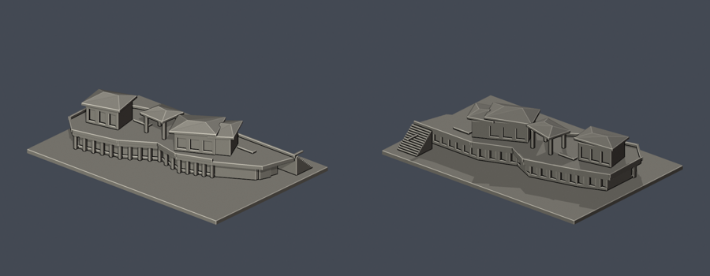
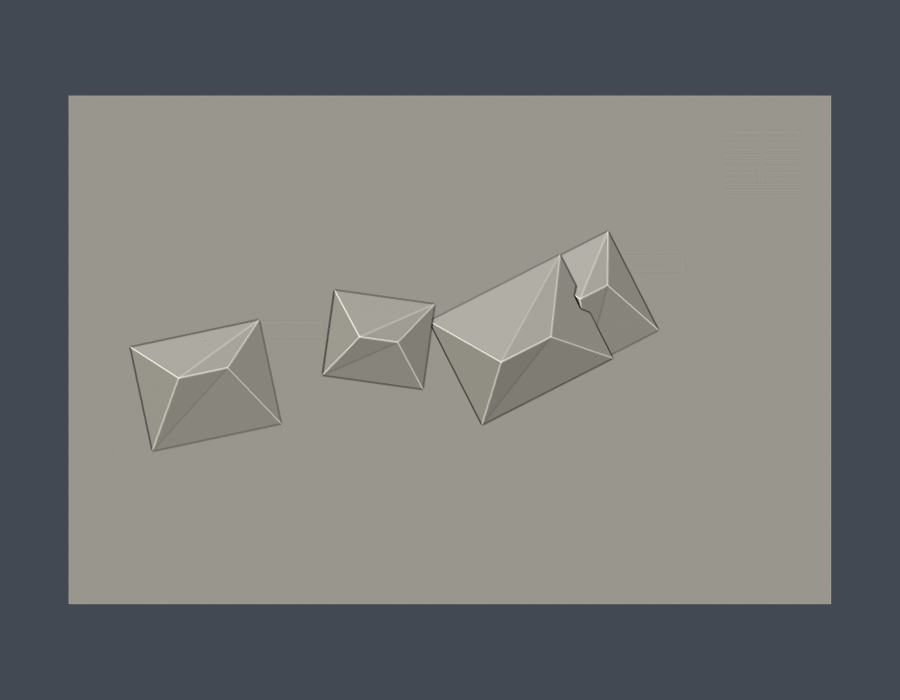

# 心湖會館

整體外觀近似。依公開竣工實拍手工參數化重建的建築外觀近似模型，沒有抓取現成3D mesh，也不是測繪或工程用模型。

## 模型與下載




- [STL](model.stl)
- [可編輯 Blender 場景](scene.blend)：匯入實際交付STL的三角網格，單位毫米
- [參數化重建腳本](build_model.py) 與 [相依版本](requirements.txt)
- [公開來源與採用特徵](sources.json)

尺寸（含底座）：150 × 100 × 31.5 mm；最長150mm。本件獨立縮放，與其他館舍不是同一比例。

## 保留的外觀

- 折線二樓露臺與主要樓板輪廓
- 三組上層亭體，其中中央亭下保持開放
- 非等高折坡屋頂、地面層柱廊與後側玻璃窗帶
- 東側寬樓梯與粗化矮牆

## 範圍與不確定處

- 側邊設備機座、空調群、管線、實體植栽不逐件製作
- 欄杆以1.15mm實牆化，避免細桿失真或列印斷裂
- 屋頂折線、各亭體與露臺進深是實拍比例估算，沒有施工測繪
- 2021年完成實拍與查核時官方照片仍在刊載；不宣稱照片攝於2026年

## 重建與檢查

以Python 3.12安裝requirements.txt，依序執行：

```sh
python build_model.py
blender -b -t 2 -P render_preview.py
python validate_model.py
python check_contour_validity.py
python check_thin_features.py
python verify_package.py
```

- 原始STL的法向量、繞序、正體積、水密、每邊兩面、vertex link單環及單一連通表面都有檢查；沒有以修復後的STL代替輸入證據。
- 獨立暫存路徑重建的STL SHA必須一致；saved Blend實際網格也要與交付STL幾何一致。
- [validation.json](validation.json)、[0.2mm逐層檢查](contour-validity-check.json)與[0.8mm參考寬度篩檢](thin-feature-check.json)分開提供；斷言失敗即非零退出，不能忽略。
- 輪廓採0.2mm層距、起點z=0.071mm，逐層檢查degree 2閉合及個別/組合Polygon有效性。
- 薄特徵以canonical shared-edge法，1mm層距、0.4mm半徑形態opening輔助檢查，不等於全面最小壁厚。

## 列印注意

毫米匯入，底座朝下。露臺、屋簷、跨橋等懸挑處可能需要支撐；請在Cura、PrusaSlicer等實際切片器逐層查看橋接、支撐可移除性、細部與首層黏著。欄杆、玻璃格柵等已做粗化或凹刻，勿再任意縮小。

本件沒有實體試印，也沒有Cura/Prusa的實際工具路徑驗證；數位幾何通過不保證所有機器、材質、噴嘴或設定都可直接印成功。

## 版本

2026-10-13 修訂版已通過外觀覆核並凍結；獨立幾何審核結果另附。來源照片與原始PDF不在公開包重新散布。
