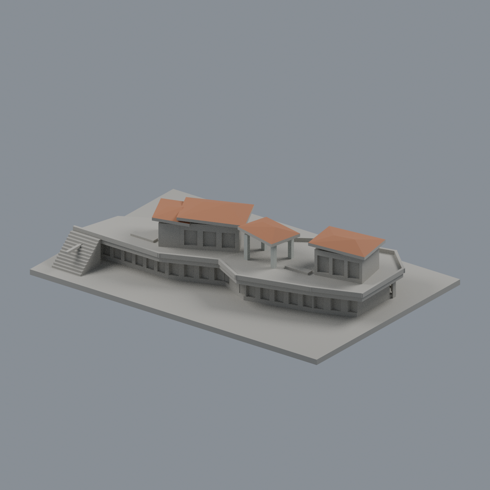
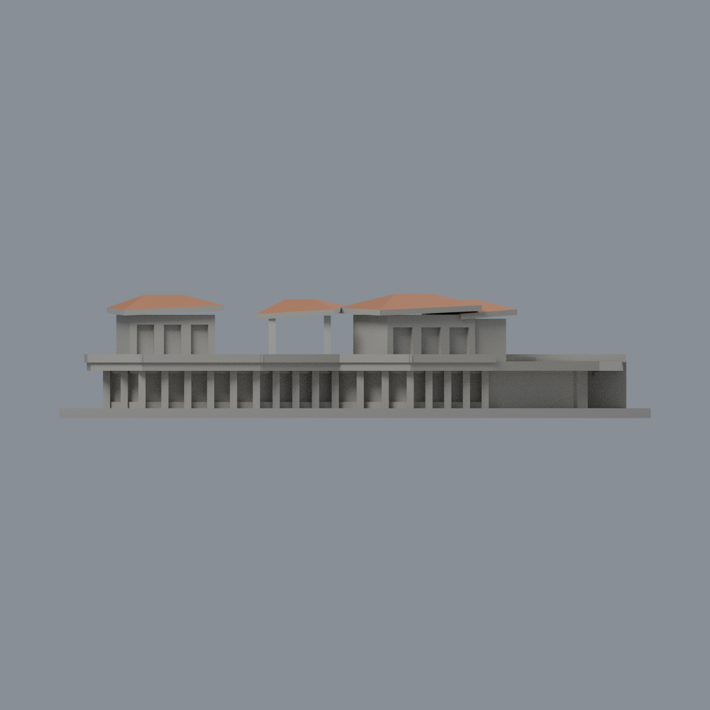
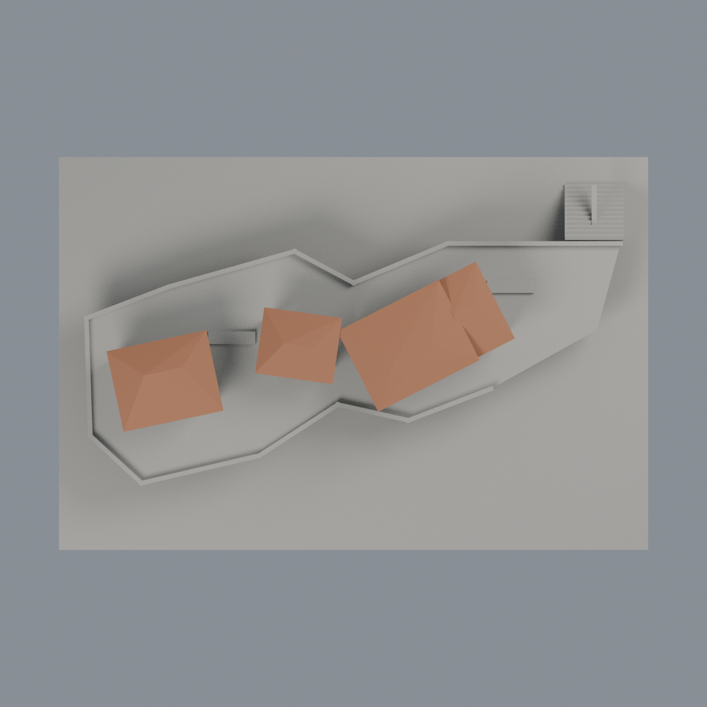

# 臺北大學心湖會館折面屋頂限定配色：三材質外觀版

沿用原 **2,444 三角面／1,180 頂點**，不改原 STL 位元、座標、面序或幾何；這是既有模型外觀改版，不增加模型包數。

| 正面 | 來源支持屋坡／混合牆面中性 |
|---|---|
|  |  |
|  |  |

[表面色 3MF](ntpumind-appearance.3mf) · [可編輯 Blender](scene.blend) · [材質色表](palette.json) · [逐面指派與依據](face-materials.json) · [原 STL](../model.stl)

## 來源與配色邊界

這是**折面屋頂限定配色**，不是全館材質還原。親看臺北大學官方兩張與 Fieldscape 設計者四張完整完工照片、原單色網格及生成器。[精確 URL、SHA 與日期欄](qa/source-review.json)。六照均無相機 Original；部分根修改欄為 2021-11-07／2022-03-10，不是攝影日期。校方文章發布 2022-06-30、工程完工 2021-04-30 僅為工程背景，不當拍攝日或 2026 現況。原照片私有研究，不入包。

- 三個亭屋區上方共四組既有折面屋頂，依日間完工空照採低飽和銅紅色金屬屋面代理；不是紅陶瓦，也不由顏色判定實際銅材含量。夕照只支持形體，不烘焙夕陽色偏。未畫實景細立縫或改原簡化扭折屋形。
- 用原生成器屋頂頂面方程及三頂點重心座標全包含檢查定位，四組分別 6／6／12／18 面，合計 **42 個原三角面**。不採 z 高度一刀切，也不把商店高牆染成屋頂。屋簷厚化立邊與屋底保留中性，避免混合金屬／底板誤染。
- 中央開放亭四根原獨立柱依實拍採淡灰；柱位置及數量仍是既有近似。其餘中性區不是實景「灰色還原」：店屋上深灰／下褐色牆未分界、露臺草坪／鋪面未分、低層紅磚／玻璃／實裙混合，均不硬染。
- 不在整片露臺塗綠，不增加草坪、空調、欄杆細絲、站縫、招牌或室內；原模型的局部形體簡化不由配色補造。

[原幾何與歷史來源限制](../README.md)

## 重建與核驗

安裝 [依賴](source/requirements.txt)，Blender 使用 4.3.2。由本資料夾上層提供原 model.stl：

1. `python appearance/source/build_appearance.py`
2. `python appearance/source/verify_exchange.py`
3. `blender -b -t 3 --python-exit-code 1 -P appearance/source/render_appearance.py`
4. `blender -b -t 3 --python-exit-code 1 -P appearance/source/verify_scene.py`

[獨立重建 ZIP](rebuild-source.zip)含原 STL、四支程式及依賴，不含第三方照片；不取代原建模腳本。[逐檔 SHA256](SHA256SUMS)

[交換／拓撲 QA](qa/exchange-validation.json)核對原座標與面序、全部面材質、單連通、有向水密邊、頂點 link 單環、正體積與零退化／重複面；lib3mf 嚴格讀取零警告，實際編輯單材質再存讀，其他材質及面指派不變。SDK 六位小數量化誤差另列。

[Blender 存讀與編輯](qa/scene-validation.json) · [渲染記錄](qa/render-manifest.json) · [獨立重建](qa/rebuild-validation.json)

## 製造限制照舊

尺寸仍為 150 × 100 × 31.5 mm；原 STL、建模程式、場景及歷史 QA 保留。原層檢與薄特徵檢查本次未重跑，不能由材質 QA 代替。

3MF 是同一網格的表面色，不是各材質各自封閉的分色實體、切片專案、噴頭映射或 G-code。切片 GUI、多材料路徑與實體列印未測；柱頭、屋簷、窗框及薄邊仍須評估材料、支撐及拆除風險，沒有保證可印或免支撐。
