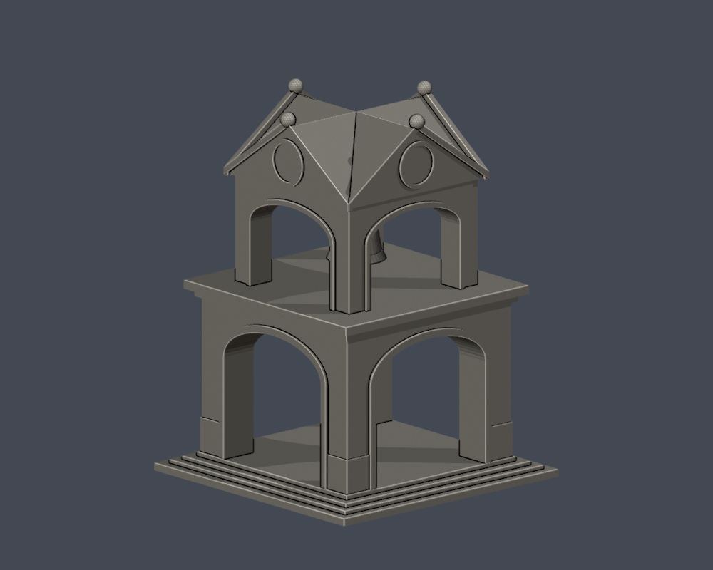

# 國立臺北教育大學｜臺北校區建築模型

第八批新增防空洞第一入口地上段、舊警衛室2024可見段、舊琴房山牆簷廊段3模型；既有19模型逐檔原樣保留。合計22模型覆蓋18個主要命名館舍範圍與5個補充／局部範圍，行政A＋圖書館H合計只算1模型。芳蘭樓仍只有入口局部，其他量體近似亦有未知面。18名冊覆蓋不代表所有歷史／附設建物或全校完成。各件自建，最長150毫米含底座，各自獨立比例。

| 大禮堂 | 文薈樓 | 芳蘭樓入口暨可見立面段 |
|---|---|---|
|  |  |  |

| 北師美術館 | 創意館 | 泳健館 |
|---|---|---|
|  |  |  |

| 體育館 | 科學館 | 藝術館 |
|---|---|---|
|  |  |  |

| 行政大樓暨圖書館建築群 | 至善樓 | 明德樓 |
|---|---|---|
|  |  |  |

| 第一宿舍 | 第二宿舍 | 篤行樓 |
|---|---|---|
|  |  |  |

| 視聽館 | 學生活動中心 | 百年紀念鐘樓 |
|---|---|---|
|  |  |  |

| 正門入口段 | 防空洞藝廊第一入口地上段 | 舊警衛室可見外觀段（2024） |
|---|---|---|
|  |  |  |

| 舊琴房／小使室山牆簷廊段 | 百年紀念鐘樓（前批索引，不重計） | 學生活動中心（前批索引，不重計） |
|---|---|---|
|  |  |  |

[後續清單](../CONTINUATION.md)。來源攝影日及未見屋頂細節未知，限制明列各件README。新增三件均為明示局部：防空洞不含地下／第二入口；舊警衛室以2024外觀為限、後部平直截斷；舊琴房只有三開間四柱段，不含另外便所。底座朝下；入口框、窗罩、簷廊與厚化斜撐可能需支撐。原照片/PDF不散布，數位QA不是實體試印或切片器驗證。本批外觀已核可，獨立QA通過才可發布。

[補充棟界與附設校區](../SUPPLEMENTARY-SCOPE.md)
