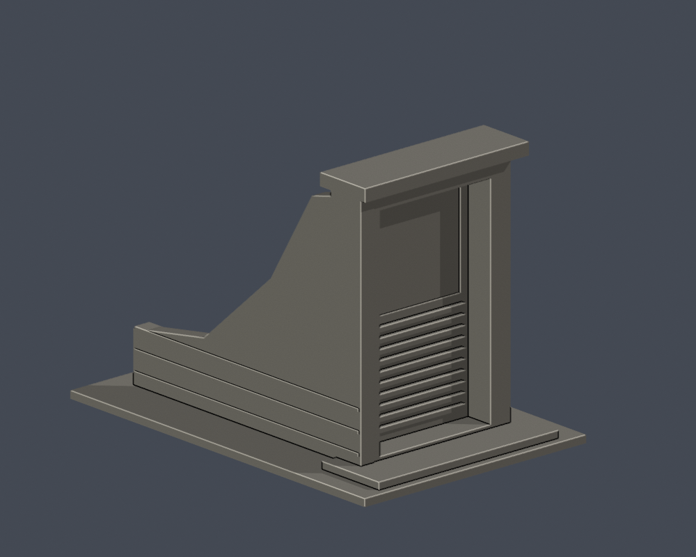
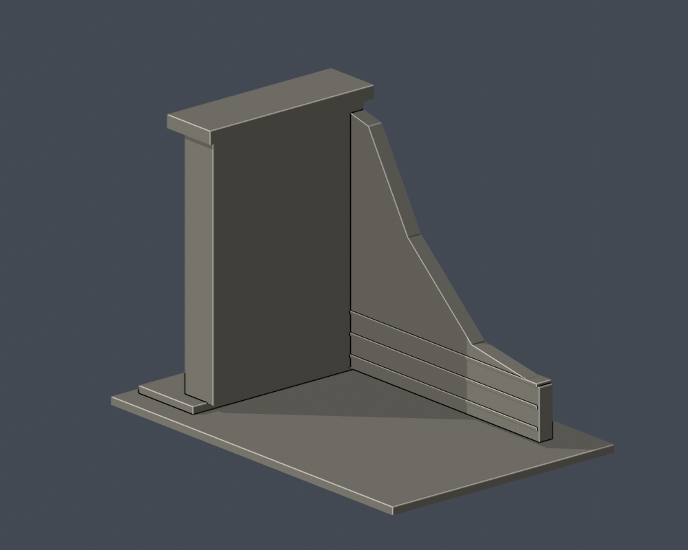

# 國立臺北教育大學｜防空洞藝廊第一入口地上段

臺北校區，自行用Python／實體布林建模，沒有下載第三方3D模型。模型為照片支持的近似，非實測或施工圖。

## 來源與界線

只做訪客照片047–049所見的第一個地上入口及可見左側降坡擋牆：平頂厚框、後退的封閉金屬門、上部整片玻璃及下部百葉、側牆三道水平砌縫。玻璃以實體凹面表現，不虛構開放的地下通道。沒有另做第二入口、兩入口間距、地下洞體或完整覆土丘；模型背面與未見右側是局部截斷，不是完整地下結構。作者沒有可核照片拍攝日期，不能稱2026現況；來源曾描述為藝廊，不表示模型包含展覽室。厚度、深度與側坡位置皆為照片近似，門上裝飾、路燈及活動招牌不納入。

完整URL、年代與來源所支持特徵見[sources.json](sources.json)。原照片／PDF不隨公開包散布。

## 模型與重建

- [model.stl](model.stl)：毫米，含底座最長150毫米；每件比例獨立
- [scene.blend](scene.blend)：由交付STL匯入的可編修網格
- [build_model.py](build_model.py)、[requirements.txt](requirements.txt)：python build_model.py
- [render_preview.py](render_preview.py)：blender -b -t 4 -P render_preview.py；圖片皆實際STL

| 實際STL正面 | 實際STL背面 |
|---|---|
|  |  |

[正立面](previews/elevation.png) · [側面](previews/side.png) · [俯視](previews/top.png) · [通口近圖](previews/entry_close.png)

## 列印及數位QA

底座朝下。窗罩、簷廊頂板與厚化斜撐需要評估支撐；移除支撐可能傷害薄框、柱或懸掛構件。玻璃細格、木板及百葉細節有意省略或粗化。沒有實體試印或Cura／Prusa工具路徑驗證，不保證免支撐或保證可印。

[validation.json](validation.json)檢原STL水密、正體積、法向／繞序、每邊兩面、vertex link單環、單一連通表面與無分離內腔殼，尺寸150毫米、重建SHA及Blend一致。[contour-validity-check.json](contour-validity-check.json)以z偏移0.071、每0.2毫米核全部輪廓閉合及Polygon有效，invalid直接失敗，不repair後宣稱成功。[thin-feature-check.json](thin-feature-check.json)使用canonical fail-closed v3的0.8毫米opening輔助篩檢，非完整最小壁厚或切片模擬。

[原STL局部凹深／廊下射線證據](portal-ray-proof.json)與[檢查腳本](check_portal_geometry.py)。原三角形射線不修補mesh；數字全是模型毫米，不能視為現地尺寸。

重跑：python validate_model.py；python check_contour_validity.py；python check_thin_features.py；python check_portal_geometry.py。

外觀已覆核，本件為作者凍結版本；獨立QA通過後才可由唯一發布者發布。
