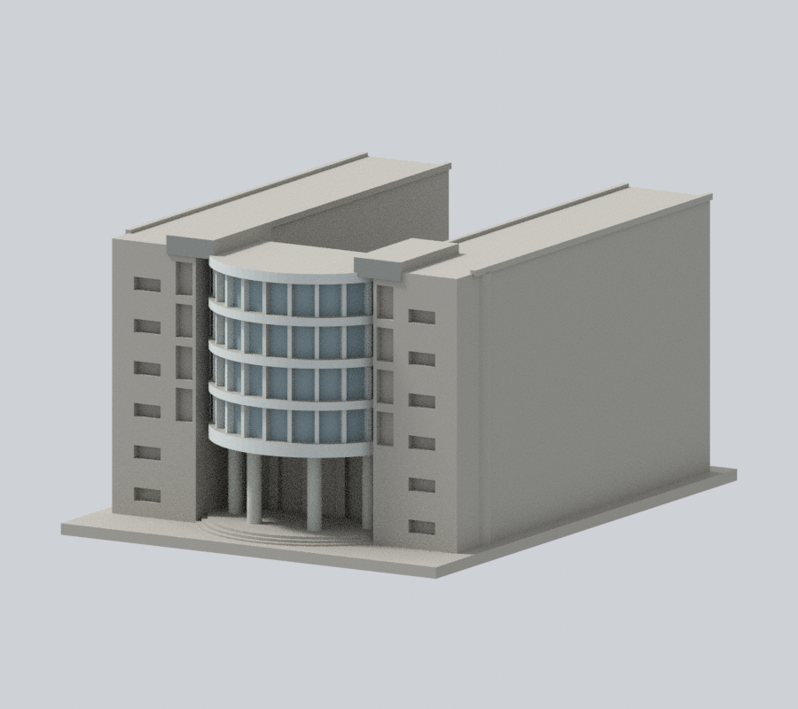
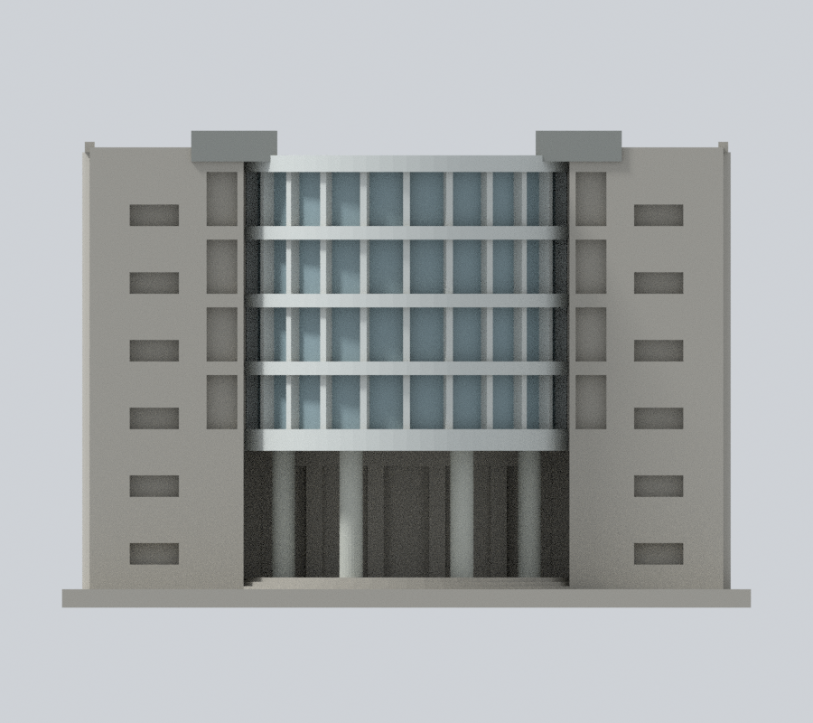
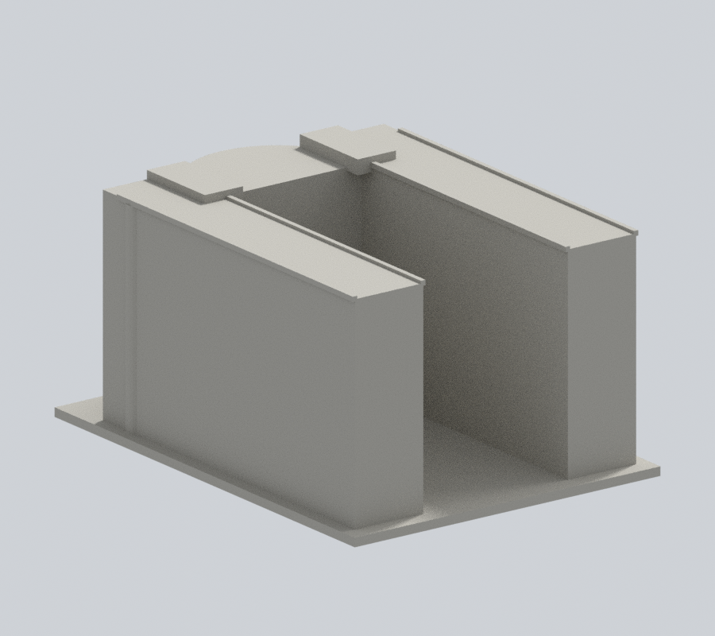
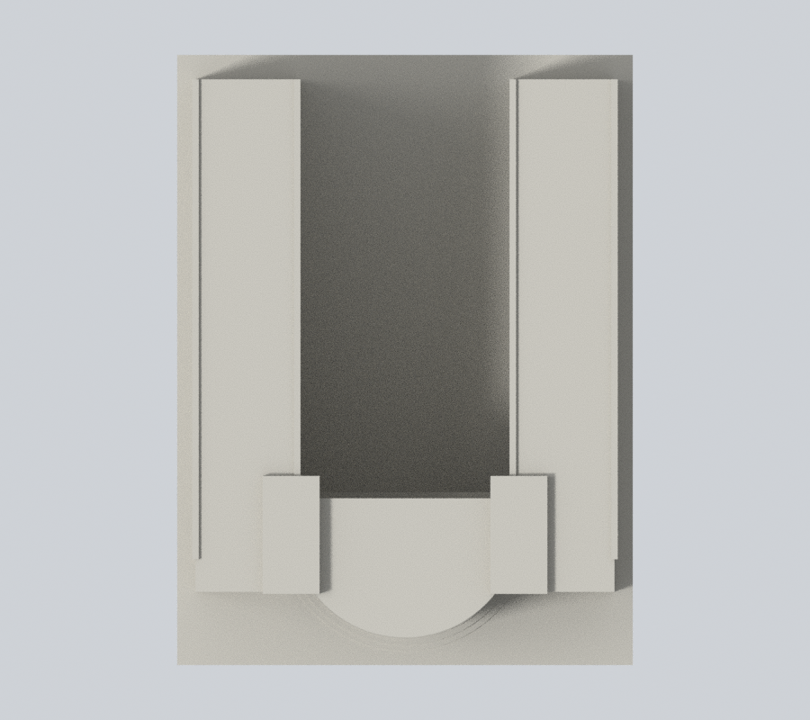

# 國立臺北教育大學｜藝術館

## 模型預覽

臺北校區。自行使用Python實體布林建立的外觀／量體近似模型；沒有下載第三方3D模型，非施工圖、測繪或館內重建。

### 僅中央入口構件的材料增補

本版只為原中央曲窗真背、前向白框／樓帶、四柱及獨立端帽前面補色。**兩側主翼磚／混凝土混合牆全保中性，並非全館配色恢復**；不以三角面斜界假畫照片磚色。

| 正斜視 | 來源角度 | 正立面 |
| :---: | :---: | :---: |
|  |  |  |
| 背向 | 上視 | 新外觀下載 |
|  |  | [3MF](appearance.3mf) · [Blender](appearance.blend) |

[有據構件及未知範圍](APPEARANCE.md)。原六張模型圖保留檔案，README只展示新版五圖；原幾何及列印警告不變。

## 證據與範圍

依官方正面及斜側入口實拍、1–2F平面建立U形院落及入口量體近似。保留真開放中央院落、半圓凸出上層玻璃面、四根可見入口大柱、兩側窄玻璃直帶、六排磚翼小窗與較高混凝土端帽。主要證據集中入口；長翼高度以入口連續量體推估，院落內壁、後端及深側立面缺實拍而留素面，不能把這些面視為測繪。玻璃密格簡化成四道寬窗帶、連續主水平樓層帶及次要細直框；曲面以80面柱體近似，不是下載模型。入口是真凹空間，背後玻璃退縮，未鑿穿整個建築。

官方文件日期2023年10月25日，實拍攝影日未載；文件更新日不是拍攝日，無法保證2026全部現況。來源、實際PDF頁碼及限制見 [sources.json](sources.json)。原照片／PDF只作私人核對，不隨公開包散布。

## 交付

- [model.stl](model.stl)：毫米，含底座最長150毫米，各件獨立比例
- [scene.blend](scene.blend)：由實際STL匯入的可編修網格
- [build_model.py](build_model.py) 與 [requirements.txt](requirements.txt)：自行建模參數來源；python build_model.py
- [render_preview.py](render_preview.py)：讀取原STL渲染；blender -b -t 2 -P render_preview.py

[原STL射線證據](portal-ray-proof.json) · [射線檢查腳本](check_portal_geometry.py)。原STL三角形射線證實中央入口真空隙深32.5毫米、前柱間淨寬14.2毫米、底板下至階梯淨高20.6毫米；均為模型近似尺寸。底板與柱間不是僅刻表面凹紋。

## 列印與QA限制

底座朝下。各件比例獨立，勿直接拼為同比例校園。入口頂板、半圓陽臺、玻璃曲面懸挑、雨遮及柱廊可能需要支撐，拆支撐仍可能傷細框。沒有實體試印、Cura／Prusa工具路徑驗證，不保證免支撐或保證可印。模型深度、柱距及高度不是實際建築尺寸。

[validation.json](validation.json) 檢原STL水密、正體積、繞序、每邊兩面、vertex link、單表面實體、無分離內腔殼、150毫米限制、重建SHA與Blend一致。[contour-validity-check.json](contour-validity-check.json) 每0.2毫米以0.071偏移逐層檢閉合及個別／組合Polygon有效，不修補後算成功。[thin-feature-check.json](thin-feature-check.json) 採canonical fail-closed v3每1毫米0.8毫米opening參考篩檢，不等於全面最小壁厚或切片模擬。

重跑：python validate_model.py；python check_contour_validity.py；python check_thin_features.py。

外觀已覆核，本件為作者凍結版本；須經獨立幾何審核通過後由唯一發布者發布。
