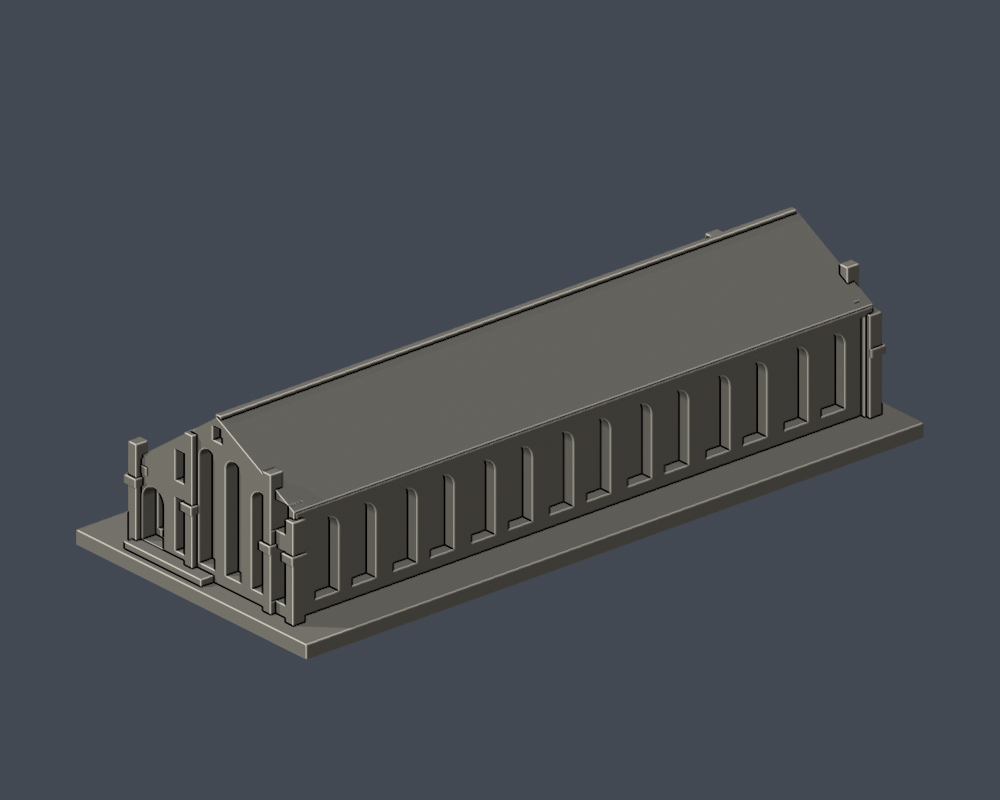

# 國立臺北教育大學｜大禮堂

臺北校區。自行以公開照片和平面資料建立的外觀近似模型；不是下載第三方3D模型、測繪成果或建築施工圖。

## 範圍與來源時點

整體外觀近似；拱廊朝向、14拱與兩端山牆按照片核對。

保留七組雙拱、可進深的通長拱廊、非對稱屋坡、背面連續高拱凹窗及山牆扶壁。背面細窗格省略，以免厚化後誤讀成多排方窗。兩端有中央高拱與矩形側翼窗；B端另建斜坡平台，D端未套用。B/D端細部遮蔽與比例為近似，未宣稱完全對稱測繪。未重現屋瓦、磚縫、玻璃、小五金；山牆尺寸、高度與隱蔽局部為目視近似。

官方防災計畫為2023年10月25日版本，實拍攝影日期未載。來源頁更新日不視為攝影日期。大禮堂另參考原檔EXIF標示2026年8月22日的四面照片；不能由此保證其他館舍2026年的外觀。

原照片、原PDF及照片對照只用於私人QA，不隨公開包散布。來源精確URL與支持特徵見 [sources.json](sources.json)。

## 模型檔案

- [model.stl](model.stl)：實際交付網格，毫米單位，含底座最長150毫米
- [scene.blend](scene.blend)：由相同STL匯入的可編修網格，參數建模來源為 [build_model.py](build_model.py)
- [requirements.txt](requirements.txt)：Python依賴；執行 python build_model.py 可重建
- [render_preview.py](render_preview.py)：用 Blender 實際讀取交付STL渲染，非示意效果圖

| 實際STL正面 | 實際STL背面 |
|---|---|
|  |  |

[俯視圖](previews/top.png) · [正立面](previews/elevation.png)

## 列印與驗證

底座朝下。每館獨立縮放，不能直接拼為同一比例校園。建議先在自己的切片器檢查；拱頂、雨遮、百葉與屋簷的懸伸可能需要支撐。長圓窗框、拱邊與窗格屬細件，拆支撐時容易損傷。沒有實體試印，亦未聲稱Cura或Prusa的實際工具路徑驗證、不用支撐或保證可印。

[validation.json](validation.json) 檢查原始STL水密、原法向與繞序、正體積、每邊兩面、vertex link單環、單一連通表面、無分離內殼、尺寸、獨立重建SHA及Blend幾何一致。

[contour-validity-check.json](contour-validity-check.json) 逐0.2毫米、固定z偏移0.071毫米檢查閉合與每個/合成Polygon有效性；不允許repair後算通過。[thin-feature-check.json](thin-feature-check.json) 是canonical fail-closed v3的0.8毫米參考opening輔助篩檢，採1毫米抽樣，不等於全面最小壁厚或切片工具路徑。

驗證命令：python validate_model.py；python check_contour_validity.py；python check_thin_features.py。需先以 blender -b -t 2 -P render_preview.py 建立scene.blend。

本件為作者凍結包，外觀已覆核；需獨立幾何審核通過後才可由指定發布者發布。
