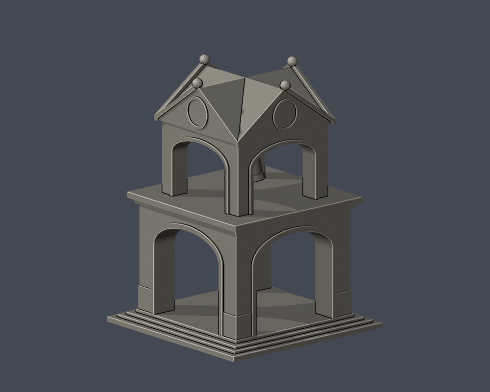

# 國立臺北教育大學｜百年紀念鐘樓

臺北校區，自行用Python／實體布林建模，沒有下載第三方3D模型。模型為照片支持的近似，非實測或施工圖。

## 來源與界線

依官方正面及夜間斜角照、2025訪客相鄰兩面照片及另一組四周照片建模，保留下層四向通拱、上層懸鐘室、四向三角山牆交叉坡頂、圓鐘面、挑出簷帶及階梯臺基。百年鐘樓指百週年校慶紀念，不是日治原建或塔齡百年。鐘與鐘頸依較早可見實拍粗化為相連實體，未確認2025–26懸鐘設備是否變動；懸鐘不是漂浮網格。鐘面數字／指針、瓦片及小石塊線省略，脊端小裝飾厚化。四面資料存在但拍攝方向未實測，朝向以模型座標表示，不能當作精確地理定位。各向深度、鐘身曲率、交叉屋脊及階梯尺寸為外觀近似，地景樹木、活動設施和地下基礎不納入。

來源跨不同年代；官方圖片未載拍攝日期，不以網站更新日替代。完整URL及支持特徵見[sources.json](sources.json)。原照片／PDF只留私下核對，不隨公開包散布。

## 模型與重建

- [model.stl](model.stl)：毫米，含底座最長150毫米；每件比例獨立
- [scene.blend](scene.blend)：由交付STL匯入的可編修網格
- [build_model.py](build_model.py)、[requirements.txt](requirements.txt)：python build_model.py
- [render_preview.py](render_preview.py)：blender -b -t 4 -P render_preview.py；圖片皆實際STL

| 實際STL正面 | 實際STL背面 |
|---|---|
|  |  |

[正立面](previews/elevation.png) · [側面](previews/side.png) · [俯視](previews/top.png) · [通口近圖](previews/entry_close.png)

## 列印及數位QA

底座朝下。拱口、頂板、鐘室懸鐘及深門廊需要評估支撐；移除支撐可能傷害薄框、柱或懸掛構件。鐘面／文字等細節有意省略或粗化。沒有實體試印或Cura／Prusa工具路徑驗證，不保證免支撐或保證可印。

[validation.json](validation.json)檢原STL水密、正體積、法向／繞序、每邊兩面、vertex link單環、單一連通表面與無分離內腔殼，尺寸150毫米、重建SHA及Blend一致。[contour-validity-check.json](contour-validity-check.json)以z偏移0.071、每0.2毫米核全部輪廓閉合及Polygon有效，invalid直接失敗，不repair後宣稱成功。[thin-feature-check.json](thin-feature-check.json)使用canonical fail-closed v3的0.8毫米opening輔助篩檢，非完整最小壁厚或切片模擬。

[原STL通口／懸鐘射線證據](portal-ray-proof.json)與[檢查腳本](check_portal_geometry.py)。原三角形射線不修補mesh；數字全是模型毫米，不能視為現地尺寸。

重跑：python validate_model.py；python check_contour_validity.py；python check_thin_features.py；python check_portal_geometry.py。

外觀已覆核，本件為作者凍結版本；獨立QA通過後才可由唯一發布者發布。
