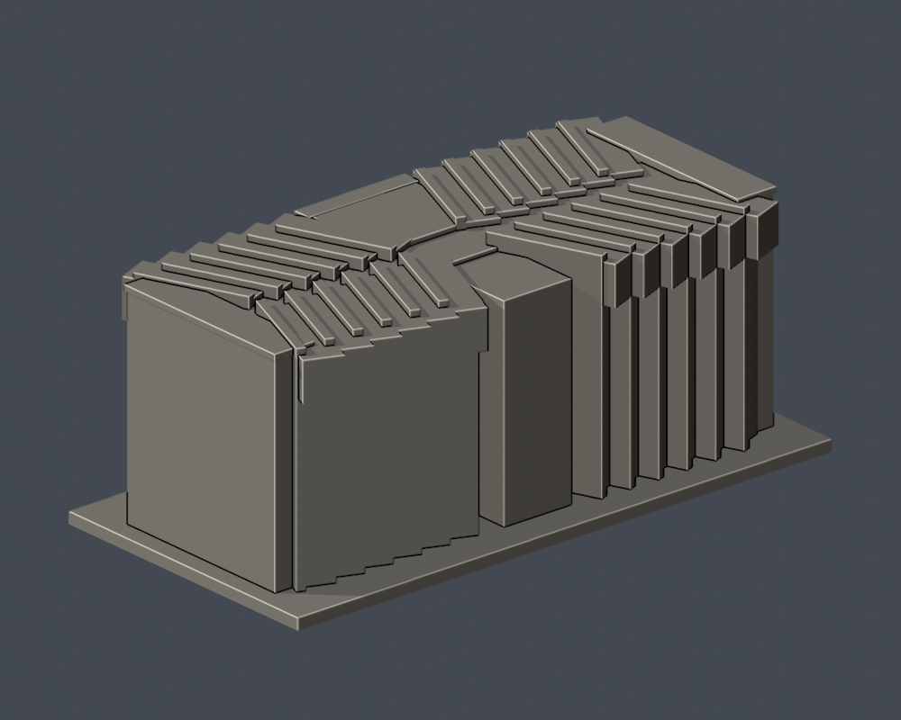

# 國立臺北教育大學｜第一宿舍

臺北校區，自行以Python實體布林建模，沒有下載第三方3D模型。此件是證據限定的外觀／量體近似，不是測繪、施工圖或室內重建。

## 證據與範圍

依五層資料、鋸齒狀1F平面、入口與端牆實拍，自行建立折角房間量體與上部前凸磚帽。保留中央淺扇形入口、兩道寬窗帶、頂層大凹口、真正後退的入口及雙柱。左端受樹遮的窗不複製右側補滿；未見的另一長側只依平面保留鋸齒量體，不臆補窗群。巨大近素面端牆取自官方側照，屋頂設備未知省略。房間斜角、翼深、磚帽突出量及窗格為列印近似，沒有重建宿舍內部。

官方文件2023年10月25日，照片攝影日未載；文件更新日期不能視為拍攝日期。完整頁碼與URL見 [sources.json](sources.json)。原照片／PDF只保留私人核對，不隨公開包散布。

## 交付檔

- [model.stl](model.stl)：毫米，含底座最長150毫米；每件比例獨立
- [scene.blend](scene.blend)：由原STL匯入的可編修網格
- [build_model.py](build_model.py) 與 [requirements.txt](requirements.txt)：建模參數；python build_model.py
- [render_preview.py](render_preview.py)：以實際STL渲染；blender -b -t 2 -P render_preview.py

| 實際STL正面 | 實際STL背面 |
|---|---|
|  |  |

[正立面](previews/elevation.png) · [側面](previews/side.png) · [俯視](previews/top.png)

[原STL射線空隙證據](portal-ray-proof.json) · [重跑射線檢查](check_portal_geometry.py)。直接檢原STL三角形，不修補或封截面；尺寸皆為模型估值。

## 列印及QA限制

底座朝下；折角上帽、雨遮、入口頂板、通廊及薄框可能需要支撐，拆支撐有傷細件風險。厚化細格及柱不是實際建築尺寸，勿把不同館直接拼為同比例校園。沒有實體試印或Cura／Prusa工具路徑驗證，不保證免支撐或保證可印。

[validation.json](validation.json) 檢原STL法向／繞序、水密、正體積、每邊兩面、vertex link、單連通表面、無分離內腔殼、150毫米限制、重建SHA與Blend一致。[contour-validity-check.json](contour-validity-check.json) 固定0.071偏移，每0.2毫米逐層閉合及個別／合成Polygon有效，不修補後算成功。[thin-feature-check.json](thin-feature-check.json) canonical fail-closed v3每1毫米抽樣0.8毫米opening輔助篩檢，不等於全面壁厚或切片模擬。

重跑：python validate_model.py；python check_contour_validity.py；python check_thin_features.py。

外觀已覆核，本件為作者凍結版本；獨立QA通過後才可由唯一發布者發布。
