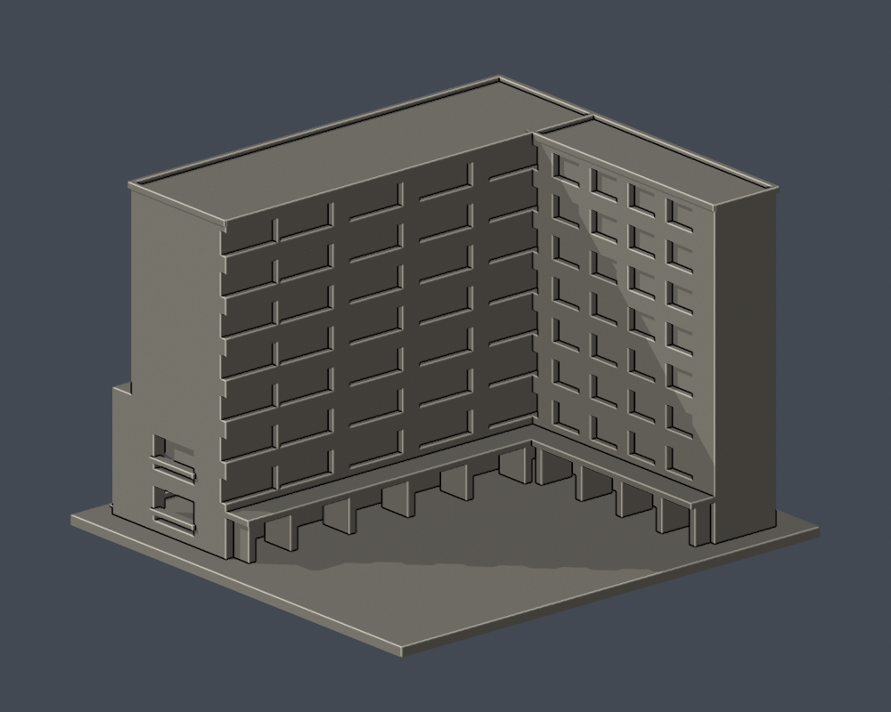
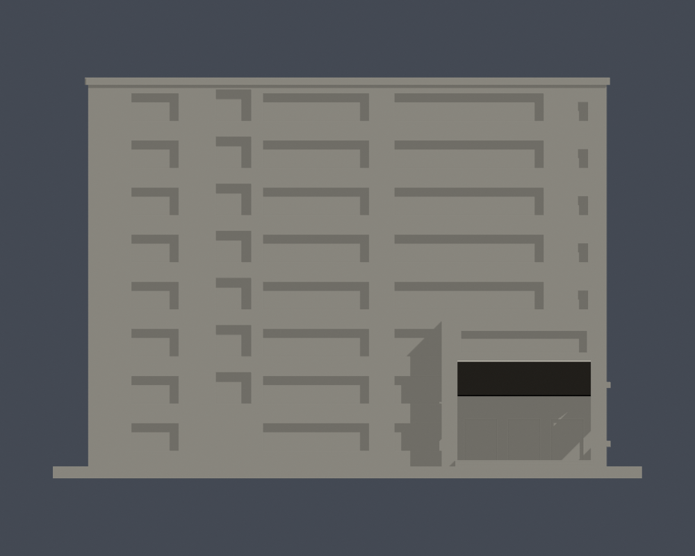
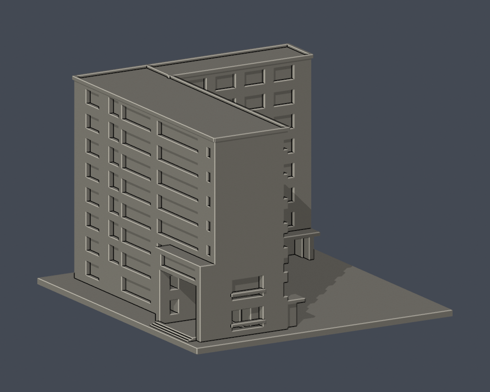
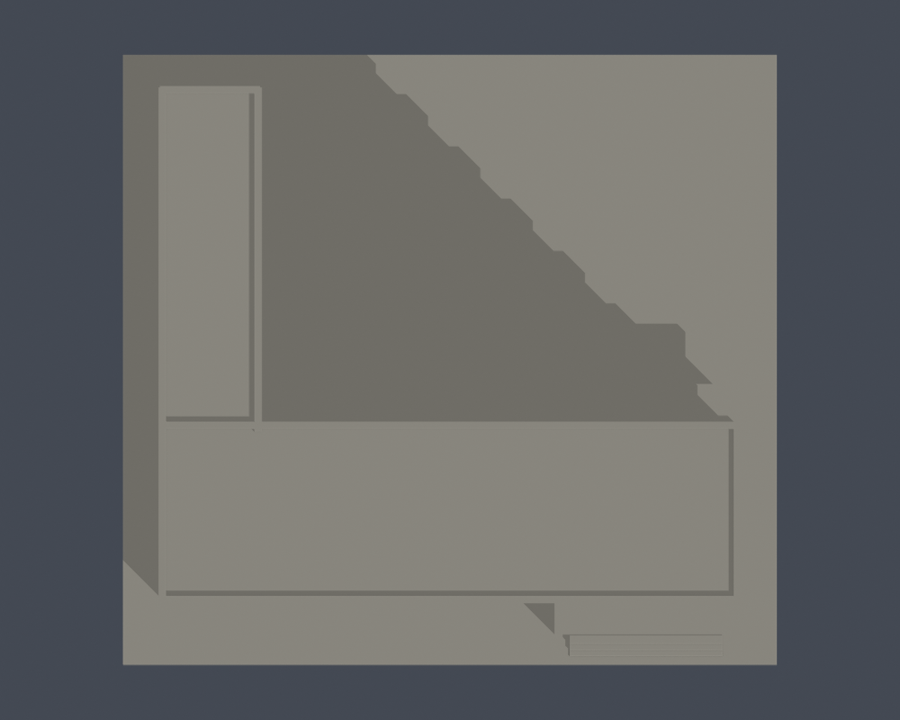
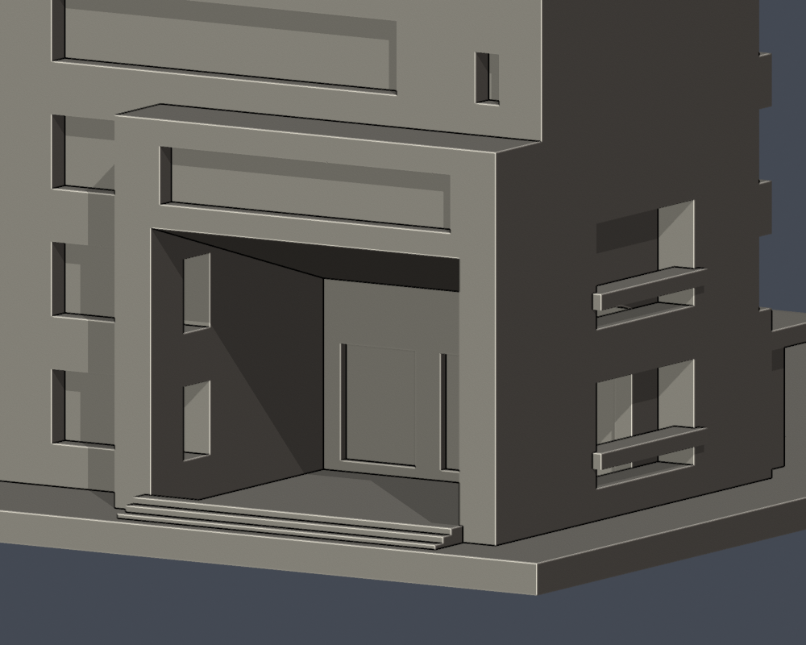
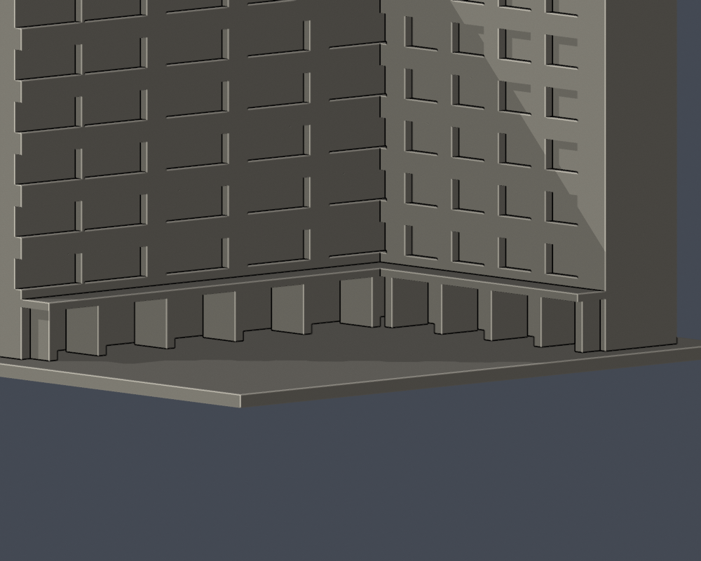

# 國立臺北教育大學｜篤行樓

臺北校區，自行以Python實體布林建模，沒有下載第三方3D模型。此件是證據限定的外觀／量體近似，不是測繪、施工圖或室內重建。

## 證據與範圍

依八層資料、正面與L形內院實拍、1F及上層L形平面建模；B1整片車庫平面不拿來填平地上院落。保留寬窄不同的長窗群、服務核心窄窗、右端大型灰框入口、向內降低的斜底板、後退玻璃、右側上下通廊凹口及內院地面柱廊。柱廊是真空隙與厚柱，不是牆面刻直紋。入口深度、斜底坡度與柱距是照片近似，未實測。未見外側及屋頂設備不補；獨立前景步道棚架不是館體，此件不製作。另已交付的北師美術館X不重複納入本件，Y主館和X之間的界線依官方命名平面，連接細節未測繪。

官方文件2023年10月25日，照片攝影日未載；文件更新日期不能視為拍攝日期。完整頁碼與URL見 [sources.json](sources.json)。原照片／PDF只保留私人核對，不隨公開包散布。

## 交付檔

- [model.stl](model.stl)：毫米，含底座最長150毫米；每件比例獨立
- [scene.blend](scene.blend)：由原STL匯入的可編修網格
- [build_model.py](build_model.py) 與 [requirements.txt](requirements.txt)：建模參數；python build_model.py
- [render_preview.py](render_preview.py)：以實際STL渲染；blender -b -t 2 -P render_preview.py

| 模型預覽 | 模型預覽 | 模型預覽 |
| :---: | :---: | :---: |
| 實際STL正面  | 實際STL背面  |  |

[正立面](previews/elevation.png) · [側面](previews/side.png) · [俯視](previews/top.png)

| 模型預覽 | 模型預覽 | 模型預覽 |
| :---: | :---: | :---: |
| 正立面  | 側面  | 俯視  |

[原STL射線空隙證據](portal-ray-proof.json) · [重跑射線檢查](check_portal_geometry.py)。直接檢原STL三角形，不修補或封截面；尺寸皆為模型估值。

[深入口近圖](previews/entry_close.png) · [柱廊近圖](previews/court_close.png)。

| 模型預覽 | 模型預覽 | 模型預覽 |
| :---: | :---: | :---: |
| 深入口近圖  | 柱廊近圖  |  |

## 列印及QA限制

底座朝下；折角上帽、雨遮、入口頂板、通廊及薄框可能需要支撐，拆支撐有傷細件風險。厚化細格及柱不是實際建築尺寸，勿把不同館直接拼為同比例校園。沒有實體試印或Cura／Prusa工具路徑驗證，不保證免支撐或保證可印。

[validation.json](validation.json) 檢原STL法向／繞序、水密、正體積、每邊兩面、vertex link、單連通表面、無分離內腔殼、150毫米限制、重建SHA與Blend一致。[contour-validity-check.json](contour-validity-check.json) 固定0.071偏移，每0.2毫米逐層閉合及個別／合成Polygon有效，不修補後算成功。[thin-feature-check.json](thin-feature-check.json) canonical fail-closed v3每1毫米抽樣0.8毫米opening輔助篩檢，不等於全面壁厚或切片模擬。

重跑：python validate_model.py；python check_contour_validity.py；python check_thin_features.py。

外觀已覆核，本件為作者凍結版本；獨立QA通過後才可由唯一發布者發布。
