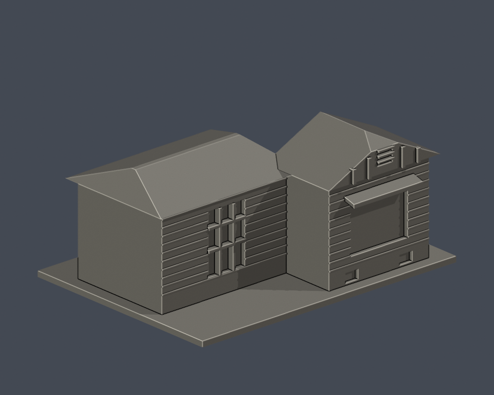
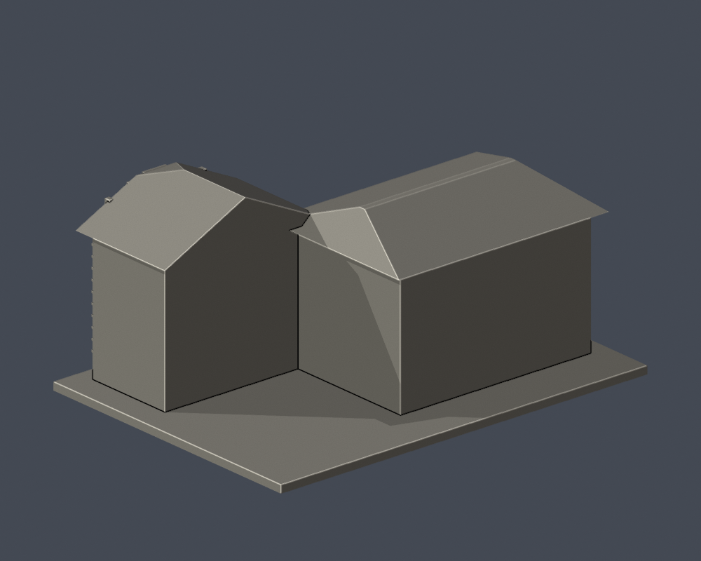
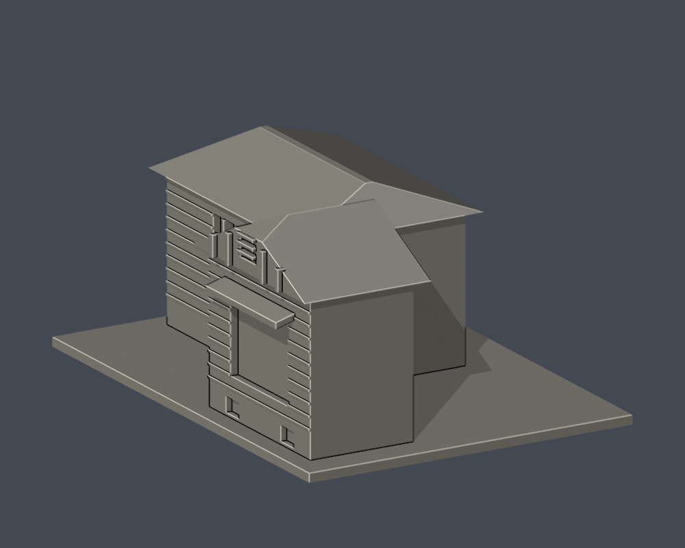
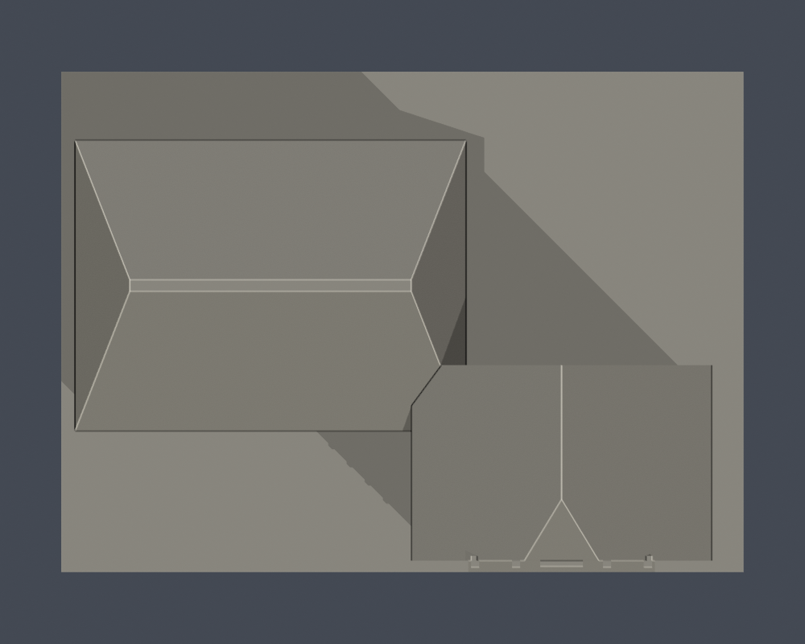
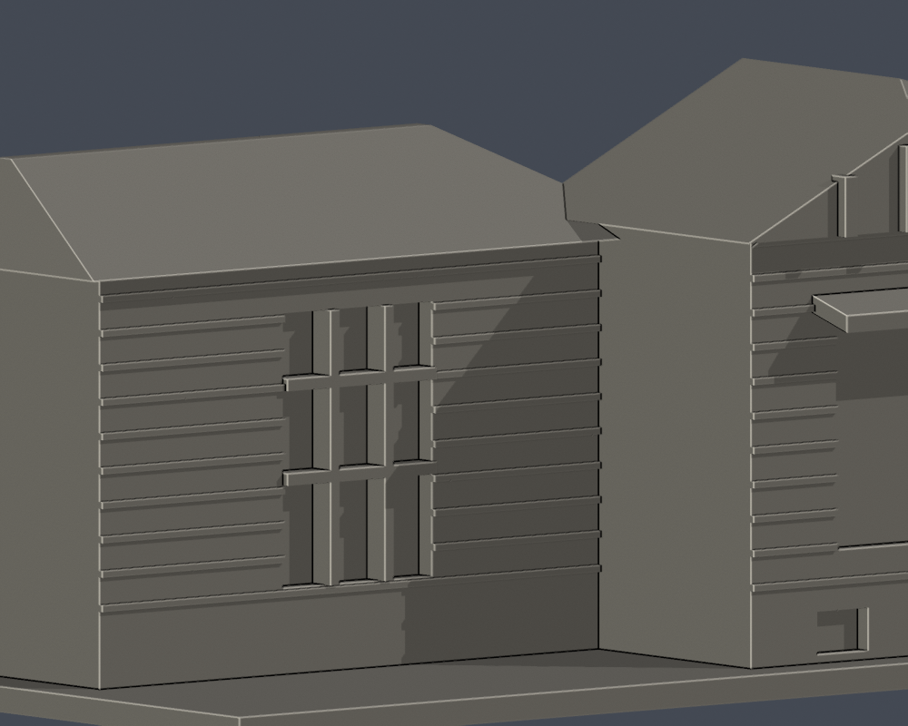

# 國立臺北教育大學｜舊警衛室可見外觀段（2024）

臺北校區，自行用Python／實體布林建模，沒有下載第三方3D模型。模型為照片支持的近似，非實測或施工圖。

## 來源與界線

以2024照片可見的突出木造山牆窗面與左側退縮翼做局部。保留削頂山牆與短斜面前端近似、木板水平帶、山牆窄百葉、大窗上後加浪板罩、兩個基座通氣口及左翼長窗；前大窗細直鐵欄刻意略去，只保留大凹面，避免讀成粗九宮框；細木格、鏽蝕、瓦苔不復刻。依2024照片可見簷口與山牆比例，主簷口模型z53、山牆上緣約z66、未知後方屋脊不高於z69；左翼屋脊z62。這些數字全是近似模型毫米而非實測。突出翼窗面後方僅保留35模型毫米（人為截取深度，非現地量測）即平直截斷，屋頂也隨之縮短，避免未知背部讀成另一大高坡。屋頂坡率、翼深和不可見切面只作保守截斷，沒有全棟平面或精確量測。19號圍牆、紅大門及遮簷附加物不混作1926年木屋原形，也不在本模型範圍內。這是2024可見段的年代限定近似，不宣稱2026修復後現況；相關計畫核定不等於工程完工。舊警衛室地址為和平東路136巷19號，與134號大學正門現役警衛空間不同。未見背窗、後部房間、完整基地與地下基礎都不建。

完整URL、年代與來源所支持特徵見[sources.json](sources.json)。原照片／PDF不隨公開包散布。

## 模型與重建

- [model.stl](model.stl)：毫米，含底座最長150毫米；每件比例獨立
- [scene.blend](scene.blend)：由交付STL匯入的可編修網格
- [build_model.py](build_model.py)、[requirements.txt](requirements.txt)：python build_model.py
- [render_preview.py](render_preview.py)：blender -b -t 4 -P render_preview.py；圖片皆實際STL

| 模型預覽 | 模型預覽 | 模型預覽 |
| :---: | :---: | :---: |
| 實際STL正面  | 實際STL背面  |  |

[正立面](previews/elevation.png) · [側面](previews/side.png) · [俯視](previews/top.png) · [通口近圖](previews/entry_close.png)

| 模型預覽 | 模型預覽 | 模型預覽 |
| :---: | :---: | :---: |
| 正立面  | 側面  | 俯視  |
| 通口近圖  |  |  |

## 列印及數位QA

底座朝下。窗罩、簷廊頂板與厚化斜撐需要評估支撐；移除支撐可能傷害薄框、柱或懸掛構件。玻璃細格、木板及百葉細節有意省略或粗化。沒有實體試印或Cura／Prusa工具路徑驗證，不保證免支撐或保證可印。

[validation.json](validation.json)檢原STL水密、正體積、法向／繞序、每邊兩面、vertex link單環、單一連通表面與無分離內腔殼，尺寸150毫米、重建SHA及Blend一致。[contour-validity-check.json](contour-validity-check.json)以z偏移0.071、每0.2毫米核全部輪廓閉合及Polygon有效，invalid直接失敗，不repair後宣稱成功。[thin-feature-check.json](thin-feature-check.json)使用canonical fail-closed v3的0.8毫米opening輔助篩檢，非完整最小壁厚或切片模擬。

[原STL局部凹深／廊下射線證據](portal-ray-proof.json)與[檢查腳本](check_portal_geometry.py)。原三角形射線不修補mesh；數字全是模型毫米，不能視為現地尺寸。

重跑：python validate_model.py；python check_contour_validity.py；python check_thin_features.py；python check_portal_geometry.py。

外觀已覆核，本件為作者凍結版本；獨立QA通過後才可由唯一發布者發布。
