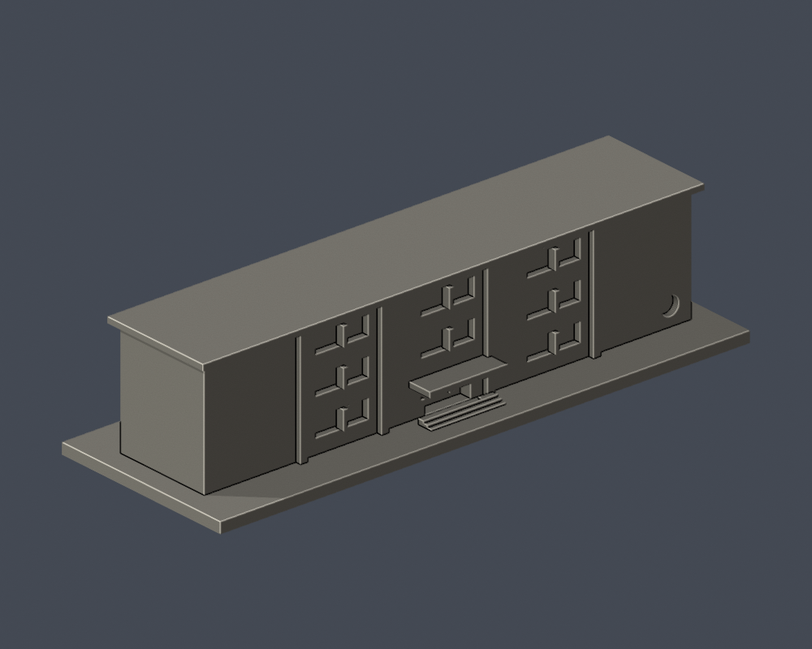
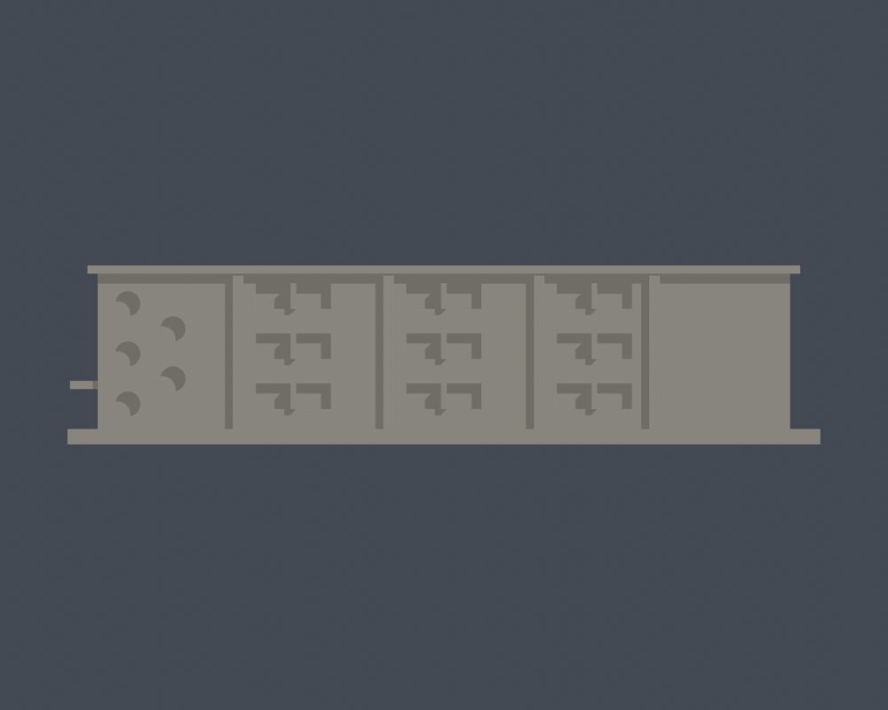
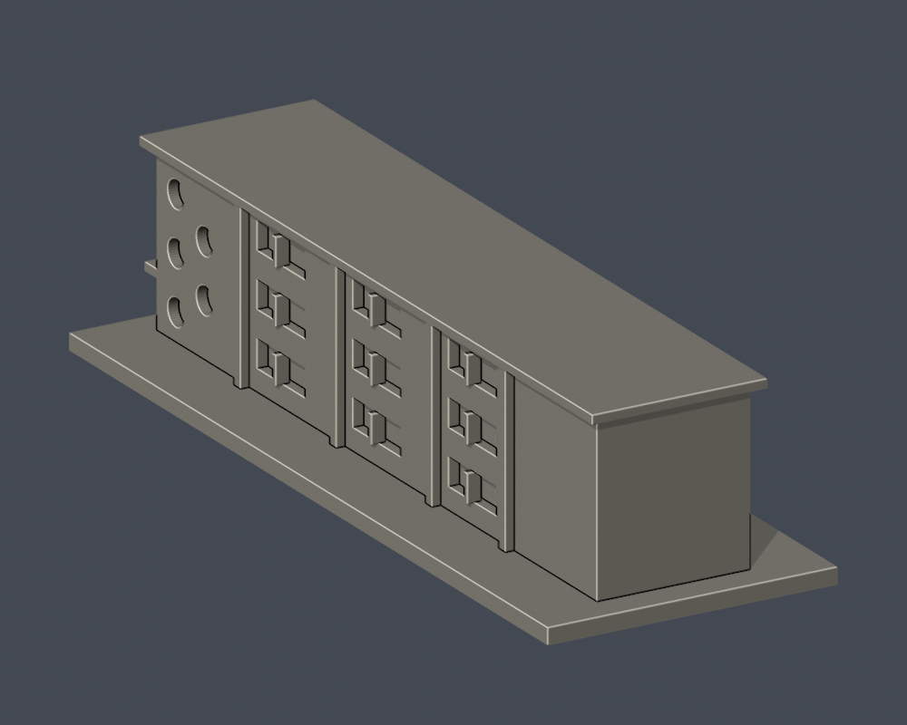

# 國立臺北教育大學｜明德樓

## 模型預覽

| 模型預覽 | 模型預覽 | 模型預覽 |
| :---: | :---: | :---: |
| 實際STL正面  | 實際STL背面  |  |

臺北校區。自行以Python實體布林建立外觀／量體近似，未下載第三方3D模型；不是測繪、施工圖或館內重建。

## 證據與範圍

依官方三層長條平面、正面及端部實拍建立量體近似。PDF23頁上圖只代表較短地下室，下圖才是全長1F。保留端部樓梯區3＋2交錯圓窗、短端上層兩組不同寬度窗、局部入口雨遮、長側可辨識的3組窗及淺凸牆帶。兩張照片對應端部及相對長側（以鄰接泳健館和館內位置辨別，非現場測向）；照片B保留3＋2交錯圓窗，照片A樹遮端部只保留確實可見的下部圓窗，不複製被遮上窗。各長側3組可見窗不代表全館只有3跨，樹遮區及遠端短牆留素面。111年屋頂防水更新記錄沒有說新增斜屋頂，因此不以其他館斜屋頂套用。

官方文件2023年10月25日，攝影日未載；文件日期不等於拍攝日，無法保證2026全部現況。各頁及URL見 [sources.json](sources.json)。原照片與PDF只留私人核對，不隨公開包散布。

## 交付檔

- [model.stl](model.stl)：毫米，含底座最長150毫米，各件獨立比例
- [scene.blend](scene.blend)：由交付STL匯入的可編修網格
- [build_model.py](build_model.py) 與 [requirements.txt](requirements.txt)：自行建模參數；python build_model.py
- [render_preview.py](render_preview.py)：實際STL渲染；blender -b -t 2 -P render_preview.py

[正立面](previews/elevation.png) · [側面](previews/side.png) · [俯視](previews/top.png)

| 模型預覽 | 模型預覽 | 模型預覽 |
| :---: | :---: | :---: |
| 正立面  | 側面  | 俯視  |

## 列印與QA限制

底座朝下。窗格、拱形框、薄簷與雨遮均有列印粗化，懸挑及入口可能需支撐；拆支撐仍可能傷細件。模型尺度不是實際建築尺寸，勿把各件直接拼成同比例校園。沒有實體試印或Cura／Prusa工具路徑驗證，不保證免支撐或保證可印。

[validation.json](validation.json) 檢原STL水密、正體積、法向與繞序、每邊兩面、vertex link、單連通表面、無分離內腔殼、150毫米限制、重建SHA與Blend幾何一致。[contour-validity-check.json](contour-validity-check.json) 固定0.071毫米偏移，每0.2毫米逐層檢閉合與個別／合成Polygon有效，不修補後算成功。[thin-feature-check.json](thin-feature-check.json) 採canonical fail-closed v3每1毫米0.8毫米opening參考篩檢，不等於全面最小壁厚或切片模擬。

重跑：python validate_model.py；python check_contour_validity.py；python check_thin_features.py。

外觀已覆核，本件為作者凍結版本；獨立QA通過後才可由唯一發布者發布。
