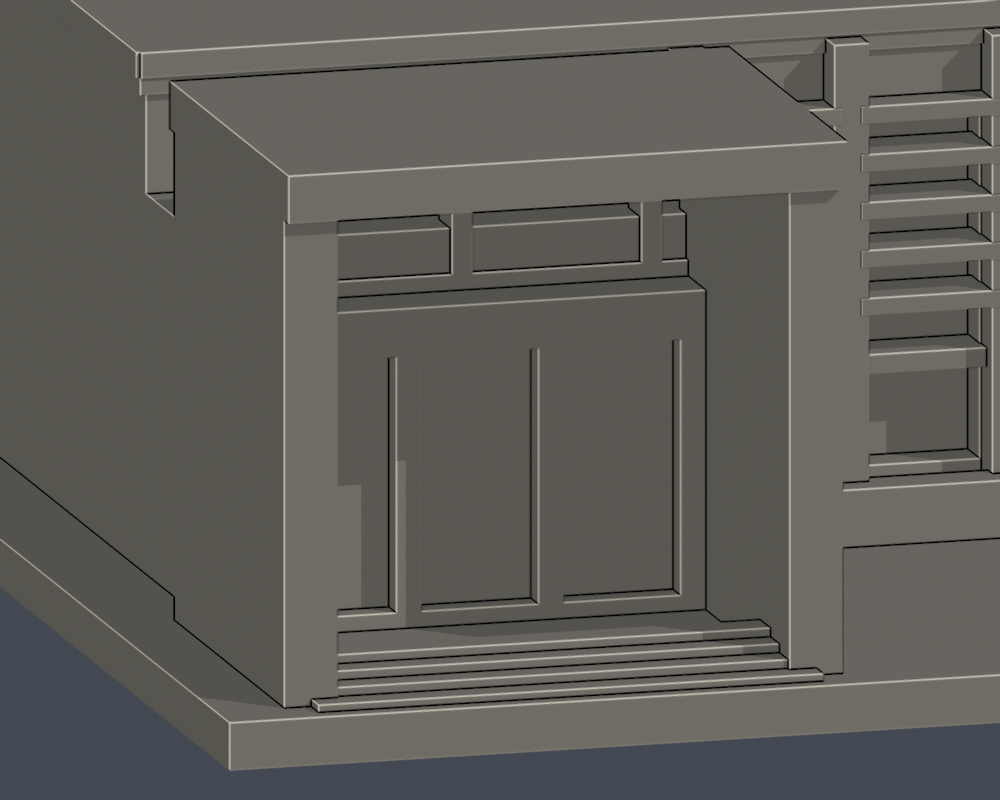
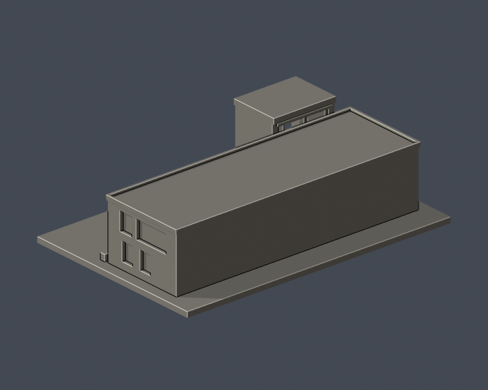
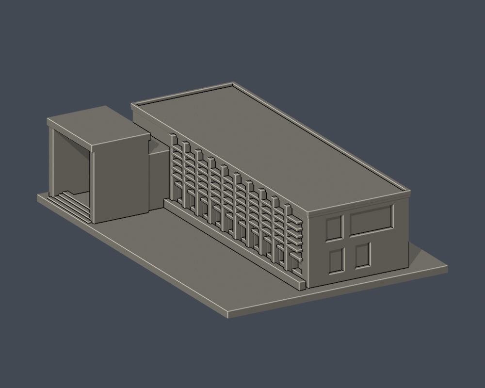
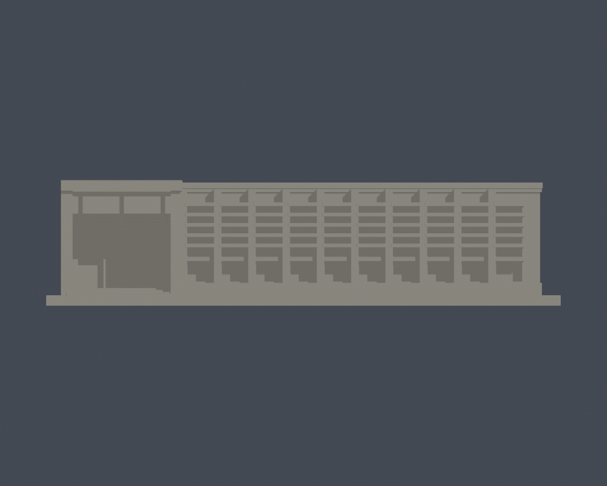

# 國立臺北教育大學｜泳健館

## 模型預覽

| 模型預覽 | 模型預覽 | 模型預覽 |
| :---: | :---: | :---: |
| 入口近圖  |  |  |

臺北校區，自行以Python實體布林建立的外觀近似模型。沒有下載第三方3D模型；不是測繪、施工圖或館內重建。

## 證據與範圍

依官方正側實拍及L型平面建立整體量體近似；外側背面缺獨立完整照片。

保留L型入口配置、入口大型灰框挑空、長列磚柱、兩段高低窗帶、厚化水平遮陽、端牆窄寬不同的窗組與階梯。遮陽百葉密度大幅簡化成可列印水平帶；窗格只保留主要分組。未見背面素面，屋頂僅保留照片可辨識的平頂邊線，沒有臆補設備。

入口為真實開放凹室：兩側牆包住門廊，頂板下留空，玻璃面退至後方。平面只支持L型配置，不提供足以校準門廊深度的測繪數據；19毫米深、28.6毫米淨寬、30.5毫米頂板下淨高均為本模型近似尺度，由兩張實拍估定並以原STL射線證實，不是實際建築尺寸。長側依可辨識實拍保留10根突出紅磚主柱，最右端寬磚牆另計；百葉細框不作主柱。

[入口近圖](previews/entry_close.png) · [原STL射線證據](portal-ray-proof.json) · [可重跑射線檢查](check_portal_geometry.py)。檢查直接遍歷原STL三角形，不修補、不封截面；入口沒有臆造貫穿背面的通道。

官方文件日期2023年10月25日，實拍攝影日未載。資料更新日不視為拍攝日；這些來源不能保證2026全部現況。完整來源頁碼與URL見 [sources.json](sources.json)。原照片與PDF只留私人核對，不隨公開包散布。

## 交付檔

- [model.stl](model.stl)：毫米，含底座最長150毫米，每件獨立比例
- [scene.blend](scene.blend)：由交付STL匯入的可編修網格
- [build_model.py](build_model.py) 與 [requirements.txt](requirements.txt)：參數重建來源，執行 python build_model.py
- [render_preview.py](render_preview.py)：以Blender讀取實際STL渲染；執行 blender -b -t 2 -P render_preview.py

| 模型預覽 | 模型預覽 | 模型預覽 |
| :---: | :---: | :---: |
| 實際STL正面  | 實際STL背面  |  |

[入口側](previews/side.png) · [正立面](previews/elevation.png) · [俯視](previews/top.png)

| 模型預覽 | 模型預覽 | 模型預覽 |
| :---: | :---: | :---: |
| 入口側  | 正立面  | 俯視  |

## 列印與檢查限制

底座朝下，勿直接把不同館的比例拼為同一校園。挑簷、入口框、百葉及柱廊可能需要支撐；粗化的片、柱、框仍有拆支撐損壞風險。沒有實體試印或Cura/Prusa工具路徑實測；不保證免支撐或保證可印。

[validation.json](validation.json) 驗證原STL法向／繞序、正體積、水密、每邊兩面、vertex link單環、單一連通表面、無分離內腔殼、最長尺寸，以及獨立重建SHA和Blend幾何一致。

[contour-validity-check.json](contour-validity-check.json) 使用固定z偏移0.071毫米，每0.2毫米檢驗原STL閉合degree2輪廓、個別及合成Polygon有效，不修補失效輪廓後算成功。

[thin-feature-check.json](thin-feature-check.json) 使用canonical fail-closed v3每1毫米抽樣0.8毫米opening輔助篩檢；這不是全面最小壁厚或切片器模擬。

驗證命令：python validate_model.py；python check_contour_validity.py；python check_thin_features.py。三者須exit0且所有檢查為真才可凍結；獨立審核通過前不可發布。

外觀已覆核，本件為作者凍結版本；須經獨立幾何審核通過後由唯一發布者發布。
