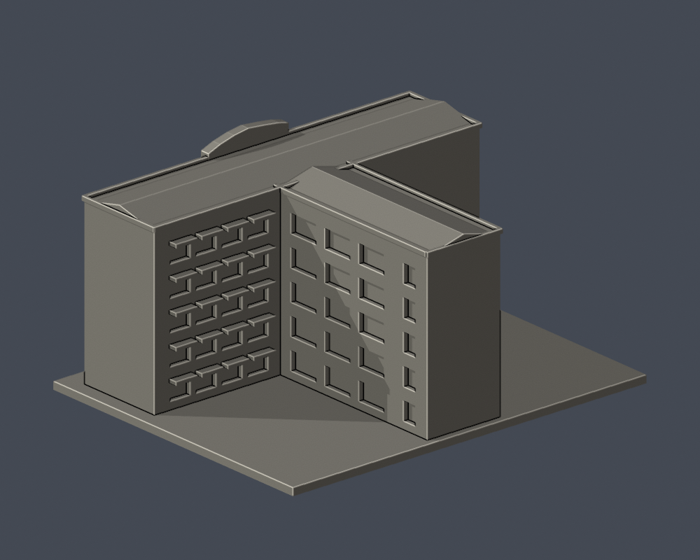
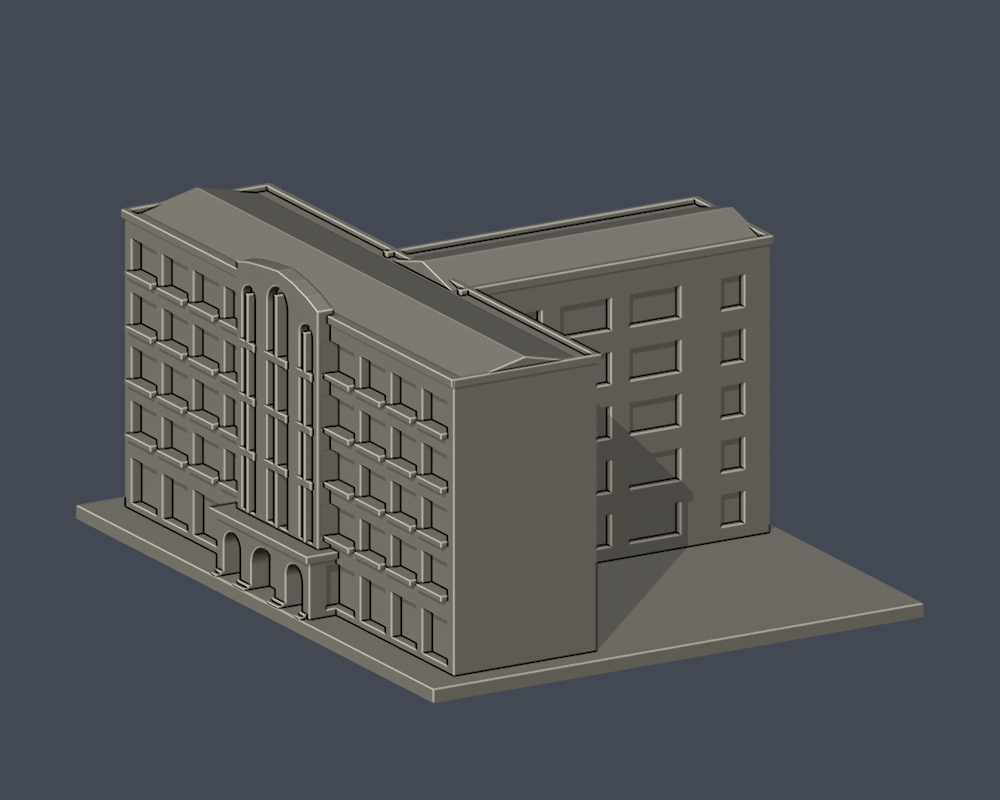
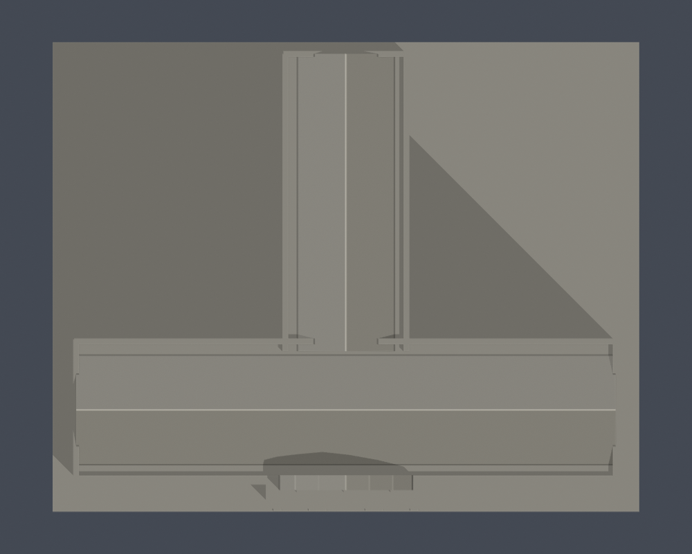

# 國立臺北教育大學｜科學館

臺北校區。自行使用Python實體布林建立的外觀／量體近似模型；沒有下載第三方3D模型，非施工圖、測繪或館內重建。

## 證據與範圍

依官方正面、內院兩翼實拍及1–2F的T形平面建立整體量體近似。保留三個不同寬高的長拱窗區、地面三拱入口、正面四排上層窗加地面窗、內院五排可見窗及遮陽帶。長拱窗的窗格、百葉與玻璃分格為加粗近似，不把細窗框當結構柱。T形長翼外端及未見外側留素面；內院相反半翼由平面延伸量體但保持素面，不鏡射複製窗群。官方照片頁備註記載111–112年加設防水斜屋頂，本模型以低坡雙脊覆蓋T形量體；坡度、脊線方向與匯接形狀仍缺屋頂照片，明列為近似，不臆造設備。

官方文件日期2023年10月25日，實拍攝影日未載；文件更新日不是拍攝日，無法保證2026全部現況。來源、實際PDF頁碼及限制見 [sources.json](sources.json)。原照片／PDF只作私人核對，不隨公開包散布。

## 交付

- [model.stl](model.stl)：毫米，含底座最長150毫米，各件獨立比例
- [scene.blend](scene.blend)：由實際STL匯入的可編修網格
- [build_model.py](build_model.py) 與 [requirements.txt](requirements.txt)：自行建模參數來源；python build_model.py
- [render_preview.py](render_preview.py)：讀取原STL渲染；blender -b -t 2 -P render_preview.py

| 模型預覽 | 模型預覽 | 模型預覽 |
| :---: | :---: | :---: |
| 實際STL正面  | 實際STL背面  |  |

[正立面](previews/elevation.png) · [側面](previews/side.png) · [俯視及院落](previews/top.png)

| 模型預覽 | 模型預覽 | 模型預覽 |
| :---: | :---: | :---: |
| 正立面  | 側面  | 俯視及院落  |

## 列印與QA限制

底座朝下。各件比例獨立，勿直接拼為同比例校園。入口頂板、半圓陽臺、玻璃曲面懸挑、雨遮及柱廊可能需要支撐，拆支撐仍可能傷細框。沒有實體試印、Cura／Prusa工具路徑驗證，不保證免支撐或保證可印。模型深度、柱距及高度不是實際建築尺寸。

[validation.json](validation.json) 檢原STL水密、正體積、繞序、每邊兩面、vertex link、單表面實體、無分離內腔殼、150毫米限制、重建SHA與Blend一致。[contour-validity-check.json](contour-validity-check.json) 每0.2毫米以0.071偏移逐層檢閉合及個別／組合Polygon有效，不修補後算成功。[thin-feature-check.json](thin-feature-check.json) 採canonical fail-closed v3每1毫米0.8毫米opening參考篩檢，不等於全面最小壁厚或切片模擬。

重跑：python validate_model.py；python check_contour_validity.py；python check_thin_features.py。

外觀已覆核，本件為作者凍結版本；須經獨立幾何審核通過後由唯一發布者發布。
