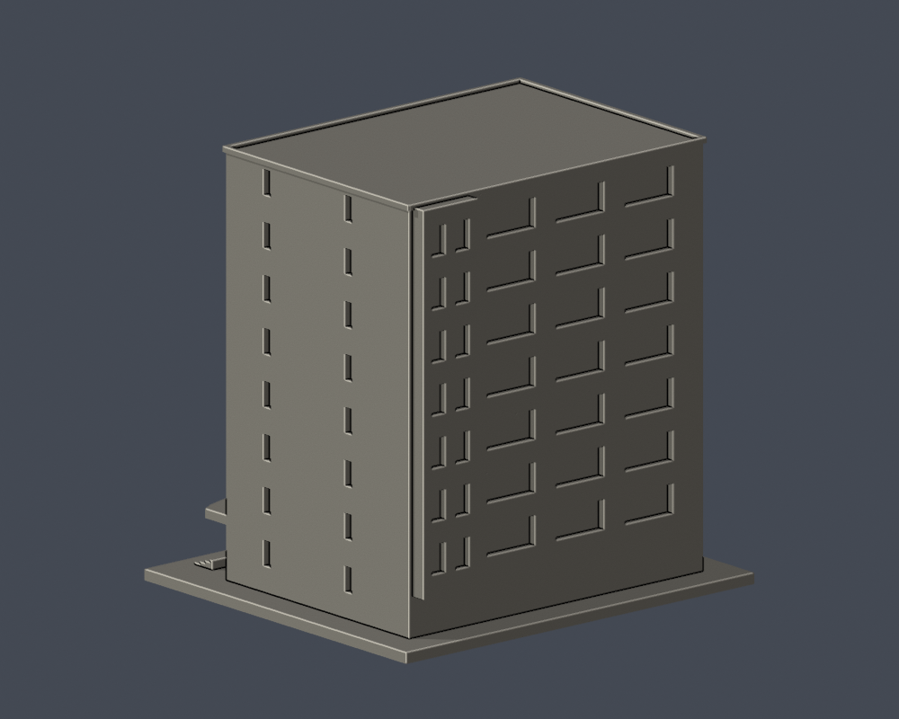
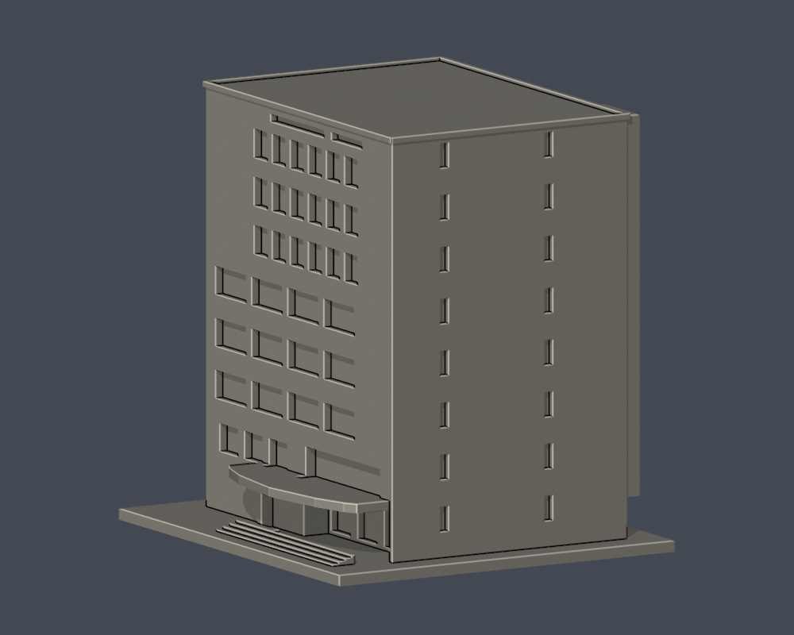

# 國立臺北教育大學｜至善樓

臺北校區。自行以Python實體布林建立外觀／量體近似，未下載第三方3D模型；不是測繪、施工圖或館內重建。

## 證據與範圍

依正面、背側照片及地上1F／2F平面建立八層量體近似。保留右前入口退縮挑空、寬而弧前緣的雨遮、低層寬窗群與高層較密窗群、端牆雙列窄直窗、背側突出窄翼。官方PDF36頁是B2／B1，未拿來直接當地上足跡；地上退縮依37頁。入口雨遮曲率、柱距及玻璃分格為列印近似；遠端樹遮、未知側面及屋頂設備不臆補。背側低層照片局部遮蔽，未複製正面窗來填滿。

官方文件2023年10月25日，攝影日未載；文件日期不等於拍攝日，無法保證2026全部現況。各頁及URL見 [sources.json](sources.json)。原照片與PDF只留私人核對，不隨公開包散布。

## 前立面逐層處理

- 1F：右側後退玻璃入口，雨遮與階梯，保留真空隙。
- 2F：左側較短窗組、右側長橫窗，不當成均一陣列。
- 3–5F：每列4組寬連窗，移除容易被讀作磚柱的細玻璃中框。
- 6–8F：每列保留6組可辨識窄窗。官方6–8F平面有8個研究室分段，但房間數不是外窗數證據，照片左側受樹遮的2段保持素面，不臆補。
- 最高處僅保留可見2道長短不同橫槽；細分玻璃格不刻製。

[新版前立面近圖](previews/front_close.png)。窗組寬度與比例仍為照片近似，沒有實測。

| 模型預覽 | 模型預覽 | 模型預覽 |
| :---: | :---: | :---: |
| 新版前立面近圖  |  |  |

## 交付檔

- [model.stl](model.stl)：毫米，含底座最長150毫米，各件獨立比例
- [scene.blend](scene.blend)：由交付STL匯入的可編修網格
- [build_model.py](build_model.py) 與 [requirements.txt](requirements.txt)：自行建模參數；python build_model.py
- [render_preview.py](render_preview.py)：實際STL渲染；blender -b -t 2 -P render_preview.py

| 模型預覽 | 模型預覽 | 模型預覽 |
| :---: | :---: | :---: |
| 實際STL正面  | 實際STL背面  |  |

[正立面](previews/elevation.png) · [側面](previews/side.png) · [俯視](previews/top.png)

| 模型預覽 | 模型預覽 | 模型預覽 |
| :---: | :---: | :---: |
| 正立面  | 側面  | 俯視  |

[原STL射線空隙檢核](portal-ray-proof.json) · [重跑射線程式](check_portal_geometry.py)。直接遍歷原STL三角形，不修補或封截面。

## 列印與QA限制

底座朝下。窗格、拱形框、薄簷與雨遮均有列印粗化，懸挑及入口可能需支撐；拆支撐仍可能傷細件。模型尺度不是實際建築尺寸，勿把各件直接拼成同比例校園。沒有實體試印或Cura／Prusa工具路徑驗證，不保證免支撐或保證可印。

[validation.json](validation.json) 檢原STL水密、正體積、法向與繞序、每邊兩面、vertex link、單連通表面、無分離內腔殼、150毫米限制、重建SHA與Blend幾何一致。[contour-validity-check.json](contour-validity-check.json) 固定0.071毫米偏移，每0.2毫米逐層檢閉合與個別／合成Polygon有效，不修補後算成功。[thin-feature-check.json](thin-feature-check.json) 採canonical fail-closed v3每1毫米0.8毫米opening參考篩檢，不等於全面最小壁厚或切片模擬。

重跑：python validate_model.py；python check_contour_validity.py；python check_thin_features.py。

外觀已覆核，本件為作者凍結版本；獨立QA通過後才可由唯一發布者發布。
