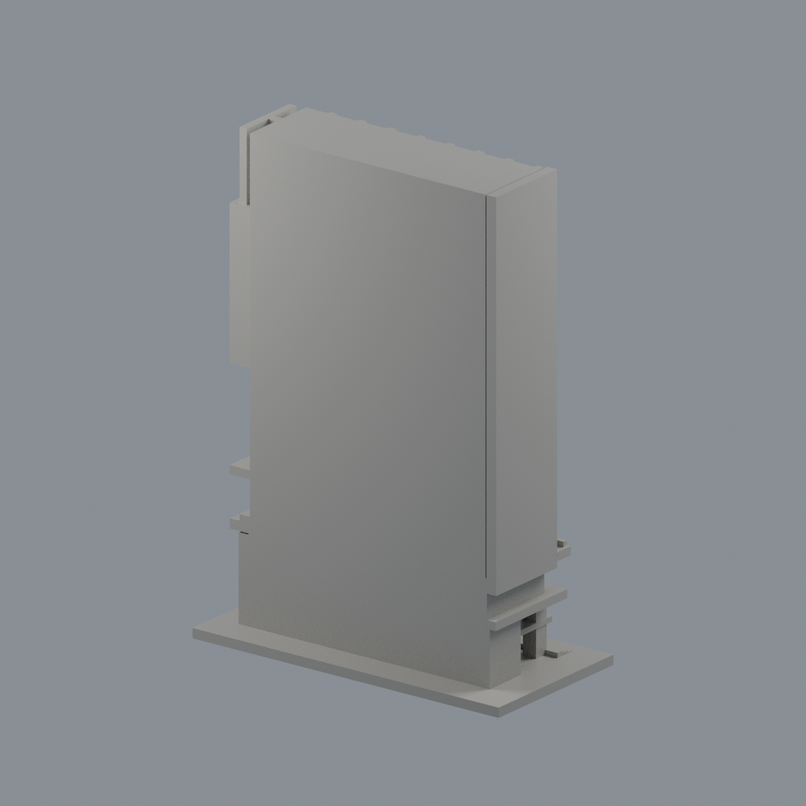
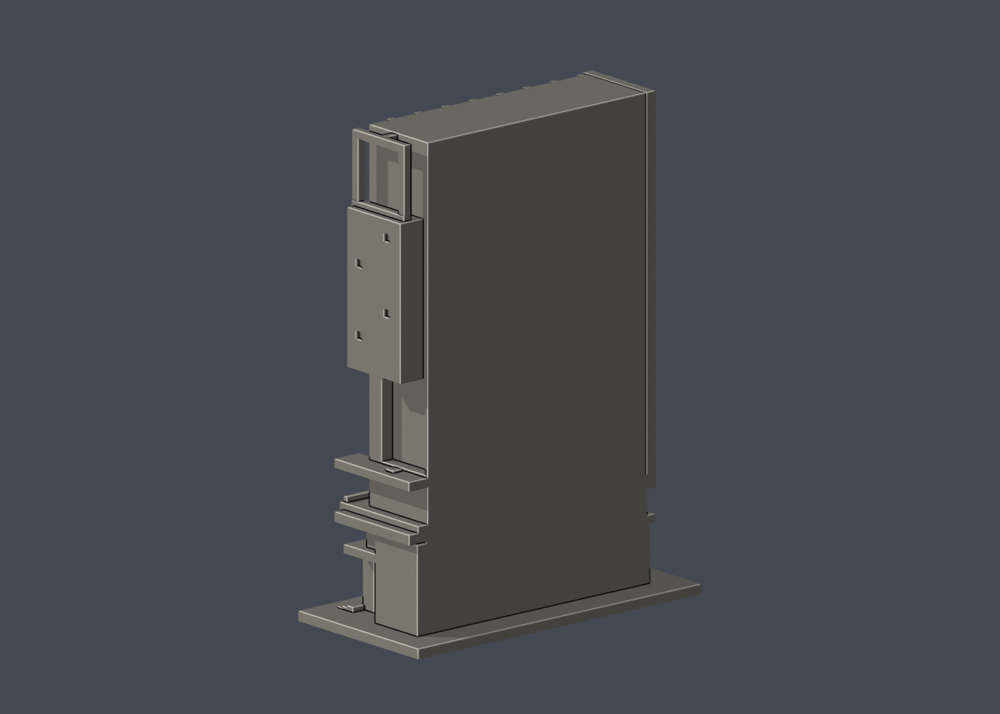

# 先鋒國際研發大樓臨忠孝東路前側段

## 4 材質外觀版（2026-10-21）

| 正面與來源支持區域 | 原截段封閉面中性 |
|---|---|
|  |  |

[來源界線與四視角](appearance/README.md) · [表面色 3MF](appearance/ntutpioneer-appearance.3mf) · [可編輯場景](appearance/scene.blend)

僅72遮陽盒前百葉與淺槽淡金米色、64真窗凹底與原十字框灰綠暗灰；盒側頂、牆、頂冠暗孔及混合低層玻璃中性。背面是原截段封閉面，不是整棟背立面，後側橘柱未加入。 原 STL 與歷史 QA 不變；這是外觀改善，不是新增幾何。[原單色正面](previews/front.png)／[原單色背面](previews/rear.png)


國立臺北科技大學／臺北校區（南校區）

## 範圍及年代

**局部段，不是整棟大樓。** 模型包含面向忠孝東路的北立面全高、入口門廊、兩側短回折及西側近端懸挑箱。平整背面是為列印封閉而設的截段界面，不是南向實際外牆。屋頂平面亦只封閉截段，不代表完整屋頂。

依營造商的竣工後兩角外觀實拍自建；照片未標攝影日期，不能當作2026現場記錄。官方資料分別記載2020年8月竣工、2021年5月驗收及改名、2022開幕使用。原工程名「精勤樓」指新建先鋒大樓；不能與已拆的舊精勤樓／慧樓另外重複計算。

模型單位為**毫米**，含底座 **106.85 × 53.42 × 150.00 mm**，獨立比例。照片目測近似，不是測繪或工程圖；全棟65.7公尺高度資料不構成本局部模型的精確比例保證。

## 實際 STL 預覽

| 正面 | 背面（模型截面） |
| --- | --- |
|  |  |

[頂視圖](previews/top.png) · [北向正立面](previews/elevation.png)

## 特徵與簡化

- 八組縱向分節，九列突出遮陽盒；最上一列位於上方小窗帶，沒有另外增加一段高平牆。
- 大門前挑空柱廊、玻璃立面凹槽、入口雨庇、上方橫向大窗帶及陽臺邊。
- 西側近端懸挑箱、下方深凹露臺、稀疏小方窗與屋頂側框。
- 左端狹長高牆與縱向翼片。為避免細長懸空尖端，翼片加厚並縮至屋面線；這項列印簡化會減少實拍頂部高低差。
- 所有窗格為與牆連接的加粗浮雕／凹槽，非真實窗框厚度。遮陽百葉只做有實心背板的溝槽，不使用分離薄葉。
- 未建後半樓體、第二個較遠西側懸挑箱、完整屋頂光電與衛星設備、地下停車坡道、室內、植栽、校名字樣。後側低楼層照片只供參考，不能推定未見的整個背面。
- 截段深度、側凹空間與比例均為目測估計；平切背板不代表真實隔間。

## 檔案與重建

[model.stl](model.stl) · [scene.blend](scene.blend) · [build_model.py](build_model.py) · [requirements.txt](requirements.txt) · [sources.json](sources.json) · [SHA256SUMS](SHA256SUMS)

scene.blend含交付STL的可編輯三角網格；參數重建來源為Python腳本。Python 3.12及Blender 4.3.2或相容版：

```sh
python -m pip install -r requirements.txt
python build_model.py
blender -b -t 2 -P render_preview.py
python validate_model.py
python check_layers.py
python check_thin_features.py
```

[網格及重建驗證](validation.json) · [全部0.2毫米輪廓](layer-check.json) · [0.8毫米輔助篩檢](thin-feature-check.json) · [QA摘要](qa-summary.json)

## 驗證與試印注意

- 原STL水密，法向／繞序一致，所有邊2面、每頂點link單環、單一連通表面，沒有分離浮件或額外內腔殼；最大尺寸150毫米。
- 獨立重建STL SHA一致；saved Blend與STL三角幾何一致。
- z=0.071毫米起每0.2毫米，共750層；所有輪廓degree2閉合且個別與組合Polygon均有效，未修補或跳過失敗。
- canonical-v3（fail-closed修訂）以0.8毫米參考寬度、1毫米層距篩檢；最大opening損失0.139%，0層超過1%。仍不是全面壁厚檢驗，窗格、框架及溝槽有縮尺限制。
- **底座朝下。門廊、雨庇、遮陽盒底部和懸挑箱需要在切片器中逐區檢查支撐與橋接。側露臺支撐移除需避開細框。**
- 本包沒有Cura／PrusaSlicer實際工具路徑，也未實體試印；不保證可印或不用支撐。切勿因網格閉合或篩檢無超標層而當成免支撐。

## 來源及權利

詳細來源與年代限制見[sources.json](sources.json)。使用原創參數幾何，未抓取第三方mesh。照片、圖說及建物名稱的權利仍屬各來源；本包只有來源連結與自己的STL渲染，不重新散布第三方照片或PDF。

## 輔助篩檢程式修訂

2026-10-13：check_thin_features.py採同一canonical-v3 fail-closed版本，僅將舊v2對無效組合Polygon的buffer(0)修補改成assert立即失敗。全部層重跑exit0，數值報告與原版逐字節相同，這4件沒有觸發原修補分支。STL、OBJ、Blend、建模來源、逐0.2毫米輪廓與幾何驗證檔完全不变。本修訂不增加任何可列印保證。
