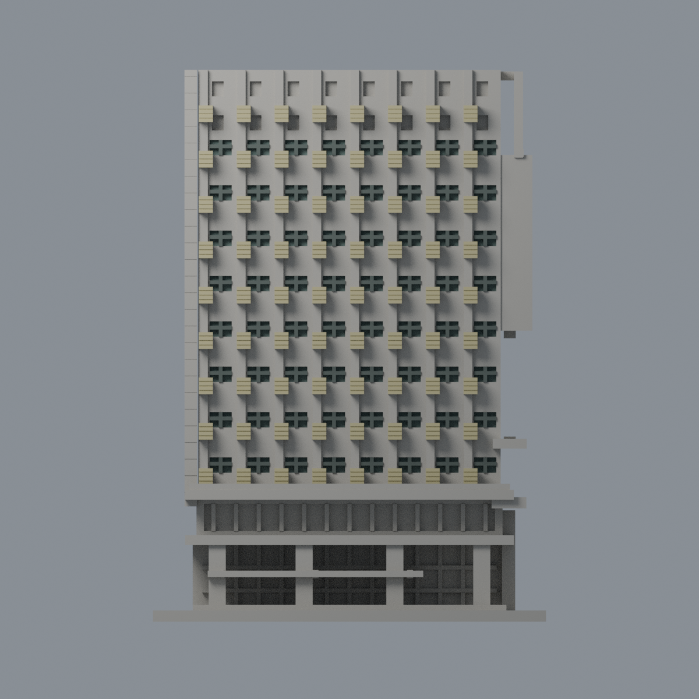
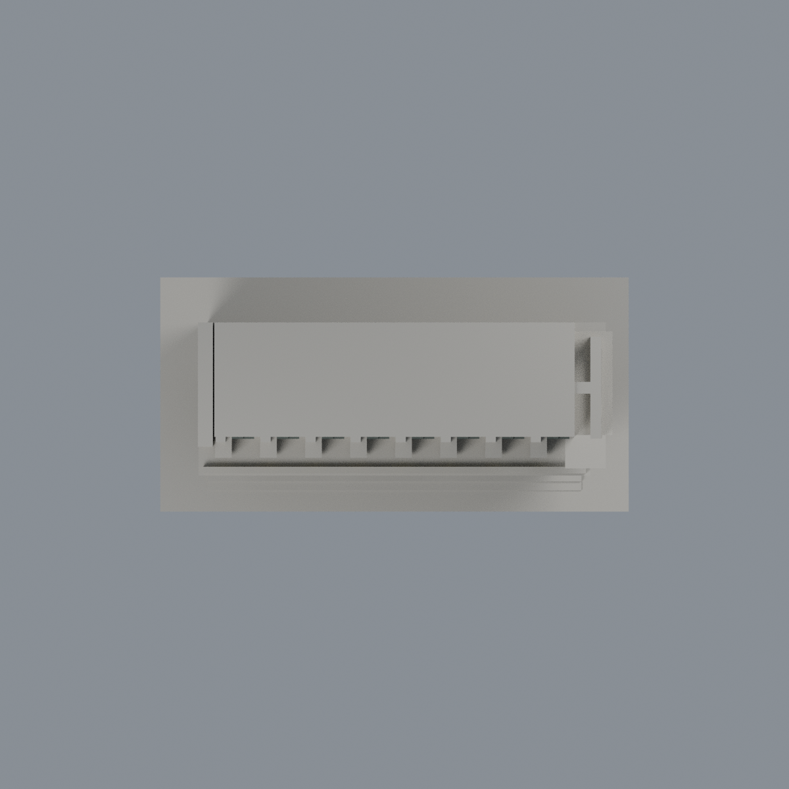

# 北科先鋒大樓北向前段百葉與窗限定配色：四材質外觀版

沿用原 **14,100 三角面／7,036 頂點**，不改原 STL 位元、座標、面序或幾何；這是既有模型外觀改版，不增加模型包數。

| 模型預覽 | 模型預覽 | 模型預覽 |
| :---: | :---: | :---: |
| 正面  | 原截段封閉面保持中性  |  |
|  |  |  |

[表面色 3MF](ntutpioneer-appearance.3mf) · [可編輯 Blender](scene.blend) · [材質色表](palette.json) · [逐面指派與依據](face-materials.json) · [原 STL](../model.stl)

## 來源與配色邊界

這是**72 個遮陽盒前百葉與離散窗的限定配色**，不是整棟大樓或全部立面還原。親看瑞助營造工程頁三張完整實拍、原單色網格與生成器。[精確照片 URL、SHA、日期欄](qa/source-review.json)。三照均無 Original／修改日期，竣工 2020、驗收改名 2021、開幕 2022 僅為建築背景，不當攝影日或 2026 現況。原工程名「精勤樓」是新建先鋒大樓，不與拆除的舊精勤樓重複計數。

- 實際照片順序：`_DSC9539` 與 `_DSC9542` 是北向前側兩角；`_DSC9541` 是後側低層橘柱與停車入口，**不在此模型段內**，只用來排除擴色。這裡以原圖檔名澄清順序，不沿用舊來源文字的序號推測，也不新增橘柱。
- 72 個既有凸盒只有正面與原淺槽採低飽和淺金米色；盒頂、側面與接牆處保持中性，不以整盒包圍體積強染。原百葉粗化深槽的明暗由渲染產生，不畫實景細密金屬葉。
- 64 個既有離散窗真正凹底採灰綠代理，原獨立十字粗框採暗灰；不是透明玻璃物理模擬，也不複製天空反射。頂冠暗小孔未證實是玻璃，保持中性；下層門廳與長窗帶有未充分分離的實裙／玻璃，也中性。
- 主牆粉灰／米色、未知屋頂、近側小窗、短回折面不擴色。平整後面是原截段封閉面，不是建築背立面，維持中性。照片後半棟、第二懸挑箱與設備不在模型中。
- 原生成器整體縮放為 150/146；分類先還原至原坐標再作每面三頂點範圍核對，不改 STL 座標或細分面。不增字樣、植栽、細窗格或光電板，原外形與歷史 QA 保留，未做實體列印測試。

[原幾何與歷史來源限制](../README.md)

## 重建與核驗

安裝 [依賴](source/requirements.txt)，Blender 使用 4.3.2。由本資料夾上層提供原 model.stl：

1. `python appearance/source/build_appearance.py`
2. `python appearance/source/verify_exchange.py`
3. `blender -b -t 3 --python-exit-code 1 -P appearance/source/render_appearance.py`
4. `blender -b -t 3 --python-exit-code 1 -P appearance/source/verify_scene.py`

[獨立重建 ZIP](rebuild-source.zip)含原 STL、四支程式及依賴，不含第三方照片；不取代原建模腳本。[逐檔 SHA256](SHA256SUMS)

[交換／拓撲 QA](qa/exchange-validation.json)核對原座標與面序、全部面材質、單連通、有向水密邊、頂點 link 單環、正體積與零退化／重複面；lib3mf 嚴格讀取零警告，實際編輯單材質再存讀，其他材質及面指派不變。SDK 六位小數量化誤差另列。

[Blender 存讀與編輯](qa/scene-validation.json) · [渲染記錄](qa/render-manifest.json) · [獨立重建](qa/rebuild-validation.json)

## 製造限制照舊

尺寸仍為 106.85 × 53.42 × 150 mm；原 STL、建模程式、場景及歷史 QA 保留。原層檢與薄特徵檢查本次未重跑，不能由材質 QA 代替。

3MF 是同一網格的表面色，不是各材質各自封閉的分色實體、切片專案、噴頭映射或 G-code。切片 GUI、多材料路徑與實體列印未測；柱頭、屋簷、窗框及薄邊仍須評估材料、支撐及拆除風險，沒有保證可印或免支撐。
