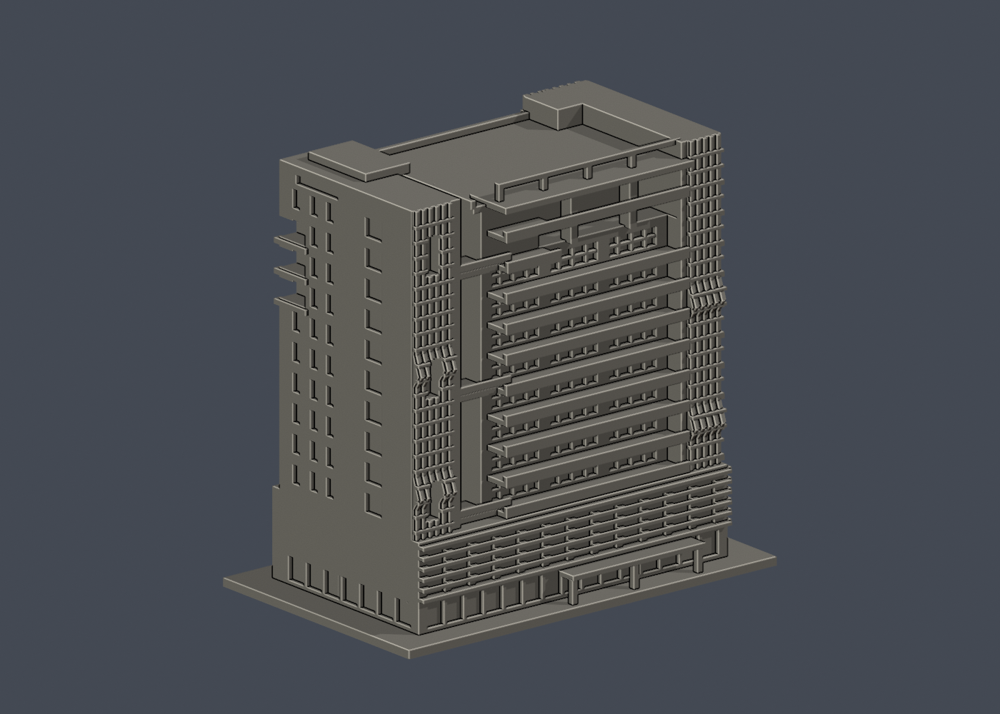
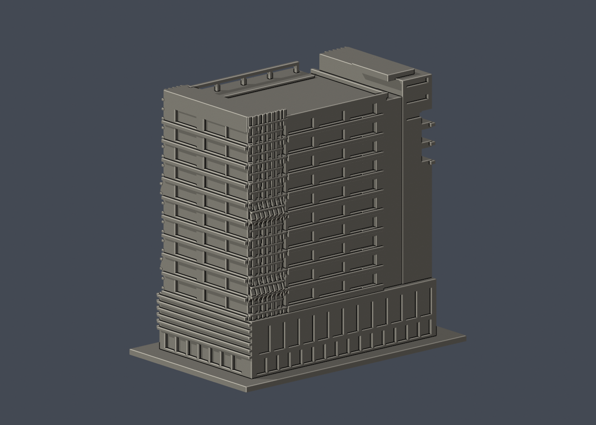

# 億光大樓

國立臺北科技大學／臺北校區（東校區）

## 範圍與年代

全棟地上**外殼近似模型**，含共用裙樓、塔樓、主要陽臺、連橋與屋頂大致輪廓；不含室內、地下3層、鄰棟及周邊球場。教學研究大樓第一期即億光大樓，內部集思會議中心等使用單位不另算一棟。

依2017-09-09正面、2020-10-31側面及校方未標攝影日期的斜角／鳥瞰照片目測。**不是2026現況測繪，也不是精確縮尺復原。** 2023取得綠建築標章是認證年，不作落成年或照片年代。

單位**毫米**，含底座 **150 × 94 × 146.70 mm**；各件獨立比例。底座最長150毫米。建築進深、比例、屋頂設備量體均未量測。

## 實際 STL 預覽

| 忠孝東路側正面 | 後面 |
| --- | --- |
|  |  |

[頂視圖](previews/top.png) · [正立面](previews/elevation.png)

## 主要辨識特徵

- 前端窄塔與主體之間的深凹間隔、三座連橋，不用整塊實心前牆填平。
- 上部十層陽臺節奏、局部退縮造成的雙層高凹廊、柱與水平外挑板。
- 兩側折面白色格柵及反側較寬的折面端部；格柵的折線保留，細網眼以實心背板加粗浮雕表示。
- 低層共用裙樓的橫向遮陽板、首層玻璃凹槽及入口雨庇近似。
- 褐色側面核心、寬窄不同窗列、上部窄橫窗與退台。
- 反側陽臺、屋頂平台矮牆、服務核心及開放框；未複製細小管線或任意添加設備。

## 未知與簡化

- 照片不是測繪，進深、窗寬、樓高、橋位及屋頂高低差均為目測近似。背面輪廓有校方鳥瞰支持，但低解析度不能支持每個小窗與设备的精確位置。
- 首層有樹木遮擋，店面、出入口與雨庇按可見節奏概括，未仿造商標或認定现今租戶配置。2019起商業空間曾變動，不以2017照片聲稱店家仍原樣。
- 陽臺護欄由細桿改成厚實短矮板；格柵、窗格及細框加粗，最低常見橫向／縱向框約1.0–1.2毫米，但不宣稱全模型最小壁厚已求得。
- 屋頂只建能由鳥瞰辨識的主要面與核心。空調、天線、花台植栽及零碎設備省略；服務核心尺寸位置仍是近似。
- 建物白色與褐色材質沒有寫入單色STL；預覽顏色不代表現地色彩。

## 檔案、來源及重建

[model.stl](model.stl) · [scene.blend](scene.blend) · [build_model.py](build_model.py) · [requirements.txt](requirements.txt) · [sources.json](sources.json) · [SHA256SUMS](SHA256SUMS)

scene.blend由實際交付STL匯入，是可編輯三角網格；Python腳本是參數重建來源。使用Python 3.12與Blender 4.3.2或相容版本：

```sh
python -m pip install -r requirements.txt
python build_model.py
blender -b -t 2 -P render_preview.py
python validate_model.py
python check_layers.py
python check_thin_features.py
```

[原STL、重建與Blend驗證](validation.json) · [全部0.2毫米有效輪廓](layer-check.json) · [0.8毫米輔助篩檢](thin-feature-check.json) · [QA摘要](qa-summary.json)

## 幾何驗證及試印注意

- 原STL水密、原始法向與繞序一致、每邊2面、每頂點link單環、單一連通表面、正體積，無分離浮件或另一個內腔殼。
- 獨立重建STL的SHA與交付檔一致，saved Blend三角幾何與STL一致。
- z=0.071毫米起每0.2毫米，共734層；degree2輪廓均閉合，個別及組合Polygon全部有效，不修補或吞掉invalid。
- canonical-v3（fail-closed修訂）以0.8毫米參考寬度、1毫米層距輔助篩檢；最大面積損失0.210%，0層超過1%。此為參考寬度opening，不是完整壁厚／噴嘴路徑驗證。
- **底座朝下。連橋、陽臺底部、頂部凹廊及入口雨庇有顯著懸挑，必須在實際切片器检查支撐與橋接；移除連橋附近支撐時勿扯斷細框。**
- 未跑Cura／PrusaSlicer實際工具路徑、未做實體試印，不保證可印、不宣稱免支撐。缩小會進一步削弱格柵與窗格。

## 權利

本件為原創參數幾何，未擷取第三方3D網格。照片權利屬校方與攝影者；Solomon203的兩張照片為CC BY-SA 4.0，來源、作者、日期及授權連結均記於[sources.json](sources.json)。公開包不重新散布原照片或PDF，只包含自己模型的渲染。

## 輔助篩檢程式修訂

2026-10-13：check_thin_features.py採同一canonical-v3 fail-closed版本，僅將舊v2對無效組合Polygon的buffer(0)修補改成assert立即失敗。全部層重跑exit0，數值報告與原版逐字節相同，這4件沒有觸發原修補分支。STL、OBJ、Blend、建模來源、逐0.2毫米輪廓與幾何驗證檔完全不变。本修訂不增加任何可列印保證。
