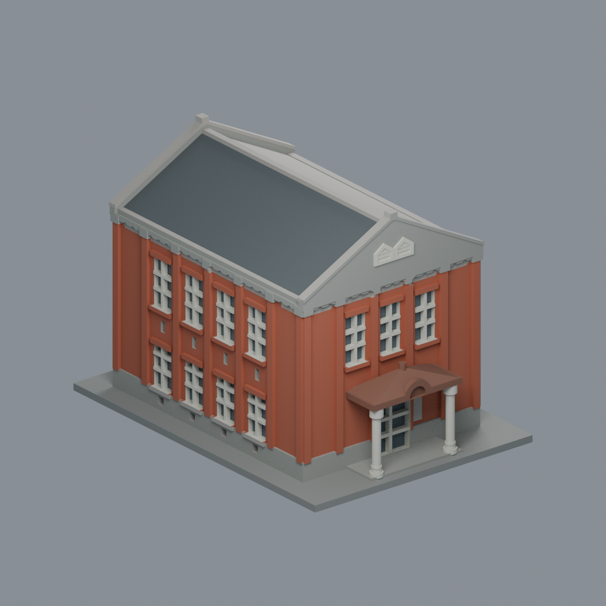
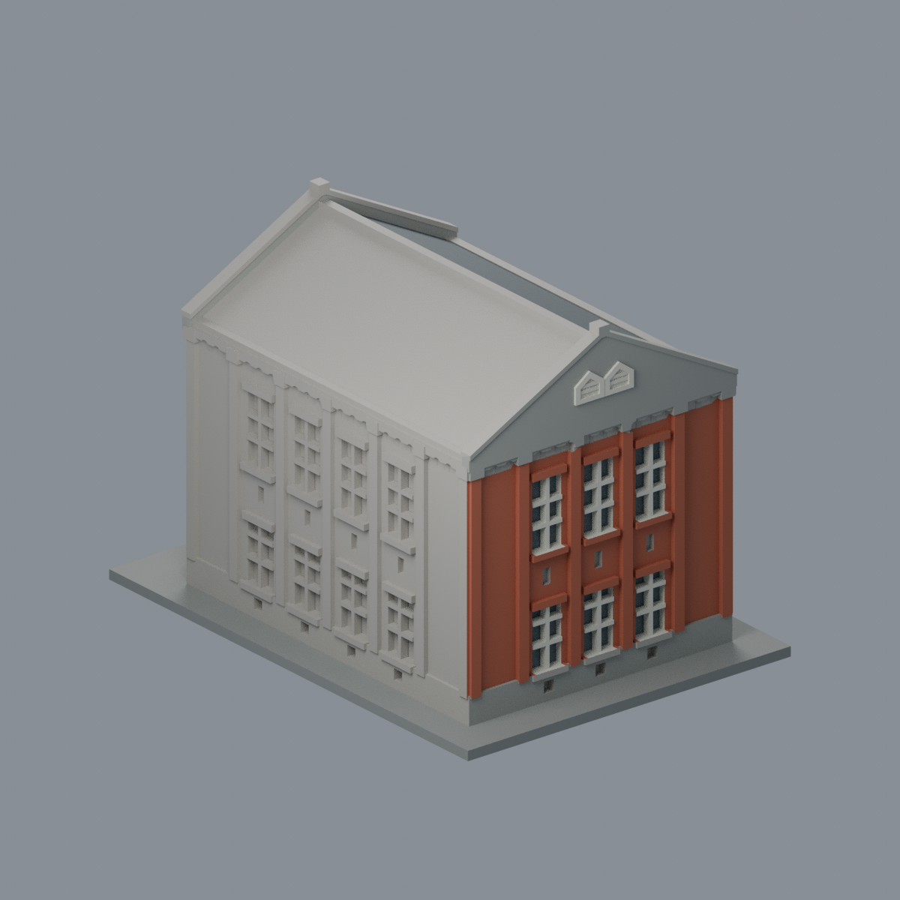

# 臺北工業學校紅樓

## 模型預覽


| 模型預覽 | 模型預覽 | 模型預覽 |
| :---: | :---: | :---: |
| 正面原幾何配色<br> | 西端與未登錄長側<br> |  |

國立臺北科技大學／臺北校區（西校區）

## 範圍與年代

完整建物外殼近似模型；含東向門廊，未含室內與周邊景觀。

1926興建，2017修復後外貌；照片實際拍摄日期未全部明示。

模型單位為 **毫米**，含底座尺寸 **108 × 150 × 105.80 mm**；每件獨立比例，底座最長150毫米。這是依公開外觀資料自建的教育展示與試印模型，並非測繪模型、修復圖說或校方官方3D檔。

## 最新八材質外觀版（2026-10-20）


[來源界線與四視角](appearance/README.md) · [表面色 3MF](appearance/ntut-appearance.3mf) · [可編輯場景](appearance/scene.blend)

依校方東入口及市府西端照片登錄橘紅磚面、灰山牆、淡色窗柱與棕色門廊；另一長側與其瓦坡中性。原STL與歷史QA不變，不是新增幾何。原單色正面（歷史檔案留存，不作本頁預覽）／原單色背面（歷史檔案留存，不作本頁預覽）


頂視圖（歷史檔案留存，不作本頁預覽） · 正立面（歷史檔案留存，不作本頁預覽）


## 已保留的外觀

- 東西雙山牆、雙坡屋頂與階梯形頂飾
- 東立面上層三窗、下層中央入口與雙柱弧眉門廊
- 西立面上下層各三窗；兩個並列尖拱氣窗
- 兩長側各四個主窗開間、全高扶壁及窗間通氣孔
- 連續簷部拱飾帶、加厚窗楣與窗臺

## 簡化與未知

- 主體進深、高度與門廊比例依照片和摺頁立面目測，不是測繪復原。
- 未重現逐塊磚、瓦片、鑄鐵校徽與木雕文字；屋頂以連續坡面呈現。
- 窗格加粗為1.2毫米；門廊柱半徑1.8毫米。山牆斜邊、坡頂及弧眉仍有漸窄截面。
- 單色渲染只呈現實際STL幾何，不代表紅磚、灰泥或銅皮原色。

## 檔案與重建

- [model.stl](model.stl)：單件列印模型
- [scene.blend](scene.blend)：由交付STL匯入的可編輯三角網格；參數式重建來源是 [build_model.py](build_model.py)
- [sources.json](sources.json)：逐條來源、年代限制與支持特徵
- [validation.json](validation.json)、[layer-check.json](layer-check.json)、[thin-feature-check.json](thin-feature-check.json)、[qa-summary.json](qa-summary.json)
- [SHA256SUMS](SHA256SUMS)：本件逐檔SHA-256

使用Python 3.12，安裝 [requirements.txt](requirements.txt)；Blender 4.3.2或相容新版另行安裝。先執行build_model.py，再用Blender背景模式執行render_preview.py。依序執行validate_model.py、check_layers.py、check_thin_features.py；任一程式非零退出或checks不是全true，均不得視為通過。

示例命令：

```sh
python -m pip install -r requirements.txt
python build_model.py
blender -b -t 2 -P render_preview.py
python validate_model.py
python check_layers.py
python check_thin_features.py
```

## 幾何驗證及試印注意

- 原STL：水密、原始法向與繞序相符、所有邊恰有兩面、每頂點link單環、單一連通表面、正體積；沒有另一個分離或內腔殼。
- 獨立重建STL的SHA一致，saved Blend與實際STL的三角幾何一致。
- 從z=0.071毫米起每0.2毫米取樣，共529層；所有輪廓degree2閉合，個別及組合Polygon均valid，不修補或忽略失敗輪廓。
- canonical-v3（fail-closed修訂）以0.8毫米參考寬度、1毫米層距做形態opening輔助篩檢，最大面積損失比例0.959%；0層超過1%。窄尖端和銳角也會造成損失，這不是全面最小壁厚驗證。
- **底座朝下。門廊屋簷與窗楣為懸挑，須在實際切片器檢查支撐；拆除門廊下方支撐時留意柱身。**
- 本包未執行Cura／PrusaSlicer實際工具路徑，也未實體試印；不保證可印、不宣稱免支撐。縮小模型會進一步削弱窗格與柱身。

## 來源與權利

原創近似幾何與參數腳本不含第三方mesh。第三方照片、PDF、校徽與文字的權利仍屬各來源；公開包只有來源URL及自己的STL渲染，不重新散布原照片或PDF。

## 輔助篩檢程式修訂

2026-10-13：check_thin_features.py採同一canonical-v3 fail-closed版本，僅將舊v2對無效組合Polygon的buffer(0)修補改成assert立即失敗。全部層重跑exit0，數值報告與原版逐字節相同，這4件沒有觸發原修補分支。STL、OBJ、Blend、建模來源、逐0.2毫米輪廓與幾何驗證檔完全不变。本修訂不增加任何可列印保證。
