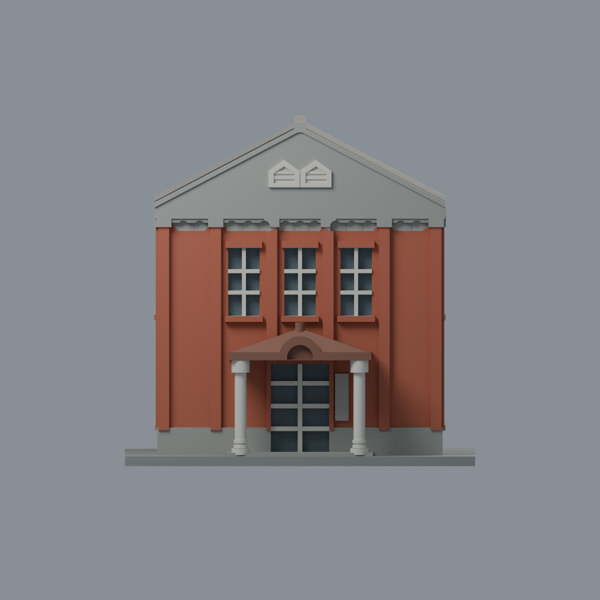
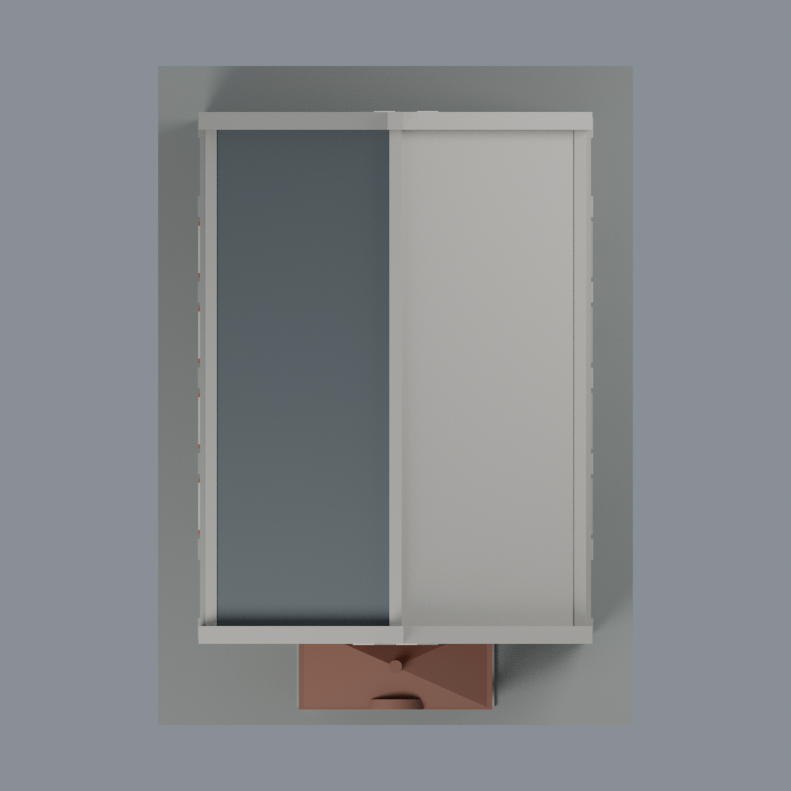

# 臺北工業學校紅樓：八材質外觀版

沿用原 **15,348 三角面／7,420 頂點**，不改原 STL 位元、座標、面序或幾何；這是既有模型外觀改版，不增加模型包數。

| 正面 | 西端與未登錄長側 |
|---|---|
|  |  |
|  |  |

[表面色 3MF](ntut-appearance.3mf) · [可編輯 Blender](scene.blend) · [材質色表](palette.json) · [逐面指派與依據](face-materials.json) · [原 STL](../model.stl)

## 來源與配色邊界

親自查看[北科大校史館〈古蹟紅樓〉](https://archive.ntut.edu.tw/p/404-1050-92391.php?Lang=zh-tw)的[東入口與長側照片](https://archive.ntut.edu.tw/var/file/50/1050/img/3035/1.jpg)，並登錄[臺北市政府文化局文化小旅行](https://miniculturaltrips.gov.taipei/News_Content.aspx?n=EC08292328F63098&s=67760B980CA719B1&sms=DC4BFB02CE861520)的[西端山牆照片](https://www-ws.gov.taipei/001/Upload/851/relpic/64106/9440315/91fe8d62-e616-4468-9139-f54823d2c1a0.jpg)。校方說明 2017-05-23 修復重開；市府頁資料更新為 2025-07-10，**兩者都不是照片精確拍攝日期**。不宣稱 2026 現況，照片不隨模型或備份散布。

- 登錄東入口 y−、西山牆 y+ 與照片可見長側 x−：橘紅磚牆／扶壁，灰色基座、簷帶及山牆，淡色既有窗梃、尖拱氣窗與東入口雙柱。
- 西端使用其獨立照片確認上下各三窗與無門廊，不把東入口鏡像到西端。另一長側 x+ 的配色沒有本次逐區來源，保留中性。
- 東門廊四坡銅屋頂及原弧眉為**棕褐色，不是綠色銅鏽**；主屋頂只把可登錄的 x− 瓦坡染深灰，另一坡中性。原平滑屋面未新增瓦片或銅板縫。
- 玻璃只在原有凹窗／門的背面；白色窗梃沿原幾何，不把紅磚窗楣改成白石。細窗格與通氣孔仍是舊模型簡化，不宣稱重現校徽。
- 不把照片上的污漬、樹影、舊化斑點畫成建材色；原無字牌保持中性，沒有新增「紅樓」文字、刻紋或招牌內容。
- 色值未校正，玻璃不透明，展示底板不代表周邊鋪地；未包含室內、庭園或附屬現代建物。

[原完整來源](../sources.json) · [原幾何與年代界線](../README.md) · [本次來源覆核](qa/source-review.json)

## 重建與核驗

安裝 [依賴](source/requirements.txt)，Blender 使用 4.3.2。由本資料夾上層提供原 model.stl：

1. `python appearance/source/build_appearance.py`
2. `python appearance/source/verify_exchange.py`
3. `blender -b -t 3 --python-exit-code 1 -P appearance/source/render_appearance.py`
4. `blender -b -t 3 --python-exit-code 1 -P appearance/source/verify_scene.py`

[獨立重建 ZIP](rebuild-source.zip)含原 STL、四支程式及依賴，不含第三方照片；不取代原建模腳本。[逐檔 SHA256](SHA256SUMS)

[交換／拓撲 QA](qa/exchange-validation.json)核對原座標與面序、全部面材質、單連通、有向水密邊、頂點 link 單環、正體積與零退化／重複面；lib3mf 嚴格讀取零警告，實際編輯單材質再存讀，其他材質及面指派不變。SDK 六位小數量化誤差另列。

[Blender 存讀與編輯](qa/scene-validation.json) · [渲染記錄](qa/render-manifest.json) · [獨立重建](qa/rebuild-validation.json)

## 製造限制照舊

尺寸仍為 108 × 150 × 105.8 mm；原 STL、建模程式、場景及歷史 QA 保留。原層檢與薄特徵檢查本次未重跑，不能由材質 QA 代替。

3MF 是同一網格的表面色，不是八個封閉分色實體、切片專案、噴頭映射或 G-code。切片 GUI、多材料路徑與實體列印未測；雙柱門廊、弧眉挑簷、氣窗及細窗梃仍須評估材料、支撐及拆除風險，沒有保證可印或免支撐。
