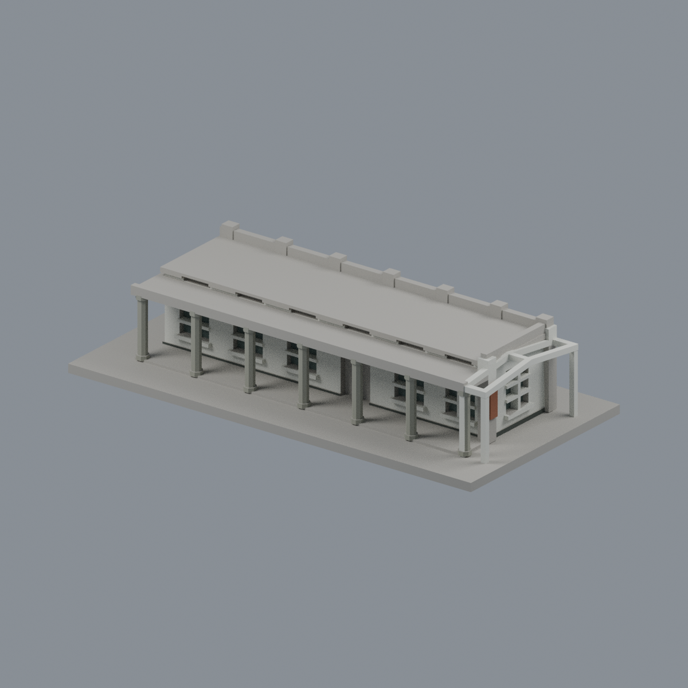
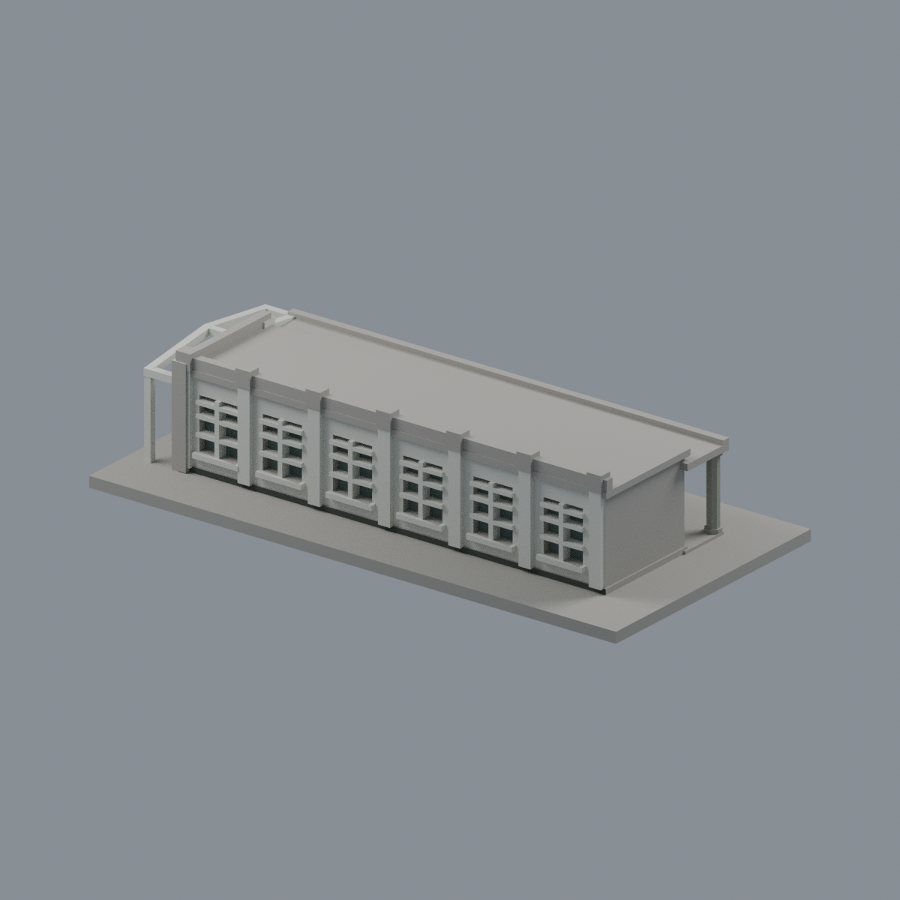

# 一大川堂校史館南端六開間段

## 模型預覽


| 模型預覽 | 模型預覽 | 模型預覽 |
| :---: | :---: | :---: |
| 正面與來源支持區域<br> | 來源支持外長牆／未知頂面中性<br> |  |

## 6 材質外觀版（2026-10-21）


[來源界線與四視角](appearance/README.md) · [表面色 3MF](appearance/ntutyida-appearance.3mf) · [可編輯場景](appearance/scene.blend)

廣角與柱廊近照分別註冊外長牆及內廊：白牆窗框與鋼棚、灰八角柱、黑窄踢腳及鏽紅牌匾，未加文字；未知屋頂、混色簷邊、北截面保持中性，僅既有南端六開間段。 原 STL 與歷史 QA 不變；這是外觀改善，不是新增幾何。原單色正面（歷史檔案留存，不作本頁預覽）／原單色背面（歷史檔案留存，不作本頁預覽）


國立臺北科技大學／臺北校區（西校區）

## 範圍與年代

局部模型；僅包含南端入口棚架及其鄰接六開間。北向延伸與東西向翼棟未建，不是完整L形一大川堂。

以2024修復後實拍為主；2022舊照只核對保留的柱廊特徵。

模型單位為 **毫米**，含底座尺寸 **150 × 74 × 32.80 mm**；每件獨立比例，底座最長150毫米。這是依公開外觀資料自建的教育展示與試印模型，並非測繪模型、修復圖說或校方官方3D檔。

## 實際 STL 預覽


頂視圖（歷史檔案留存，不作本頁預覽） · 正立面（歷史檔案留存，不作本頁預覽）


## 已保留的外觀

- 八角RC柱、加寬柱頭與柱脚
- 低於主屋面的深迴廊與上方氣窗帶
- 外長牆扶壁、窗臺與窗格
- 南端白色棚架的四柱和折坡框
- 保留柱廊的真正開放空間，房間為實心近似量體

## 簡化與未知

- 從公開照片擷取南端六開間做獨立段模型；左端平切是模型邊界，不代表實際建物端牆。
- 北向尚有延伸及L形轉折，屋頂太子樓、銅製通風筒的現況數量與位置未獲足夠證據，均未猜補。
- 室內隔間、現況設備、透明棚面與植栽不建模；棚架只表現可見框架。
- 背面渲染的六窗排列按斜角實拍所見節奏近似配置；沒有背面正投影或測繪資料，窗位及完整進深含推定。
- 局部進深、開間、窗門位置及尺度為目測近似；八角柱直徑3.3毫米、棚架柱1.8毫米。

## 檔案與重建

- [model.stl](model.stl)：單件列印模型
- [scene.blend](scene.blend)：由交付STL匯入的可編輯三角網格；參數式重建來源是 [build_model.py](build_model.py)
- [sources.json](sources.json)：逐條來源、年代限制與支持特徵
- [validation.json](validation.json)、[layer-check.json](layer-check.json)、[thin-feature-check.json](thin-feature-check.json)、[qa-summary.json](qa-summary.json)
- [SHA256SUMS](SHA256SUMS)：本件逐檔SHA-256

使用Python 3.12，安裝 [requirements.txt](requirements.txt)；Blender 4.3.2或相容新版另行安裝。先執行build_model.py，再用Blender背景模式執行render_preview.py。依序執行validate_model.py、check_layers.py、check_thin_features.py；任一程式非零退出或checks不是全true，均不得視為通過。

示例命令：

```sh
python -m pip install -r requirements.txt
python build_model.py
blender -b -t 2 -P render_preview.py
python validate_model.py
python check_layers.py
python check_thin_features.py
```

## 幾何驗證及試印注意

- 原STL：水密、原始法向與繞序相符、所有邊恰有兩面、每頂點link單環、單一連通表面、正體積；沒有另一個分離或內腔殼。
- 獨立重建STL的SHA一致，saved Blend與實際STL的三角幾何一致。
- 從z=0.071毫米起每0.2毫米取樣，共164層；所有輪廓degree2閉合，個別及組合Polygon均valid，不修補或忽略失敗輪廓。
- canonical-v3（fail-closed修訂）以0.8毫米參考寬度、1毫米層距做形態opening輔助篩檢，最大面積損失比例0.963%；0層超過1%。窄尖端和銳角也會造成損失，這不是全面最小壁厚驗證。
- **底座朝下。深柱廊頂板及棚架橫梁跨距較大，務必在實際切片器檢查橋接與支撐。不要把幾何閉合當成不用支撐。**
- 本包未執行Cura／PrusaSlicer實際工具路徑，也未實體試印；不保證可印、不宣稱免支撐。縮小模型會進一步削弱窗格與柱身。

## 來源與權利

原創近似幾何與參數腳本不含第三方mesh。第三方照片、PDF、校徽與文字的權利仍屬各來源；公開包只有來源URL及自己的STL渲染，不重新散布原照片或PDF。

## 輔助篩檢程式修訂

2026-10-13：check_thin_features.py採同一canonical-v3 fail-closed版本，僅將舊v2對無效組合Polygon的buffer(0)修補改成assert立即失敗。全部層重跑exit0，數值報告與原版逐字節相同，這4件沒有觸發原修補分支。STL、OBJ、Blend、建模來源、逐0.2毫米輪廓與幾何驗證檔完全不变。本修訂不增加任何可列印保證。
