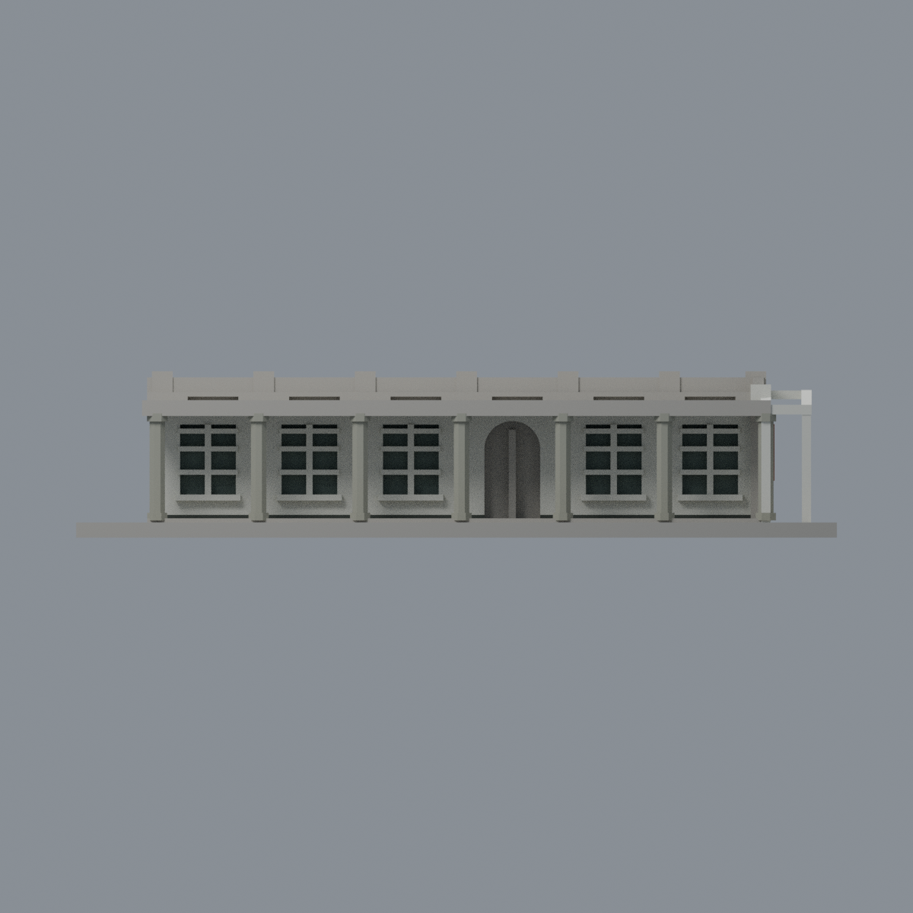
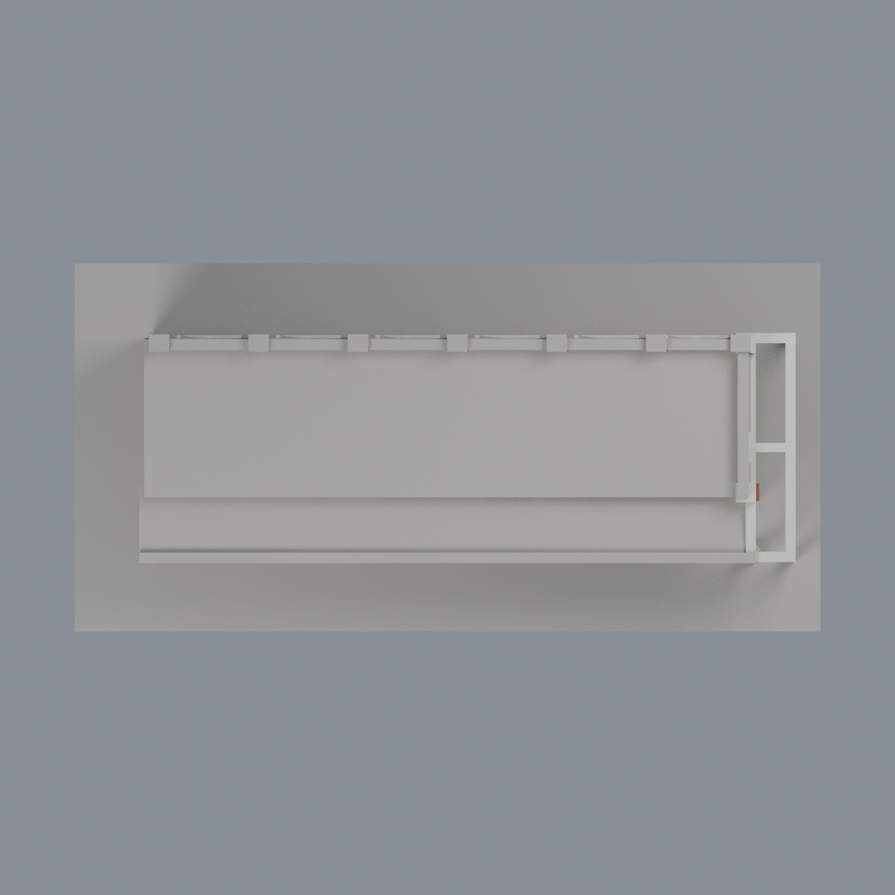

# 北科一大川堂南段修復外觀限定配色：六材質外觀版

沿用原 **5,034 三角面／2,329 頂點**，不改原 STL 位元、座標、面序或幾何；這是既有模型外觀改版，不增加模型包數。

| 正面 | 來源支持外長牆／未知頂面中性 |
|---|---|
|  |  |
|  |  |

[表面色 3MF](ntutyida-appearance.3mf) · [可編輯 Blender](scene.blend) · [材質色表](palette.json) · [逐面指派與依據](face-materials.json) · [原 STL](../model.stl)

## 來源與配色邊界

親看北科官方修復後廣角完整照片、官方《行穩致遠：北科八年承續與創新之路》實體 PDF 第 97 頁上半部柱廊近照、原單色網格與生成器。[精確來源／完整檔 SHA 與日期限制](qa/source-review.json)。廣角相片無拍攝 EXIF，官方報導為 2024-11-22；PDF 建立／修改於 2026-03-10，均不是近照攝影日。PDF 下方開幕活動照印有 2024-11-22，不能移作上方柱廊近照拍攝日。不宣稱 2026 現況。照片及 PDF 私有研究，不入公開包。

- 這是既有**南端六開間段**，不是完整 L 形一大川堂。廣角從南端支持 +Y 外長牆與南端；PDF 近照從南端沿 -Y 廊內望，支持八角柱、內退白牆及黑腳。不是一張照片推兩面。
- 既有牆面、框梃與南端鋼棚白色；修復後八角柱是灰色裸露石／混凝土外觀，不是白柱，也不採舊歷史照黃色。只原柱身／柱頭／柱腳可確定側面採灰，不畫斑駁紋理；鋼棚白柱與八角灰柱區分，斜梁依原剖面全頂點範圍定位。
- 原獨立窄踢腳前、外長與南端垂直面黑灰，不用整體低 z 塗黑。南端既有牌匾浮塊鏽紅棕，不加白字、校徽或宣稱實際鏽化材質。
- 窗凹底僅低飽和灰綠玻璃／簾影代理，原白框不改；弧門背混海報、門與室內保持中性，不畫內容。實景細窗格比模型密，保留既有粗化。
- 屋頂頂面未確認、廊簷立邊有上風化褐／下白而原未分界、北端截斷面及底板，全部保持中性。這不是把中性色說成實景還原；不補屋頂設備、草坪、遠翼或北向續段。
- 不改原三角面、STL、外形、歷史 QA；未做實體列印測試。

[原幾何與歷史來源限制](../README.md)

## 重建與核驗

安裝 [依賴](source/requirements.txt)，Blender 使用 4.3.2。由本資料夾上層提供原 model.stl：

1. `python appearance/source/build_appearance.py`
2. `python appearance/source/verify_exchange.py`
3. `blender -b -t 3 --python-exit-code 1 -P appearance/source/render_appearance.py`
4. `blender -b -t 3 --python-exit-code 1 -P appearance/source/verify_scene.py`

[獨立重建 ZIP](rebuild-source.zip)含原 STL、四支程式及依賴，不含第三方照片；不取代原建模腳本。[逐檔 SHA256](SHA256SUMS)

[交換／拓撲 QA](qa/exchange-validation.json)核對原座標與面序、全部面材質、單連通、有向水密邊、頂點 link 單環、正體積與零退化／重複面；lib3mf 嚴格讀取零警告，實際編輯單材質再存讀，其他材質及面指派不變。SDK 六位小數量化誤差另列。

[Blender 存讀與編輯](qa/scene-validation.json) · [渲染記錄](qa/render-manifest.json) · [獨立重建](qa/rebuild-validation.json)

## 製造限制照舊

尺寸仍為 150 × 74 × 32.8 mm；原 STL、建模程式、場景及歷史 QA 保留。原層檢與薄特徵檢查本次未重跑，不能由材質 QA 代替。

3MF 是同一網格的表面色，不是各材質各自封閉的分色實體、切片專案、噴頭映射或 G-code。切片 GUI、多材料路徑與實體列印未測；柱頭、屋簷、窗框及薄邊仍須評估材料、支撐及拆除風險，沒有保證可印或免支撐。
