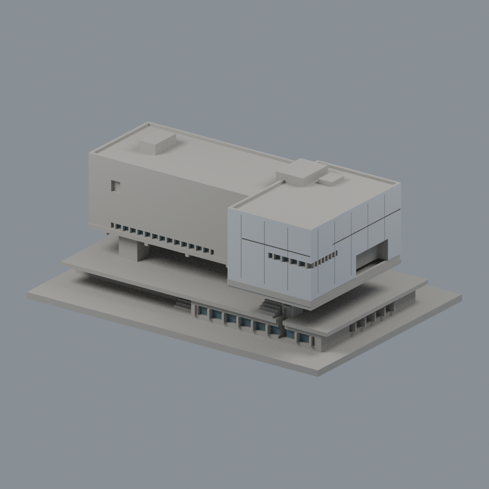

# 國立臺北藝術大學 TNUA

[關渡校本部](關渡校本部/README.md) · [逐項續接](remaining-building-work.zh-TW.md) · [機器可讀清單](remaining-building-work.json)

| 模型預覽 | 模型預覽 | 模型預覽 |
| :---: | :---: | :---: |
|  [科技藝術館（有限配色）](關渡校本部/buildings/tnua-art-technology/appearance/README.md) |  [關渡美術館入口暨曲牆屋頂段](關渡校本部/buildings/tnua-kuandu-museum-upper-section/) |  [教學大樓鐘樓段](關渡校本部/buildings/tnua-teaching-bell-tower-section/) |
|  [研究大樓下坡端量體段](關渡校本部/buildings/tnua-research-downhill-section/) |  [戲劇舞蹈教學大樓外角樓梯塔暨玻璃轉角段](關渡校本部/buildings/tnua-drama-dance-stair-corner-section/) |  [活動中心鼓樓段](關渡校本部/buildings/tnua-activity-drum-tower-section/) |

目前累計6件模型：1件主要外觀近似、5件局部段。**全校仍未完成，這不是6棟完整建築測繪。** 各件含底座最長150mm、獨立縮放，底座朝下。

- 科技藝術館：架空L形高差、偏置開口；屋頂機電與細網格簡化。
- 關渡美術館入口暨曲牆屋頂段：入口、三層曲牆／天窗；不含下坡樓層與研究大樓，背牆截斷。
- 教學大樓鐘樓段：通透鐘廊、三側孔、三窄窗、曲牆／雙坡頂；吊桿加粗，教學長翼裁短。
- 研究大樓下坡端量體段：頂六窄窗、下三列各六加二、磚座寬窄窗組；只含端部及左側前三組短翼，後方平簡。
- 戲劇舞蹈教學大樓外角樓梯塔暨玻璃轉角段：四孔群、兩側樓廊、L形玻璃；2016刊文歷史外觀，兩翼裁短，不含中庭，內梯及未知遮擋窗省略。
- 活動中心鼓樓段：外側2／3／1窗群、內側三窄窗、塔廊及曲牆；兩翼裁切，屋脊鰭件加厚，不加猜鼓，與對面鐘樓分開。

## 列印與可重跑驗證

每件含原創腳本、STL、由同件STL匯入的可編修Blend、actual STL正背／頂／立面PNG、來源、驗證腳本與SHA。鼓樓另附外側斜角，對照下坡端窗群。

原STL法向繞序、每邊兩面、頂點連結單環、單一正體積表面殼、最長150mm、獨立重建SHA與Blend幾何一致都需通過。0.2mm逐層自z=0.071mm檢查輪廓閉合及個別／合成Polygon有效；canonical fail-closed v3不修補無效輸入來掩蓋失敗。

科技館320層、關渡段280層、鐘樓段750層、研究端651層、戲舞段750層、鼓樓段750層。0.8mm參考寬度opening最大面積損失依序約0.1914%、0.3985%、0.5712%、0.3608%、0.4867%、0.8959%。此篩檢不是完整最小壁厚測量，也不等同實體試印或切片工具路徑驗證。懸挑、鐘吊桿、樓廊梁、屋簷與欄杆需要支撐評估；沒有保證免支撐。

## 校圖、去重與未完成範圍

已查看北藝大製作、芳苑國中公開轉載的[115學年度招生簡章校圖（PDF第27頁／印刷頁25）](https://fsjh.chc.edu.tw/storage/074521/posts/6091/files/1141004310-0-0.pdf)，並與[112年官方計畫配置圖（PDF第24頁）](https://ws-proj.moe.edu.tw/001/Upload/568/relfile/13271/12988/d95e8a4f-fa4e-4d65-9fd9-193872248e2e.pdf)相核。115圖是最新取得的學年度配置插畫，仍不是測繪／2026全面現況。[113招生校圖](https://admissionex.tnua.edu.tw/wp-content/uploads/2024/04/113_cac_map.pdf)只有文字可讀、圖像取用遇issuer certificate錯誤，未繞過。

[2024官方會議記錄](https://sec.tnua.edu.tw/wp-content/uploads/2024/10/113.10.01_%E6%9C%83%E8%AD%B0%E7%B4%80%E9%8C%84.pdf)確認原藝大會館2–4樓轉教學的動畫與新媒體大樓、2024年9月5日揭牌；也列圖書館外牆／屋頂與綜合宿舍修繕。這些更名、用途與修繕不等於新增多棟。圖書館尚缺修繕後側背證據，繼續暫緩全棟建模。

[2022官方會議記錄](https://sec.tnua.edu.tw/wp-content/uploads/2022/10/111.04.19.pdf)明寫文資書苑位於研究大樓4樓；[學生手冊](https://student.tnua.edu.tw/upload/files/guidance/TNUAhandbook.pdf)確認地下美術館位於圖書館。鐘樓歸教學大樓、鼓樓另在活動中心。地圖標籤、使用單位與OSM多邊形均不能直接當作獨立棟數。

逐項續接擴至38個研究條目，包含早期26個名稱、補查設施與校外合作場地；新增北藝風創意貨櫃屋及校門舊污水廠空間待查，仍不是38棟。實體建築分母未確定，不能計算全校完成率。華山、C-LAB、國際藝術村與剝皮寮等合作學堂仍待核現行教室／使用範圍，不另宣稱新校區。

原照片／PDF與私人研究對照圖不在公開包內；sources.json只保留可回查URL、年代、支持特徵與限制。

## 後續工程與排除未建案

[2025-08總務處報告](https://ga.tnua.edu.tw/wp-content/uploads/2025/08/總務處工作會報營繕組.pdf)記圖書館第一階段8/13複驗通過、第二階段當時報竣待驗；[2025-04報告](https://ga.tnua.edu.tw/wp-content/uploads/2025/04/總務會議議程_附件1-113學年第2學期.pdf)記宿舍分區拆架／查驗。仍需修繕後外觀，不能將舊照當全面現況。

[2025-05完成回報](https://sec.tnua.edu.tw/wp-content/uploads/2025/05/主管會報會議紀錄20250512通過.pdf)支持貨櫃屋2025有展演使用；現形與精確基礎待查，一組建築不可按貨櫃模組數加棟。[2022-10紀錄](https://sec.tnua.edu.tw/wp-content/uploads/2022/12/1111025_會議紀錄.pdf)只證校門舊污水廠已整修、將交電影系，不能說已點交啟用，與崗亭共構關係仍未知。

同份2022紀錄已說新佈景工廠計畫終止；[2025清理款項](https://sec.tnua.edu.tw/wp-content/uploads/2025/05/1140506_會議紀錄.pdf)不是竣工。既有展演中心工廠仍另有功能空間，不因此追加兩棟。[藝術圓夢中心BOT](https://sec.tnua.edu.tw/wp-content/uploads/2023/05/主管會報會議紀錄20230501核可.pdf)在2023決定不續辦，後續延的是結案，不增建成數。
