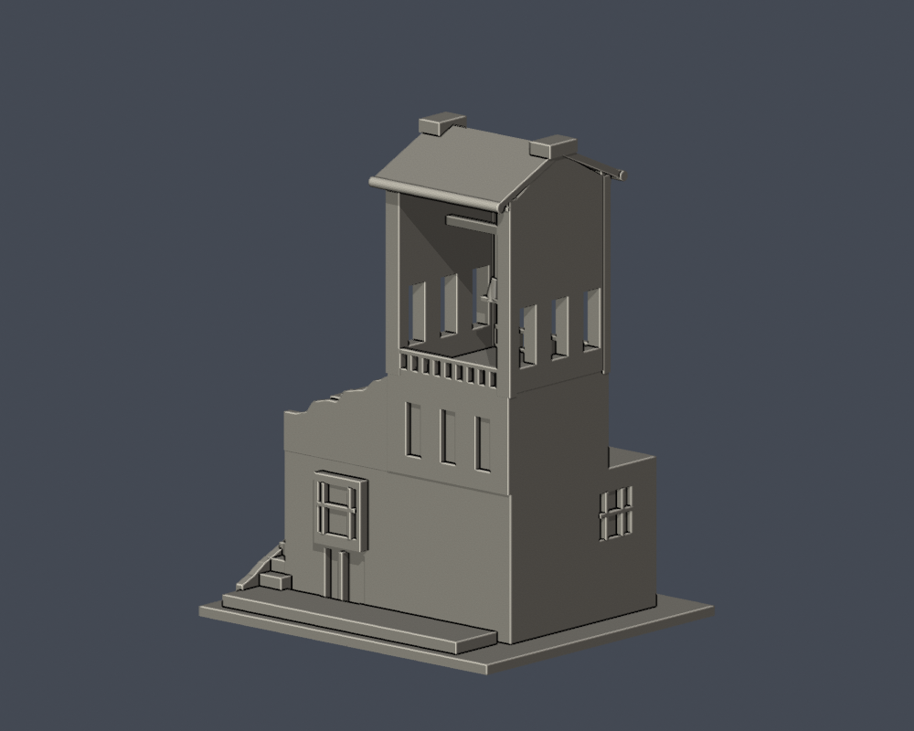
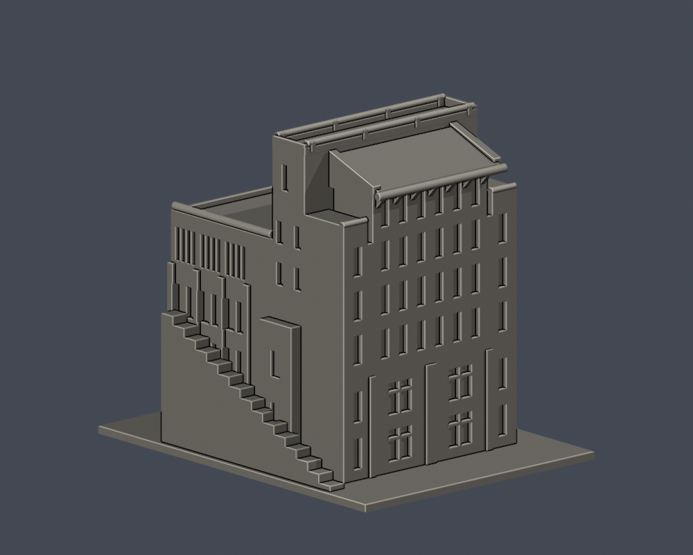
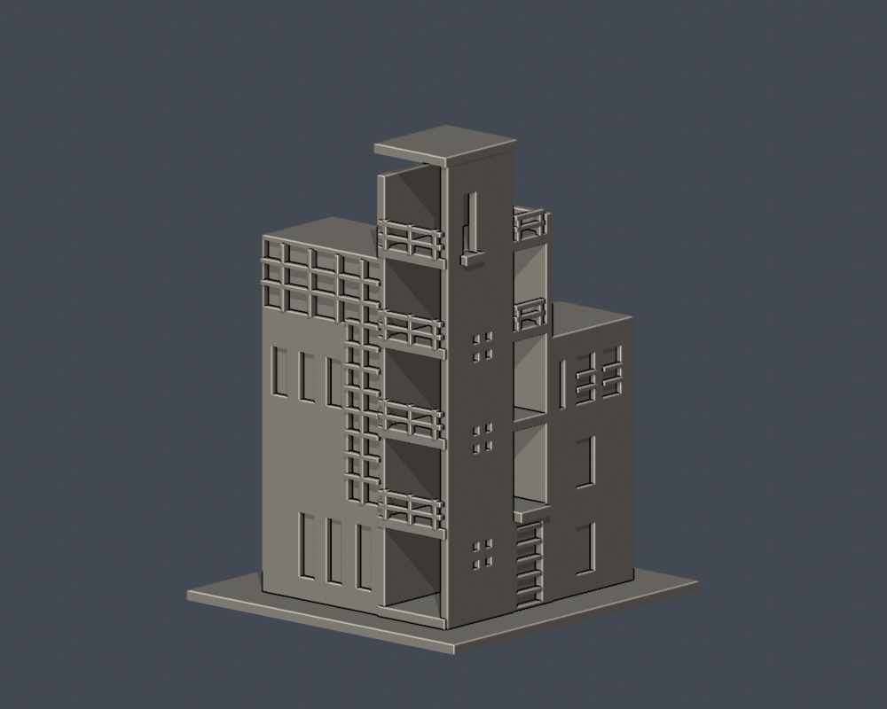
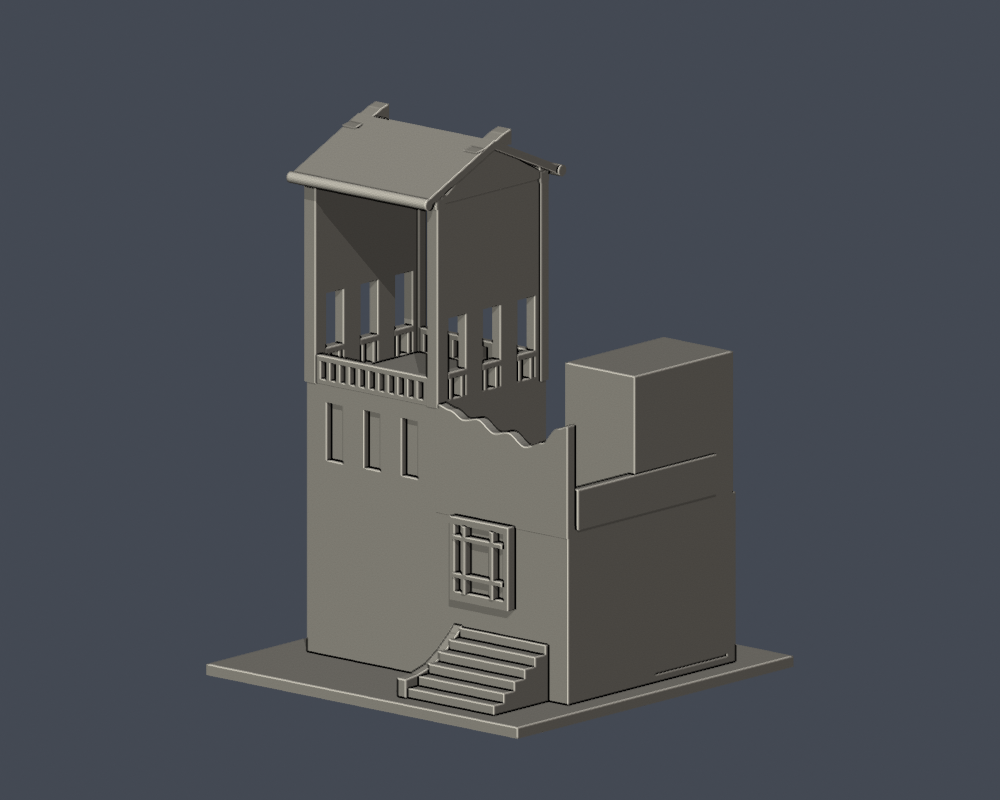

# 國立臺北藝術大學｜關渡校本部

[學校入口](../README.md) · [未完成逐項清單](../remaining-building-work.zh-TW.md)

<table><tr><td width="33%"> <a href="buildings/tnua-art-technology/">科技藝術館</a></td><td width="33%"> <a href="buildings/tnua-kuandu-museum-upper-section/">關渡美術館入口暨曲牆屋頂段</a></td><td width="33%"> <a href="buildings/tnua-teaching-bell-tower-section/">教學大樓鐘樓段</a></td></tr><tr><td width="33%"> <a href="buildings/tnua-research-downhill-section/">研究大樓下坡端量體段</a></td><td width="33%"> <a href="buildings/tnua-drama-dance-stair-corner-section/">戲劇舞蹈教學大樓外角樓梯塔暨玻璃轉角段</a></td><td width="33%"> <a href="buildings/tnua-activity-drum-tower-section/">活動中心鼓樓段</a></td></tr></table>

目前累計6件模型：1件主要外觀近似、5件局部段。**全校仍未完成，這不是6棟完整建築測繪。** 各件含底座最長150mm、獨立縮放，底座朝下。

- 科技藝術館：架空L形高差、偏置開口；屋頂機電與細網格簡化。
- 關渡美術館入口暨曲牆屋頂段：入口、三層曲牆／天窗；不含下坡樓層與研究大樓，背牆截斷。
- 教學大樓鐘樓段：通透鐘廊、三側孔、三窄窗、曲牆／雙坡頂；吊桿加粗，教學長翼裁短。
- 研究大樓下坡端量體段：頂六窄窗、下三列各六加二、磚座寬窄窗組；只含端部及左側前三組短翼，後方平簡。
- 戲劇舞蹈教學大樓外角樓梯塔暨玻璃轉角段：四孔群、兩側樓廊、L形玻璃；2016刊文歷史外觀，兩翼裁短，不含中庭，內梯及未知遮擋窗省略。
- 活動中心鼓樓段：外側2／3／1窗群、內側三窄窗、塔廊及曲牆；兩翼裁切，屋脊鰭件加厚，不加猜鼓，與對面鐘樓分開。

## 列印與可重跑驗證

每件含原創腳本、STL、由同件STL匯入的可編修Blend、actual STL正背／頂／立面PNG、來源、驗證腳本與SHA。鼓樓另附外側斜角，對照下坡端窗群。

原STL法向繞序、每邊兩面、頂點連結單環、單一正體積表面殼、最長150mm、獨立重建SHA與Blend幾何一致都需通過。0.2mm逐層自z=0.071mm檢查輪廓閉合及個別／合成Polygon有效；canonical fail-closed v3不修補無效輸入來掩蓋失敗。

科技館320層、關渡段280層、鐘樓段750層、研究端651層、戲舞段750層、鼓樓段750層。0.8mm參考寬度opening最大面積損失依序約0.1914%、0.3985%、0.5712%、0.3608%、0.4867%、0.8959%。此篩檢不是完整最小壁厚測量，也不等同實體試印或切片工具路徑驗證。懸挑、鐘吊桿、樓廊梁、屋簷與欄杆需要支撐評估；沒有保證免支撐。

[校圖、去重、工程與範圍限制](../README.md#校圖去重與未完成範圍)
