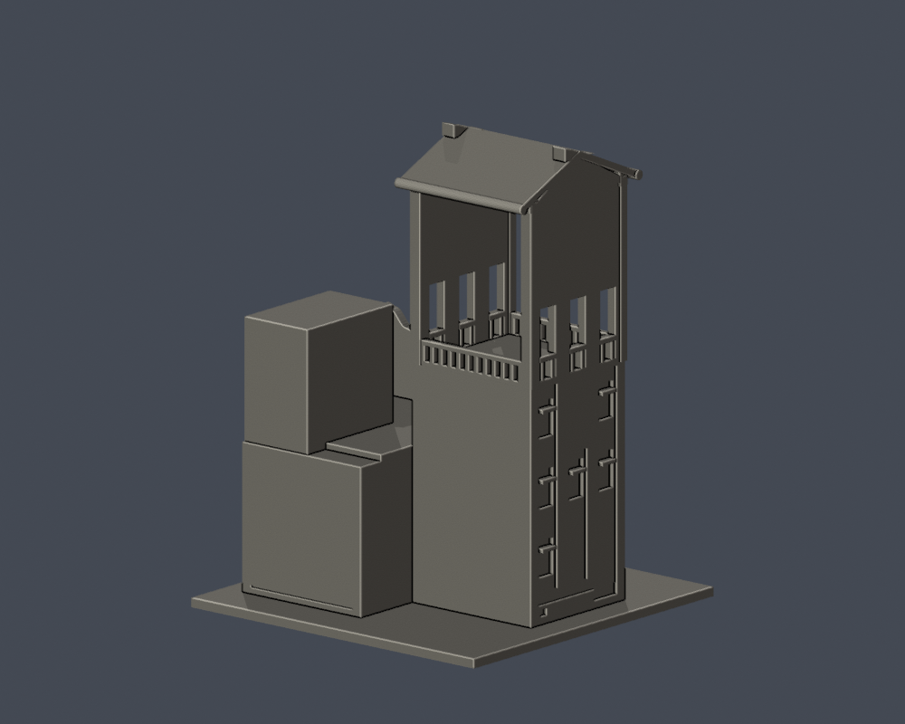
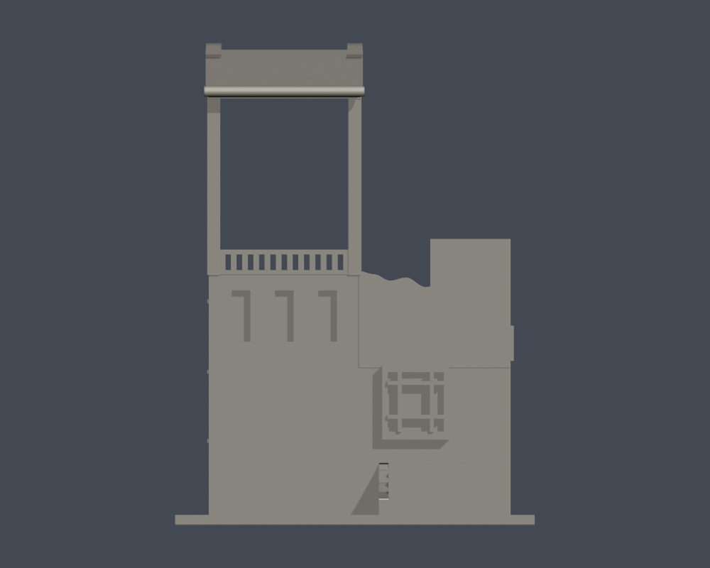
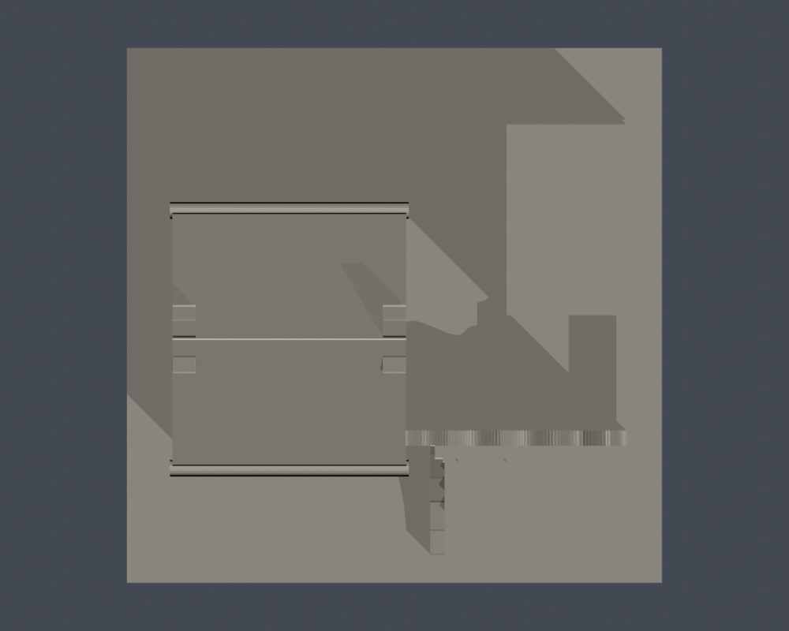
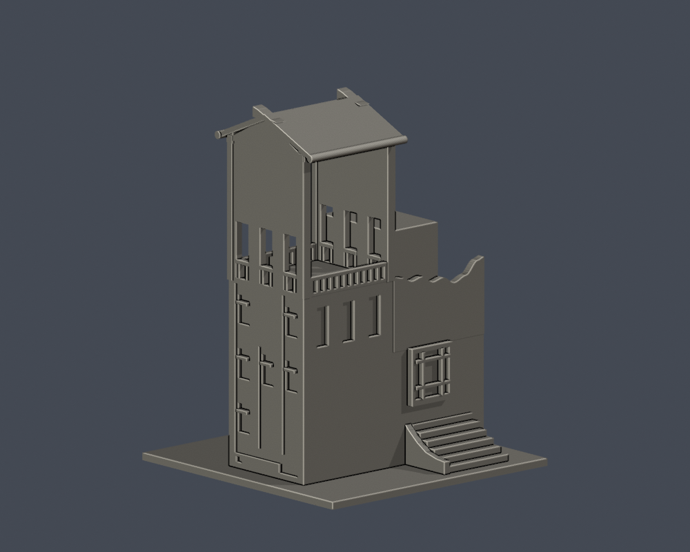

# 活動中心鼓樓段

國立臺北藝術大學｜關渡校本部｜自建外觀近似模型

> **局部段，不是全棟。** 鼓樓塔體、下坡端三層窗帶、附近低翼、曲牆與短階梯；活動中心長翼、完整水舞臺／荷池、全部室內與廣場皆未建。

| 模型預覽 | 模型預覽 | 模型預覽 |
| :---: | :---: | :---: |
|  |  |  |

[正立面](previews/elevation.png) · [頂面](previews/top.png) · [外側窗帶對照角](previews/outer.png)

| 模型預覽 | 模型預覽 | 模型預覽 |
| :---: | :---: | :---: |
| 正立面  | 頂面  | 外側窗帶對照角  |

## 下載與列印

- [STL](model.stl) · [可編修Blend](scene.blend) · [生成腳本](build_model.py) · [實際STL渲染腳本](render_preview.py) · [固定版本依賴](requirements.txt)
- 含底座外廓：112.0 × 112.0 × 150.0 mm；最長150mm，各件獨立縮放。毫米匯入，底座朝下。
- [逐檔SHA](SHA256SUMS) · [來源](sources.json)

通透樓廊的高跨梁、兩坡簷口、屋脊鰭件、窄窗與欄杆上部須檢查支撐；靠近窄孔移除支撐時避免折斷加粗欄柱。

先在自己的切片器以0.4mm噴嘴／0.2mm層高檢視，再按材料和機器調整支撐、牆數與填充。尚未實體試印或Cura／PrusaSlicer工具路徑驗證，沒有保證免支撐。

## 保留特徵與未知範圍

- 外側窗群依2024實拍，上列2窗、中列3窗、下列1窗，並保留縱向灰帶與底部U形連接；不做三乘三通用窗陣。
- 內院面保留3個窄窗，鄰窗為窄／寬／窄三分、短／高／短三行。上部是開放塔廊，側牆有3個主開口。
- 相鄰女兒牆保留起伏曲線，兩坡屋頂和小山牆鰭狀件自建近似；瓦片、磚縫、冷氣與管線略。
- 屋脊鰭件因薄特徵篩檢加粗為4.8mm，欄杆及簷口亦有列印尺度調整。沒有已可辨認的鼓內部形狀，未加猜鼓。
- 短階梯與側擋牆簡化步數，底座不是全坡地；連往活動中心的背部與兩裁切面平簡，不稱全棟。

## 重建與fail-closed QA

Python3.12依requirements.txt準備環境後執行build_model.py；以Blender4.3.2或相容版本執行render_preview.py，最後執行run_all_checks.py。請先複製凍結資料夾到可寫工作目錄。

- [原STL／重建／Blend驗證](validation.json)：原法向繞序、每邊兩面、頂點連結單環、單一正體積表面殼、最大150mm、獨立重建SHA及Blend幾何一致。
- [0.2mm逐層閉合](layer-check.json)與[個別／合成Polygon有效](contour-validity-check.json)：750層，起點z=0.071mm。
- [canonical fail-closed v3薄特徵](thin-feature-check.json)：0.8mm參考寬、150層，最大opening面積損失0.8959%。不是全面最小壁厚測量。
- [綜合QA](qa-summary.json)：所有硬檢查true；遇無效輪廓非零退出，沒有以修補Polygon遮掩失敗。

## 可回查證據

- [北藝大115學年度舞蹈學系七年一貫制招生簡章，附件校圖（PDF第27頁／印刷頁25）](https://fsjh.chc.edu.tw/storage/074521/posts/6091/files/1141004310-0-0.pdf)：北藝大製作、芳苑國中公開轉載的正式招生文件。已查看圖像：館舍相對位置、鐘樓／教學大樓、研究大樓與文資書苑標籤。 插畫非測繪平面；最新取得的學年度資料，不等同確認2026全校外觀未變。
- [112年氣候友善校園計畫配置圖（PDF第24頁）](https://ws-proj.moe.edu.tw/001/Upload/568/relfile/13271/12988/d95e8a4f-fa4e-4d65-9fd9-193872248e2e.pdf)：官方早期配置圖，核位置和別名。 插畫非測量平面。
- [113學年度招生校圖](https://admissionex.tnua.edu.tw/wp-content/uploads/2024/04/113_cac_map.pdf)：承接26項研究名稱。 本次只有文字索引可讀；圖像取用502／issuer certificate錯誤，未繞過，未用作形狀證據。
- [Jeff & Jill：台北藝術大學走春（鼓樓斜面）](https://blog.udn.com/jefnjil/112277513)：原文指此側為鼓樓、對面是鐘樓。已看實拍：內側三窄窗、通透塔廊、三側孔、曲牆、階梯、鄰窗窄寬窄／短高短分格。 不能拿來當鐘樓背面；只保留附近量體，活動中心全體界線未證。
- [Yu tptw：TNUA administration buildings and Arts forum 20240324](https://commons.wikimedia.org/wiki/File:TNUA_administration_buildings_and_Arts_forum_20240324.jpg)：人文廣場前景左側為本次鼓樓。支持下坡端上2／中3／下1窗組、灰色U形窗帶與兩個低位通氣口。 檔名的行政建物是背景；不把前景雙塔與背景合成一棟。右側是鐘可見的鐘樓，不在此模型。
- [TNUA administrative building 20100123](https://commons.wikimedia.org/wiki/File:TNUA_administrative_building_20100123.jpg)：較早廣場斜面可核鼓樓位於左、鐘樓位於右，以及下坡端窗帶的大致形態。 歷史旁證，不據此聲稱2010–2026所有細部未變；原照片不散布。
- [北藝大圖書館校史發展組：北藝大鐘樓](https://openmuseum.tw/muse/digi_object/297876b35514c00d2ecdb225ce847e0b)：校方說明李祖原取暮鼓晨鐘意涵設兩塔，鐘樓後於2006有捐贈大鐘。 只作雙塔區別的文字證據；沒有據名稱捏造鼓樓內部鼓。

原照片、PDF及私人對照圖未隨公開包散布；未使用第三方3D網格。

## 導覽

[關渡校本部](../../README.md) · [國立臺北藝術大學](../../../README.md)

此包凍結後不覆寫；重建或重跑驗證請先複製至可寫目錄。
