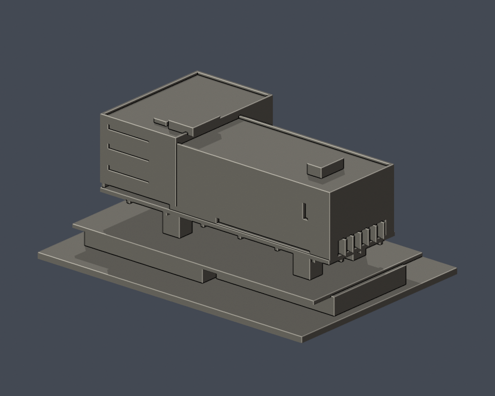

# 科技藝術館

國立臺北藝術大學｜關渡校本部｜150 mm 自建外觀近似模型

> 主要外觀近似；包含架空主館與局部低層平台，不含相鄰體泳館、室內及完整地形。

<table><tr><td></td><td></td></tr><tr><td>正面</td><td>背面</td></tr></table>

[頂面](previews/top.png) · [正立面](previews/elevation.png)

## 下載與單位

- [可列印網格 model.stl](model.stl)
- [可編修 Blender scene.blend](scene.blend)：由這一件交付 STL 匯入的三角網格；單位設定為毫米。
- [參數生成腳本](build_model.py) · [固定依賴版本](requirements.txt) · [來源](sources.json)
- 外廓（含底座）：150 × 104 × 64 mm。最長150 mm，各件獨立縮放，不可當作校園統一比例。
- 底座平面朝下；先以0.4 mm噴嘴／0.2 mm層高在自己的切片器檢視，這不是已生成的工具路徑。

## 外觀依據與簡化

- 以L形平面保留黑盒子、灰盒子高差，四個主要核心架空支承與下方大挑空。
- 短向偏置窄窗帶和另一側低位深凹，長向僅一個高方窗及低水平帶，不套用方窗陣列。
- 屋頂設備只保留公開圖面可確認的大體量；其餘機電、金屬擴張網小孔、欄杆細格及真實材料不重製。
- 地下層、地形落差和退台進深按公開圖面／實拍相對比例簡化；不是固定建築比例尺或測繪成果。

## 列印注意

四核心上方的大跨距懸挑、底面樑格及階梯需要仔細規劃可移除支撐；須在實際切片器檢查支撐可達性。不要直接當作免支撐件。

數位幾何檢查不等於實體試印或 Cura／PrusaSlicer 工具路徑驗證，不能保證所有機器可直接列印。請自行選擇材料、支撐、牆數與填充。模型是單一連通實體，並非拆件組裝。

## 重建與驗證

Python 3.12，先依 requirements.txt 安裝依賴，再執行 build_model.py；用 Blender 4.3.2 或相容版本執行 render_preview.py。最後執行 run_all_checks.py（先把凍結套件複製到可寫工作目錄）。它會在任一驗證失敗時非零退出；不修補 STL 或不合法截面。

- [原始 STL／繞序／單殼／vertex-link／重建 SHA／Blend 一致](validation.json)
- [0.2 mm 逐層閉合](layer-check.json)
- [個別與合成 Polygon 逐層有效性](contour-validity-check.json)
- [canonical fail-closed v3 薄特徵篩檢](thin-feature-check.json)
- [綜合檢查](qa-summary.json) · [逐檔 SHA256](SHA256SUMS)

截層從 z=0.071 mm 開始避免共面退化。0.8 mm 形態 opening 僅輔助判斷狹窄特徵，不是完整最小壁厚測量。

## 來源與年代

- [北藝大112年氣候友善校園計畫申請書，附件三校區配置圖（第24頁）](https://ws-proj.moe.edu.tw/001/Upload/568/relfile/13271/12988/d95e8a4f-fa4e-4d65-9fd9-193872248e2e.pdf)。官方校本部位置、科技藝術館與體泳館相鄰、關渡美術館及圖書館／研究大樓分列；插畫僅核名稱與相對位置。 插畫不是平面測繪；不是2026更新版。
- [113學年度招生校園地圖](https://admissionex.tnua.edu.tw/wp-content/uploads/2024/04/113_cac_map.pdf)。web文字可讀的官方名稱索引；早期26筆研究列承接來源。 直接下載及雲端瀏覽器均遇502／issuer certificate錯誤，未繞過。未取得本次可檢視圖像，也未證實為最新校圖。
- [臺北藝術大學科技藝術館，大尺建築＋郭旭原聯合建築師事務所設計者專文](https://ta-mag.net/ta/News.php?id=1969)。四巨型支承、架空黑盒子／灰盒子、基地位置與2018–2021施工期間。 文字可讀；不是現況測繪。
- [科技藝術館設計團隊作品資料／圖面與完工實拍](https://forgemind.net/media/台北藝術大學科技藝術館-大尺建築-郭旭原聯合建築/)。三、四、五樓與屋頂L形平面、四向立面、兩剖面、四支承位置、大挑空、開口與平台關係。 圖面為公開發表的設計資料，縮圖可量比例但未讀到精確尺寸；局部有文字排版錯誤，不引用面積數值。
- [專訪郭旭原與黃惠美：科技藝術館；攝影牧童](https://www.wowlavie.com/article/ae2200074)。完成建築東南高視角、短向正面、地面四核心、外部階梯與網皮細節；以實拍覆核公開圖面。 刊登日期不當作實際攝影日期。屋頂完整設備未全數辨識；材質網眼不具150mm列印尺度。
- [北藝大開放博物館：科技藝術館](https://tnua.openmuseum.tw/muse/digi_object/f1e437bcc54919de3a618074d719b189)。校方確認館名、設計者與2021年建築體竣工。 不據此推定2026所有局部均未改變。
- [北藝大2025第二屆新媒卓越獎活動資料](https://w3.tnua.edu.tw/events/list/page/9/?tribe-bar-date=2025-03-29)。官方記載科技藝術館1F Studio 1,2及2F戶外劇場持續使用；研究大樓大黑盒為另一地點。 使用證據不等同2026現況立面照片。

原照片、原PDF與對照工作圖不隨公開包再散布；來源檔只列可回查URL與支持範圍。這是自行建立的外觀近似，未下載他人的3D模型。

## 導覽

[關渡校本部](../../README.md) · [國立臺北藝術大學](../../../README.md)
