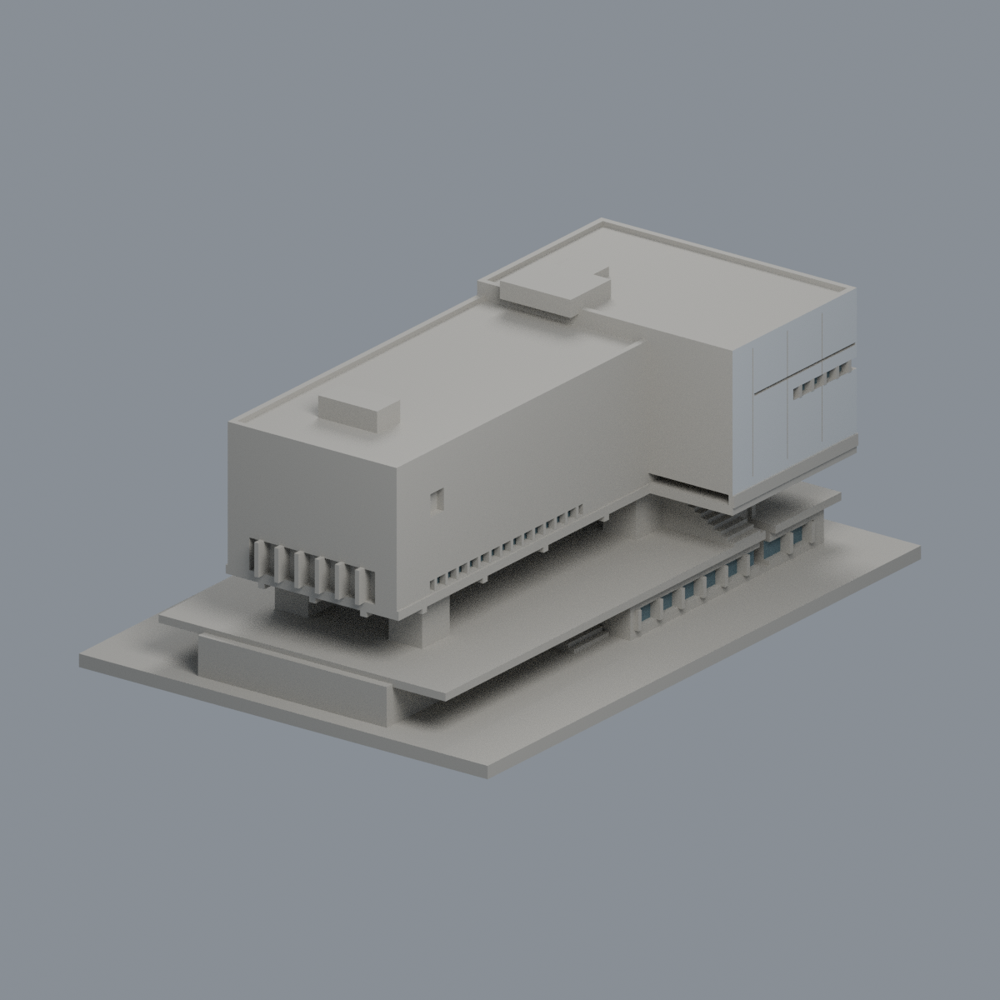
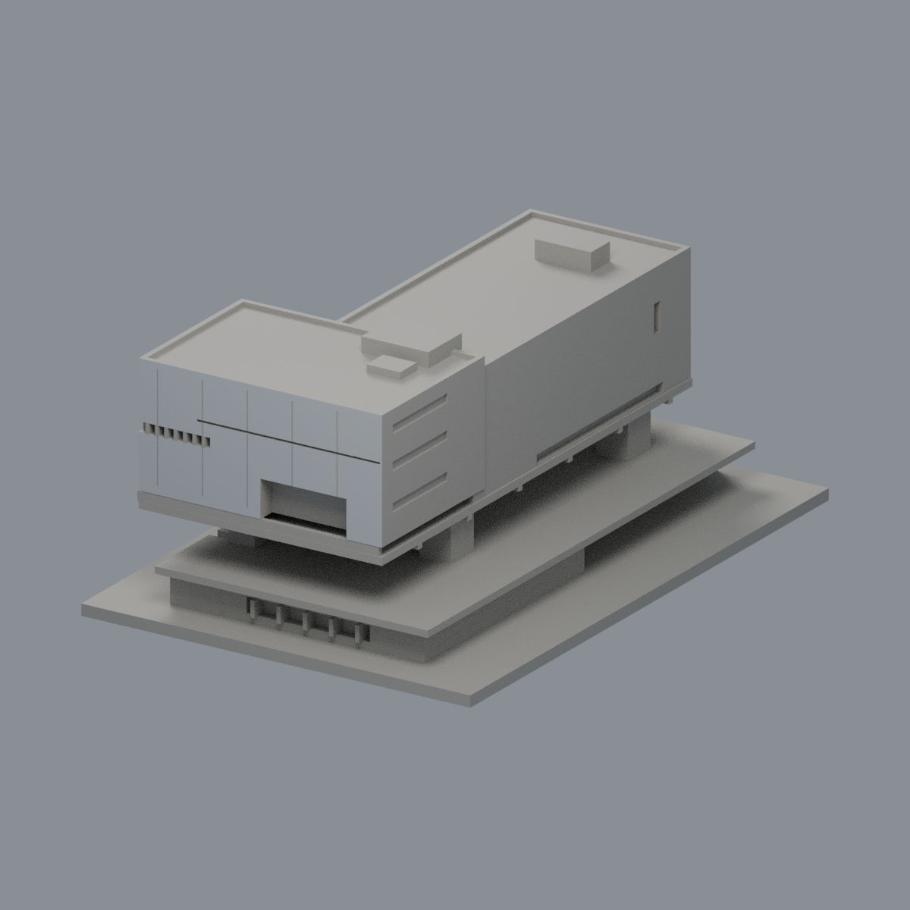
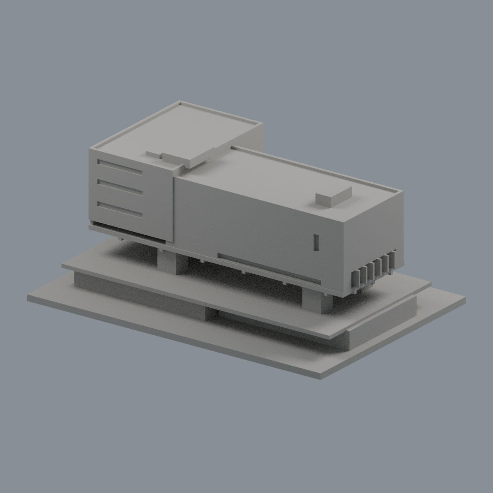
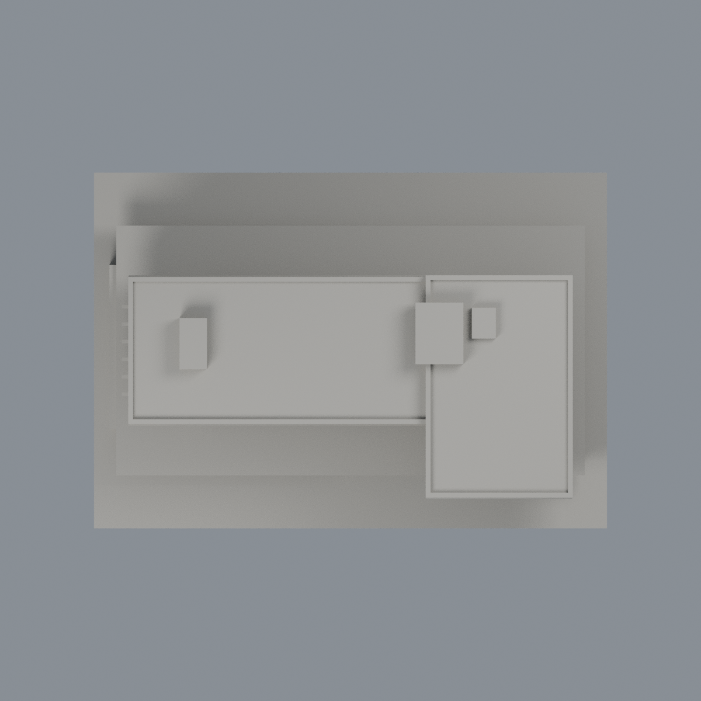

# 北藝大科技藝術館：限域外觀層

這是既有模型的局部材質改善，不新增模型套數、不修改原幾何；不是全館全彩復原，也不是2026現況調查。

- [三材質3MF](tnua-art-technology-appearance.3mf) · [可編輯Blender](scene.blend) · [材質表](palette.json) · [逐面對照](face-materials.json)
- [正面](previews/front.png) · [左面](previews/left.png) · [右面](previews/right.png) · [背面](previews/rear.png) · [頂面](previews/top.png)
- [來源與年代](SOURCES.md) · [授權說明](LICENSE-NOTICE.md) · [重建原始碼包](rebuild-source.zip)

| 模型預覽 | 模型預覽 | 模型預覽 |
| :---: | :---: | :---: |
| 正面  | 左面  | 右面  |
| 背面  | 頂面  |  |

3292個原三角面保持原座標與面序；只有46面可定位的窄窗背採低彩度灰藍，196面直接可見的-Y/+X外皮採不透明淺銀灰代理材質，3050面維持中性。兩組均逐面驗證全部三點落在有限平面範圍且實際叉積法向正確，不以中心點選取、不切面、不增加玻璃。

金屬擴張網不是玻璃：原模型實心外皮只以不透明銀灰代理，不宣稱真實孔隙。黑盒是劇場功能名，不塗黑。大凹口、露臺、簷底、側緣、窗框、屋頂設備、背側未知窗面保持中性，不能以陰影推導材質，也不將正面窗帶鏡像到背面。鄰接泳池、室內與完整地形仍不在既有範圍；設備保持原粗略表示。

顏色不是照片校色所得的精準RGB；沒有物理列印驗證。保留原製造QA，不冒稱本輪重算歷史檢核。正面收益主要在窄窗與銀灰外皮，其他視角改善有限。

## 重建
在appearance上層保留原model.stl，安裝source/requirements.txt；執行`python source/build_appearance.py`、`python source/verify_exchange.py`，再用Blender執行`source/render_appearance.py`及`source/verify_scene.py`。五圖以固定Cycles CPU/種子生成；PNG移除時間metadata，3MF/map/palette與五圖需獨立重建bytes相同，Blend比較語義而非二進位一致。
