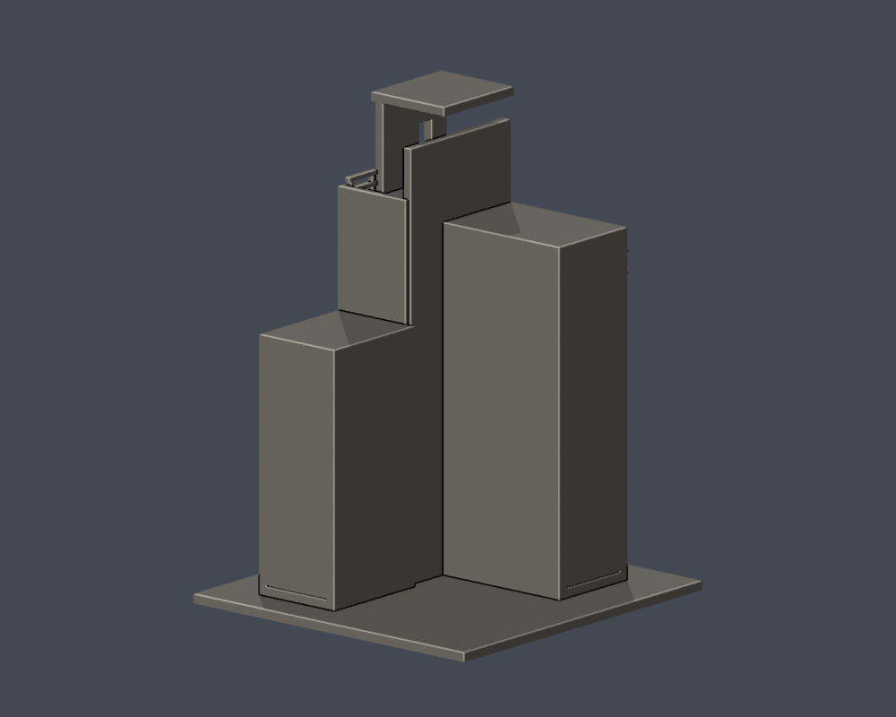

# 戲劇舞蹈教學大樓外角樓梯塔暨玻璃轉角段

國立臺北藝術大學｜關渡校本部｜自建外觀近似模型

> **局部段，不是全棟。** 只含外角高塔、L形玻璃角與兩翼近角短段；長磚翼、灰翼、完整中庭、後面教室及全部屋頂均未重建。

<table><tr><td width="50%"></td><td width="50%"></td></tr></table>

[正立面](previews/elevation.png) · [頂面](previews/top.png)

## 下載與列印

- [STL](model.stl) · [可編修Blend](scene.blend) · [生成腳本](build_model.py) · [實際STL渲染腳本](render_preview.py) · [固定版本依賴](requirements.txt)
- 含底座外廓：108.0 × 112.0 × 150.0 mm；最長150mm，各件獨立縮放。毫米匯入，底座朝下。
- [逐檔SHA](SHA256SUMS) · [來源](sources.json)

塔廊樓板、頂蓋、加粗欄杆、窄槽窗頂與小挑板需要支撐評估。細欄柱至少約1.5mm；支撐移除不要扭曲樓廊。

先在自己的切片器以0.4mm噴嘴／0.2mm層高檢視，再按材料和機器調整支撐、牆數與填充。尚未實體試印或Cura／PrusaSlicer工具路徑驗證，沒有保證免支撐。

## 保留特徵與未知範圍

- 歷史外觀依2016刊文實拍及市府公共藝術照片；不是2026現況測繪。公共藝術2014是作品年，不當作照片年。
- 三組四孔、頂部窄槽與挑出窗臺、左右通透樓廊、較低灰翼和較高磚翼均保留。L形玻璃直列11段；細格與欄杆有加粗／簡化。
- 只納水平玻璃帶下3窗、近角低位3窗，以及灰翼近角2寬加1窄上開口；更遠上列12寬加1窄、磚翼17／20窗已研究，但沒有整列加入此局部模型。
- 樹遮的中低窗列沒有套用規則陣列。內梯路徑未明，完全省略內梯；樓廊不能拿來判定真實樓梯構造。
- 兩翼背面與裁切端為平簡實牆。進深、階高與壁厚僅視覺近似；未把公共藝術中庭照片硬拼成未證平面。

## 重建與fail-closed QA

Python3.12依requirements.txt準備環境後執行build_model.py；以Blender4.3.2或相容版本執行render_preview.py，最後執行run_all_checks.py。請先複製凍結資料夾到可寫工作目錄。

- [原STL／重建／Blend驗證](validation.json)：原法向繞序、每邊兩面、頂點連結單環、單一正體積表面殼、最大150mm、獨立重建SHA及Blend幾何一致。
- [0.2mm逐層閉合](layer-check.json)與[個別／合成Polygon有效](contour-validity-check.json)：750層，起點z=0.071mm。
- [canonical fail-closed v3薄特徵](thin-feature-check.json)：0.8mm參考寬、150層，最大opening面積損失0.4867%。不是全面最小壁厚測量。
- [綜合QA](qa-summary.json)：所有硬檢查true；遇無效輪廓非零退出，沒有以修補Polygon遮掩失敗。

## 可回查證據

- [北藝大115學年度舞蹈學系七年一貫制招生簡章，附件校圖（PDF第27頁／印刷頁25）](https://fsjh.chc.edu.tw/storage/074521/posts/6091/files/1141004310-0-0.pdf)：北藝大製作、芳苑國中公開轉載的正式招生文件。已查看圖像：館舍相對位置、鐘樓／教學大樓、研究大樓與文資書苑標籤。 插畫非測繪平面；最新取得的學年度資料，不等同確認2026全校外觀未變。
- [112年氣候友善校園計畫配置圖（PDF第24頁）](https://ws-proj.moe.edu.tw/001/Upload/568/relfile/13271/12988/d95e8a4f-fa4e-4d65-9fd9-193872248e2e.pdf)：官方早期配置圖，核位置和別名。 插畫非測量平面。
- [113學年度招生校圖](https://admissionex.tnua.edu.tw/wp-content/uploads/2024/04/113_cac_map.pdf)：承接26項研究名稱。 本次只有文字索引可讀；圖像取用502／issuer certificate錯誤，未繞過，未用作形狀證據。
- [原攝影者：國立臺北藝術大學校園遊記](https://s1323015.blogspot.com/2016/02/blog-post_29.html)：兩張已視讀實拍支持高塔、兩側開放樓廊、三組四孔、頂部窄槽窗與L形玻璃角。以該歷史外觀建模。 同一行程兩張近角照片，不是四向測繪；底層樹遮處不補猜窗，無完整院落或背面。
- [臺北市公共藝術：場景 Scene](https://publicart.taipei/Works_detail.aspx?id=780)：兩張完整公開照片，第二角度可核高塔、門前小挑板與低灰翼的寬窄上列開口。 原始影像只有480px寬；作品年代與2017影像檔名均不等於攝影日。只納模型範圍清楚的近角，不把兩翼全部補出。
- [臺北市公共藝術：劇場‧聚場 Gathering Place](https://publicart.taipei/Works_detail.aspx?id=779)：三張完整院落照片已看，證明內院有突出平台、多層橋廊與外階。 不足定位全部翼向／院落尺寸。因此本件完全不建中庭，不把有院落照片升級成全棟平面。
- [梅城建築師事務所：建築作品](https://meichengarchitect.com/architecture)：公開設計者中庭實拍證明本樓院落及左右橋廊。 只作排除實心整棟方盒的證據；本件不含院落幾何。

原照片、PDF及私人對照圖未隨公開包散布；未使用第三方3D網格。

## 導覽

[關渡校本部](../../README.md) · [國立臺北藝術大學](../../../README.md)

此包凍結後不覆寫；重建或重跑驗證請先複製至可寫目錄。
