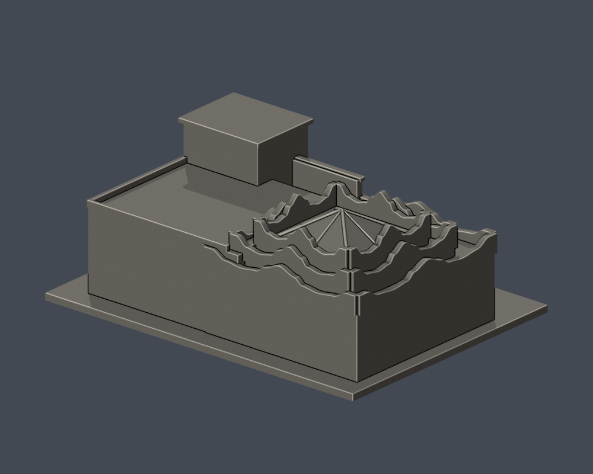
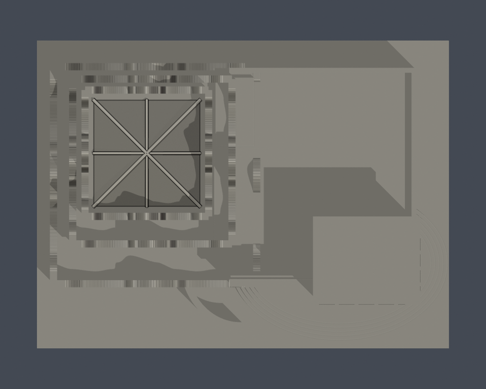
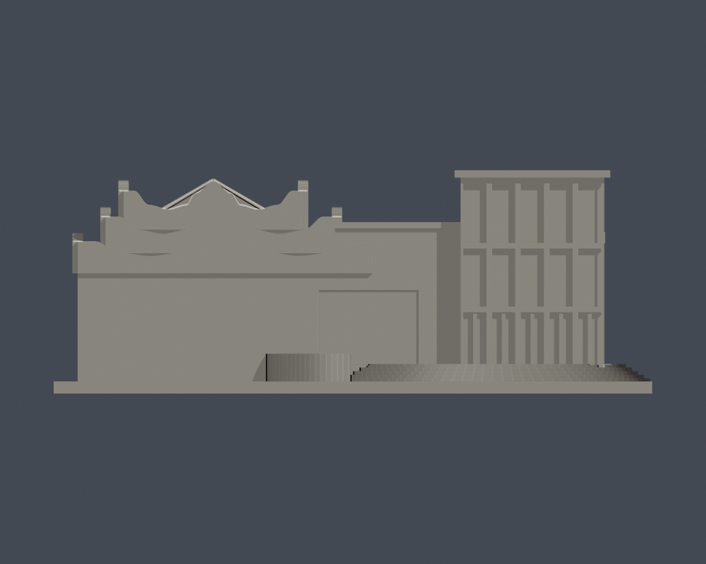

# 關渡美術館入口暨曲牆屋頂段

國立臺北藝術大學｜關渡校本部｜150 mm 自建外觀近似模型

> 局部：四樓入口層可見玻璃盒、階梯與層疊曲牆屋頂；不含下坡低樓層、不含相連／相鄰研究大樓，不代表完整美術館。

| 模型預覽 | 模型預覽 | 模型預覽 |
| :---: | :---: | :---: |
|  正面 |  背面 |  |

[頂面](previews/top.png) · [正立面](previews/elevation.png)

| 模型預覽 | 模型預覽 | 模型預覽 |
| :---: | :---: | :---: |
| 頂面  | 正立面  |  |

## 下載與單位

- [可列印網格 model.stl](model.stl)
- [可編修 Blender scene.blend](scene.blend)：由這一件交付 STL 匯入的三角網格；單位設定為毫米。
- [參數生成腳本](build_model.py) · [固定依賴版本](requirements.txt) · [來源](sources.json)
- 外廓（含底座）：150 × 112 × 56 mm。最長150 mm，各件獨立縮放，不可當作校園統一比例。
- 底座平面朝下；先以0.4 mm噴嘴／0.2 mm層高在自己的切片器檢視，這不是已生成的工具路徑。

## 外觀依據與簡化

- 正面5個主要玻璃跨、側面5個主要玻璃跨，底層門片與上方兩列高玻璃保留高寬分組；實心淺凹模擬玻璃。
- 保留三層曲牆退縮、金字塔天窗與相鄰平屋頂；曲線以照片重建，沒有精密曲率尺寸。
- 背面與兩侧底部是截段用的簡化實心牆，不能當作背立面測繪。入口所在四樓以下的下坡樓層完全未建。
- 臨時展覽布條、招牌文字、獨立藝術作品及屋頂水箱／細小管線未納入。天窗細骨架作可列印加粗。

## 列印注意

玻璃框架、薄曲牆與階梯宜放慢速度；天窗邊條及挑檐需由切片器檢查支撐。曲牆厚約2.6mm，玻璃跨分隔保留約1.4mm。

數位幾何檢查不等於實體試印或 Cura／PrusaSlicer 工具路徑驗證，不能保證所有機器可直接列印。請自行選擇材料、支撐、牆數與填充。模型是單一連通實體，並非拆件組裝。

## 重建與驗證

Python 3.12，先依 requirements.txt 安裝依賴，再執行 build_model.py；用 Blender 4.3.2 或相容版本執行 render_preview.py。最後執行 run_all_checks.py（先把凍結套件複製到可寫工作目錄）。它會在任一驗證失敗時非零退出；不修補 STL 或不合法截面。

- [原始 STL／繞序／單殼／vertex-link／重建 SHA／Blend 一致](validation.json)
- [0.2 mm 逐層閉合](layer-check.json)
- [個別與合成 Polygon 逐層有效性](contour-validity-check.json)
- [canonical fail-closed v3 薄特徵篩檢](thin-feature-check.json)
- [綜合檢查](qa-summary.json) · [逐檔 SHA256](SHA256SUMS)

截層從 z=0.071 mm 開始避免共面退化。0.8 mm 形態 opening 僅輔助判斷狹窄特徵，不是完整最小壁厚測量。

## 來源與年代

- [北藝大112年氣候友善校園計畫申請書，附件三校區配置圖（第24頁）](https://ws-proj.moe.edu.tw/001/Upload/568/relfile/13271/12988/d95e8a4f-fa4e-4d65-9fd9-193872248e2e.pdf)。官方校本部位置、科技藝術館與體泳館相鄰、關渡美術館及圖書館／研究大樓分列；插畫僅核名稱與相對位置。 插畫不是平面測繪；不是2026更新版。
- [113學年度招生校園地圖](https://admissionex.tnua.edu.tw/wp-content/uploads/2024/04/113_cac_map.pdf)。web文字可讀的官方名稱索引；早期26筆研究列承接來源。 直接下載及雲端瀏覽器均遇502／issuer certificate錯誤，未繞過。未取得本次可檢視圖像，也未證實為最新校圖。
- [仲觀／J.M. LIN：關渡美術館作品](https://www.jmlin.tw/portfolio/關渡美術館/)。入口玻璃盒實拍、5跨正面及5跨側面、底部門片／上方兩列玻璃、入口階梯、公開剖面與軸測。 仲觀項目包含室內整建，不能以此把全部原建築外形歸為仲觀新建。原外殼設計另見校方／市府資料。照片攝錄日未標示。
- [Kuandu Museum and TNUA campus 20240324，Yu tptw自攝](https://commons.wikimedia.org/wiki/File:Kuandu_Museum_and_TNUA_campus_20240324.jpg)。從圖書館向美術館俯視：層疊曲牆、相鄰露台、金字塔玻璃天窗、玻璃入口與後方其他校舍界面。 後方高樓為相鄰校園建築，沒有納入此局部模型。照片未覆蓋本館全部下坡樓層或背立面。
- [文化部藝術進駐網：關渡美術館](https://artres.moc.gov.tw/zh/database/twContent/1d31e4701c90447c99b1eff033002c5c)。另一低視角入口照片，覆核玻璃跨數、階梯弧形與相鄰牆面。 實拍年代未註，不以網站索引日期替代。
- [關渡美術館官方空間與設備](https://kdmofa.tnua.edu.tw/mod/data/index.php?REQUEST_ID=5fc4b8a43203c8db81d467a177fa32847299f9c5ba49ef691f006299e858ad58)。官方明示入口服務台在四樓；因此入口段絕不能聲稱含全館五個地上樓層。 本模型截去未充分證實的下坡樓層。
- [關渡美術館官網](https://kdmofa.tnua.edu.tw/)。2026營運與館名現行性。 營運頁不是建築竣工或外觀未變證明。
- [臺北市文化局：臺北藝術大學（關渡美術館）](https://miniculturaltrips.gov.taipei/News_Content.aspx?n=0DA7E7A7A1EA5C19&s=01EF1E76BFA548E3&sms=337199328131CB54)。原建築李祖原設計、1996建築完工與2005內部裝修開幕。 歷史說明不提供精確外觀尺寸。

原照片、原PDF與對照工作圖不隨公開包再散布；來源檔只列可回查URL與支持範圍。這是自行建立的外觀近似，未下載他人的3D模型。

## 導覽

[關渡校本部](../../README.md) · [國立臺北藝術大學](../../../README.md)
