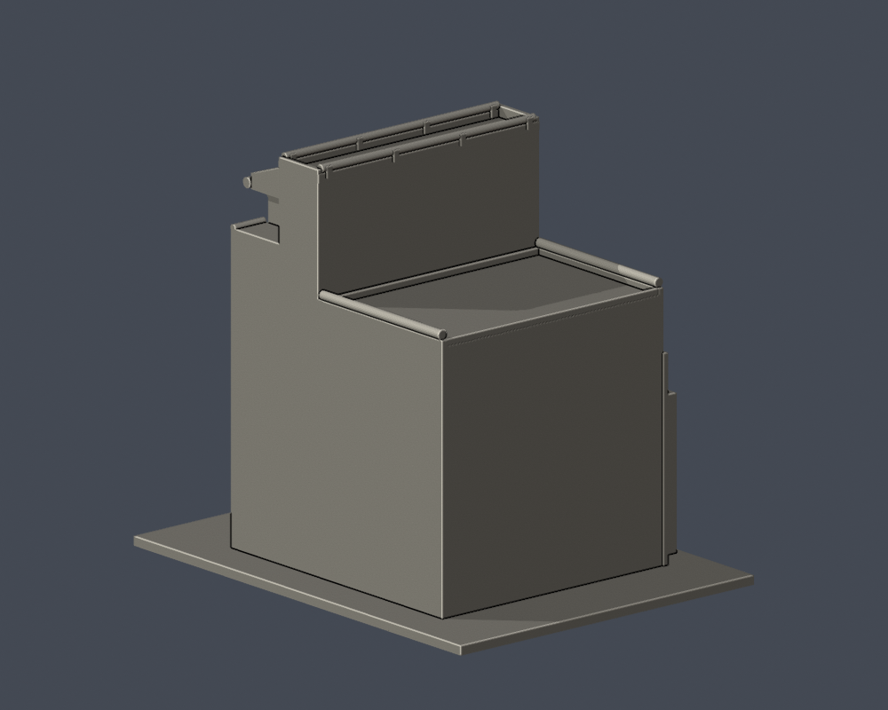
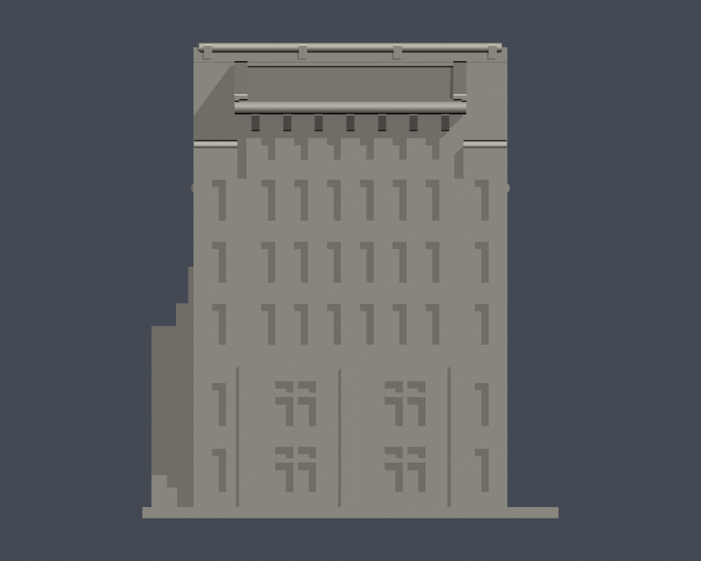
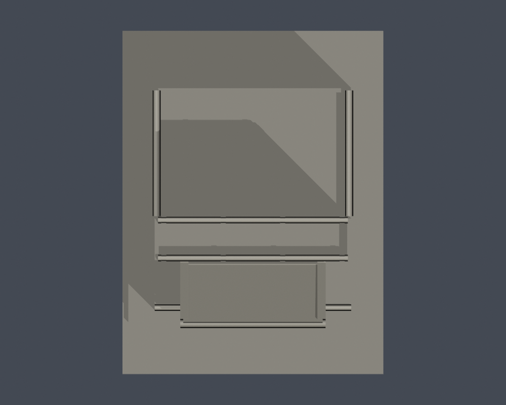

# 研究大樓下坡端量體段

國立臺北藝術大學｜關渡校本部｜自建外觀近似模型

> **局部段，並非全棟。** 研究大樓下坡端塔狀量體與左側前三組短翼；未建完整長翼、其餘連體區、文資書苑完整外廓或關渡美術館。

| 模型預覽 | 模型預覽 | 模型預覽 |
| :---: | :---: | :---: |
|  |  |  |

[正立面](previews/elevation.png) · [頂面](previews/top.png)

| 模型預覽 | 模型預覽 | 模型預覽 |
| :---: | :---: | :---: |
| 正立面  | 頂面  |  |

## 下載與尺寸

- [STL](model.stl) · [可編修 Blender 網格](scene.blend)
- [參數生成腳本](build_model.py) · [預覽生成腳本](render_preview.py) · [固定版本依賴](requirements.txt)
- 含底座外廓：114 × 150 × 130.25 mm；最長150 mm。本件獨立縮放，不與別件共用校園比例。
- STL 單位按毫米匯入，底座朝下；scene.blend 的毫米單位已設定，由本件交付 STL 匯入。
- [來源與支持範圍](sources.json) · [逐檔SHA256](SHA256SUMS)

## 保留特徵與未知範圍

- 正面最高灰色窗列6個窄窗；其下3列各6個中央窄窗加兩側各1，與底部2列寬窄窗分組區別。
- 保留中央單坡挑簷、三角側牆、較低兩肩與最高平屋頂女兒牆，不把建築變成同高長方盒。
- 左側只重建可辨前三個長翼窗群，每群上部4個窄槽、下部較寬雙窗；在第三群後截斷。
- 截斷背面與右側連體界面用平簡實牆；屋頂設備與未見窗列不臆測。2018與2023照片接近同一角度，整棟背面未證。
- 文資書苑為研究大樓4樓空間；OSM分拆的使用單位輪廓不是獨立棟數，不把文資書苑重複建模。
- 階梯只表示端部相鄰動線，踏步數簡化，沒有重建全校真實坡地。

## 列印限制

斜簷、托架、窄窗內頂及女兒牆小挑出處需切片器檢查支撐。長翼窄槽寬約1.6mm；側階梯與附牆已加厚相連，細小冷氣／管線省略。

建議先以0.4mm噴嘴／0.2mm層高在自己的切片器檢視，依材料與機器調整支撐、牆數及填充。數位幾何QA不等於實體試印、完整最小壁厚或Cura／PrusaSlicer工具路徑驗證，沒有保證免支撐。

## 可重建與fail-closed驗證

Python3.12依 requirements.txt 安裝版本後執行 build_model.py；再用Blender4.3.2或相容版本執行 render_preview.py；最後執行 run_all_checks.py。原始輸出若不合格即非零退出，不以修補網格或Polygon隱藏錯誤。

- [原STL、法向繞序、每邊兩面、單殼、頂點連結單環、重建SHA與Blend一致](validation.json)
- [0.2mm逐層閉合](layer-check.json)：651層，自z=0.071mm起
- [個別與合成Polygon有效性](contour-validity-check.json)
- [canonical fail-closed v3 薄特徵篩檢](thin-feature-check.json)：0.8mm參考寬度、131切層，最大面積損失0.3608%
- [綜合QA](qa-summary.json)：所有硬檢查皆true。形態opening只是輔助篩檢，不是完整壁厚檢測。

## 證據與年代

- [北藝大115學年度舞蹈學系七年一貫制招生簡章，附件校圖（PDF第27頁／印刷頁25）](https://fsjh.chc.edu.tw/storage/074521/posts/6091/files/1141004310-0-0.pdf)：北藝大製作、芳苑國中公開轉載的正式招生文件。已查看圖像：館舍相對位置、鐘樓／教學大樓、研究大樓與文資書苑標籤。 插畫非測繪平面；最新取得的學年度資料，不等同確認2026全校外觀未變。
- [112年氣候友善校園計畫配置圖（PDF第24頁）](https://ws-proj.moe.edu.tw/001/Upload/568/relfile/13271/12988/d95e8a4f-fa4e-4d65-9fd9-193872248e2e.pdf)：官方早期配置圖，核位置和別名。 插畫非測量平面。
- [113學年度招生校圖](https://admissionex.tnua.edu.tw/wp-content/uploads/2024/04/113_cac_map.pdf)：承接26項研究名稱。 本次只有文字索引可讀；圖像取用502／issuer certificate錯誤，未繞過，未用作形狀證據。
- [TNUA Research building，Yu tptw 原攝影](https://commons.wikimedia.org/wiki/File:TNUA_Research_building.jpg)：下坡端正面頂列六窄窗，下三列各六中央窄窗加兩側各一；下部兩列寬窄窗、斜簷、高低肩牆、左側長翼前三組窗列。 樹遮下方局部；只建照片明確的端部與短翼，長翼／後方整體連接未重建。
- [Jeff & Jill：台北藝術大學走春（照片0Y6A0703）](https://blog.udn.com/jefnjil/112277513)：相同下坡角、樹較少的早期實拍，核高低角樓、窄窗與底部門窗位置。 該網誌相鄰標題「關渡美術館」不能作建築認定；主體身份以校方配置圖與2023原攝影者標示互證。兩個年代接近同角度，不能聲稱四面測繪。
- [北藝大110學年度第2學期第1次校務會議紀錄](https://sec.tnua.edu.tw/wp-content/uploads/2022/10/111.04.19.pdf)：明寫文資書苑位於研究大樓4樓。因此文資書苑是館內空間，不另增一棟。 不代表已有完整連體外牆或屋頂圖。
- [2022文化資源經典講座暨研究生學術研討會交通資訊](https://2022tnuacrc.weebly.com/traffic-2013236890.html)：主辦活動資料亦指國際會議廳在研究大樓2樓、文資書苑在4樓。 用途位置不能轉成獨立建物。

可視外觀依上列實拍年代，不聲稱2026所有外觀均未變。原照片／PDF及研究對照圖不在公開包；未下載或改作他人的3D網格。

## 導覽與凍結套件

[關渡校本部](../../README.md) · [國立臺北藝術大學](../../../README.md)

重建與重跑驗證前，請先把本資料夾複製到可寫工作目錄。凍結套件不直接覆寫，修訂另建版本。
