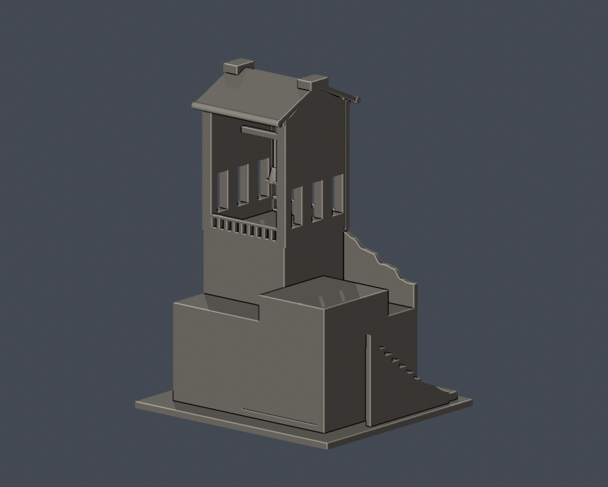

# 教學大樓鐘樓段

國立臺北藝術大學｜關渡校本部｜自建外觀近似模型

> **局部段，並非全棟。** 鐘樓、下部量體、近旁低翼及短階梯；不含完整教學大樓、人文廣場、鼓樓或行政大樓。

<table><tr><td width="50%"></td><td width="50%"></td></tr></table>

[正立面](previews/elevation.png) · [頂面](previews/top.png)

## 下載與尺寸

- [STL](model.stl) · [可編修 Blender 網格](scene.blend)
- [參數生成腳本](build_model.py) · [預覽生成腳本](render_preview.py) · [固定版本依賴](requirements.txt)
- 含底座外廓：112 × 100 × 150 mm；最長150 mm。本件獨立縮放，不與別件共用校園比例。
- STL 單位按毫米匯入，底座朝下；scene.blend 的毫米單位已設定，由本件交付 STL 匯入。
- [來源與支持範圍](sources.json) · [逐檔SHA256](SHA256SUMS)

## 保留特徵與未知範圍

- 以2023正面、2017斜面及2024另一斜面保留通透鐘廊、側面各三開口、正面三窄窗、偏置寬窗與低位入口。
- 屋頂雙坡、山牆、曲線女兒牆與正面欄杆依實拍近似；瓦片、壁磚縫、細小管線及避雷器省略。
- 連往教學大樓的背面採截斷平牆與短低翼，沒有補上未見的窗列，不能當作教學大樓背立面。
- 鐘吊桿加粗為直徑2.4mm，欄杆／簷口亦加粗；這些是列印尺度調整，不是建築尺寸。

## 列印限制

鐘下、跨越鐘廊的橫梁及斜簷需要可移除支撐；吊鐘不是可活動零件。鐘廊高且窄，移除支撐時避免扭折側牆與吊桿。

建議先以0.4mm噴嘴／0.2mm層高在自己的切片器檢視，依材料與機器調整支撐、牆數及填充。數位幾何QA不等於實體試印、完整最小壁厚或Cura／PrusaSlicer工具路徑驗證，沒有保證免支撐。

## 可重建與fail-closed驗證

Python3.12依 requirements.txt 安裝版本後執行 build_model.py；再用Blender4.3.2或相容版本執行 render_preview.py；最後執行 run_all_checks.py。原始輸出若不合格即非零退出，不以修補網格或Polygon隱藏錯誤。

- [原STL、法向繞序、每邊兩面、單殼、頂點連結單環、重建SHA與Blend一致](validation.json)
- [0.2mm逐層閉合](layer-check.json)：750層，自z=0.071mm起
- [個別與合成Polygon有效性](contour-validity-check.json)
- [canonical fail-closed v3 薄特徵篩檢](thin-feature-check.json)：0.8mm參考寬度、150切層，最大面積損失0.5711%
- [綜合QA](qa-summary.json)：所有硬檢查皆true。形態opening只是輔助篩檢，不是完整壁厚檢測。

## 證據與年代

- [北藝大115學年度舞蹈學系七年一貫制招生簡章，附件校圖（PDF第27頁／印刷頁25）](https://fsjh.chc.edu.tw/storage/074521/posts/6091/files/1141004310-0-0.pdf)：北藝大製作、芳苑國中公開轉載的正式招生文件。已查看圖像：館舍相對位置、鐘樓／教學大樓、研究大樓與文資書苑標籤。 插畫非測繪平面；最新取得的學年度資料，不等同確認2026全校外觀未變。
- [112年氣候友善校園計畫配置圖（PDF第24頁）](https://ws-proj.moe.edu.tw/001/Upload/568/relfile/13271/12988/d95e8a4f-fa4e-4d65-9fd9-193872248e2e.pdf)：官方早期配置圖，核位置和別名。 插畫非測量平面。
- [113學年度招生校圖](https://admissionex.tnua.edu.tw/wp-content/uploads/2024/04/113_cac_map.pdf)：承接26項研究名稱。 本次只有文字索引可讀；圖像取用502／issuer certificate錯誤，未繞過，未用作形狀證據。
- [TNUA Bell tower，Yu tptw 原攝影](https://commons.wikimedia.org/wiki/File:TNUA_Bell_tower.jpg)：鐘確實入鏡的正面：大通透框、正面三窄窗、低翼窗／門、曲線女兒牆、側階梯與兩坡屋頂。 裁切版本是同張照片，不算第二視角；未據此重建完整教學長翼。
- [甘答門文史生態集景：臺北藝術大學校園步道巡禮](https://kandoman.blogspot.com/2017/03/blog-post_25.html)：文中DSCF2656.JPG為鐘在畫面內的斜面：三個側開口、空心鐘廊、斜屋頂與簷口。 攝影日期未有EXIF；只確認刊文年份，不當作2026現況。不可與2018網誌的鼓樓照片混用。
- [TNUA administration buildings and Arts forum 20240324，Yu tptw 原攝影](https://commons.wikimedia.org/wiki/File:TNUA_administration_buildings_and_Arts_forum_20240324.jpg)：人文廣場右側的鐘樓側面，鐘可見，核側面三開口、山牆與下部磚體。 檔名含行政大樓，但鐘樓是前景右邊、行政大樓在遠後方；模型不把它們合成一棟。部分下方側面被樹遮蔽。
- [北藝大校史：1994教學大樓](https://tnua.openmuseum.tw/muse/digi_object/bc524ebffa926b686c9b6654ca655371)：校方明示教學大樓設計有鐘樓。鐘樓段歸入教學大樓研究項，不另計一棟。 校史文字不是可度量的施工圖。
- [北藝大鐘樓，校史發展組](https://openmuseum.tw/muse/digi_object/297876b35514c00d2ecdb225ce847e0b)：官方介紹鐘樓與鼓樓的區別、2006捐鐘。 不用此紀錄聲稱已取得完整背面。
- [112學年度主管會報紀錄（1121024）](https://sec.tnua.edu.tw/wp-content/uploads/2023/11/1121024_%E6%9C%83%E8%AD%B0%E7%B4%80%E9%8C%84.pdf)：教學大樓與鐘樓露台曾進行防水、壁磚修繕；使用2024另一角度照片覆核主要外形。 修繕記錄非完整2026現況調查。

可視外觀依上列實拍年代，不聲稱2026所有外觀均未變。原照片／PDF及研究對照圖不在公開包；未下載或改作他人的3D網格。

## 導覽與凍結套件

[關渡校本部](../../README.md) · [國立臺北藝術大學](../../../README.md)

重建與重跑驗證前，請先把本資料夾複製到可寫工作目錄。凍結套件不直接覆寫，修訂另建版本。
