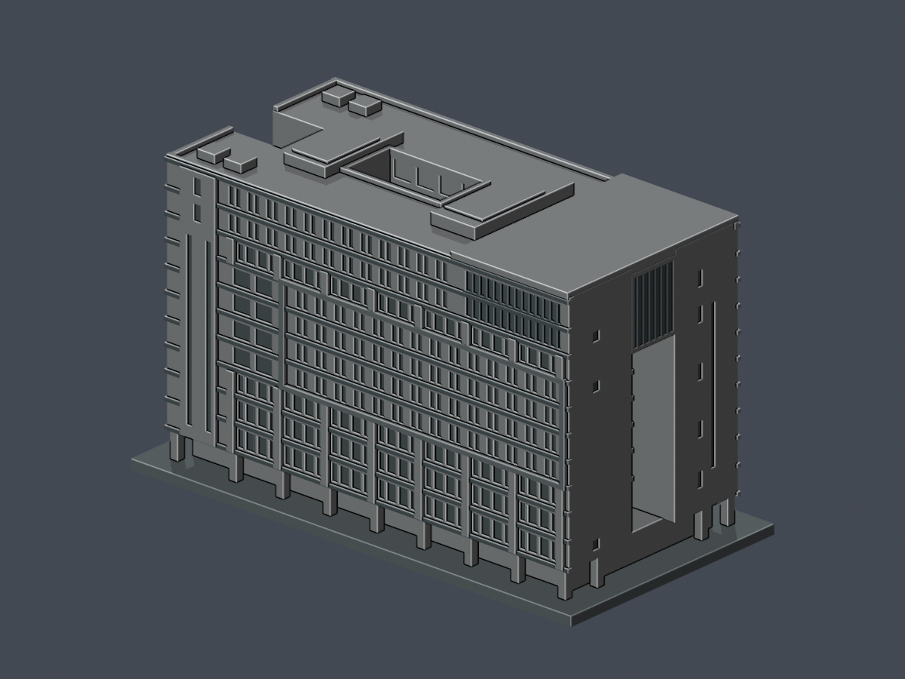
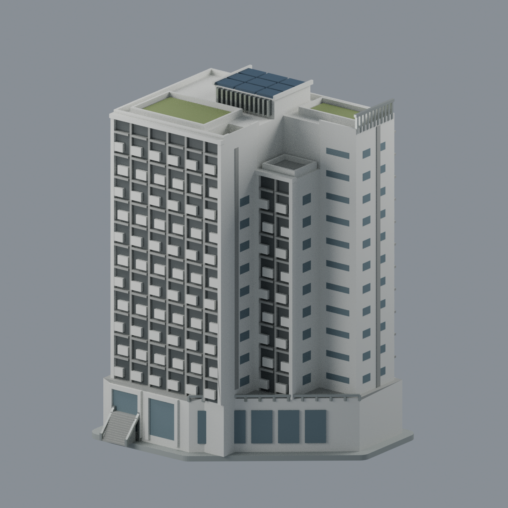

# 國立臺北護理健康大學建築模型

目前本校收錄 **3 件**不同建物；原文教大樓段落為歷史增量說明，不代表全校完成。各件來源、分棟與角損警示請見主圖鑑連結的模型詳頁。

歷史首件為城區校區文教大樓1965原始主棟；後增石牌校區學思樓與爾雅樓，現共3件，並非全校完成。其他建築與林口校區尚未完整建模。

## 已收錄模型（3件）

| 模型 | 模型 | 模型 |
|---|---|---|
|  **[文教大樓｜1965原始主棟](城區校區/buildings/ntunhs-wenjiao-1965/README.md)** |  **[學思樓｜2021完工外觀](石牌校區/buildings/ntunhs-xuesi-2021/README.md)** |  **[爾雅樓（第三學生宿舍）](石牌校區/buildings/ntunhs-erya-dorm/README.md)** |

[模型、範圍與驗證](城區校區/buildings/ntunhs-wenjiao-1965/README.md) · [城區校區入口](城區校區/README.md) · [覆蓋範圍](coverage.json)

本件保留38層形態opening面積損失超過1%的警示；逐構件連通性與抽樣法線厚度已檢查，仍需支撐及實際切片檢視。詳見模型頁，請勿解讀為零警告或全面保證可印。

[石牌校區入口](石牌校區/README.md)

## 爾雅樓（第三學生宿舍）範圍

爾雅樓（第三學生宿舍）2021履歷竣工照片主要外觀近似：13F階梯退差、約兩層斜切裙房、中段窄凸翼低約兩層、前外階入口、後端厚白框上窗與落地門、完整退縮綠頂與中央抬高PV設備區。138×110.7×190.1mm、8材質Blend/3MF/STL及5實mesh圖；12962三角單閉殼、951層0.8mm組件檢查通過，格式真編輯存讀與乾淨九檔重建一致。後中上窗排及體育館旁低部小開口按可見規律近似，非逐格測繪；僅取得3/4/6/7F平面，不含學思、舊體育館、舊宿舍、白棚或B2。需支撐評估、未實印；原照拍日不明，2024存檔不是拍攝年。 [模型與來源](石牌校區/buildings/ntunhs-erya-dorm/README.md) · [QA警告](石牌校區/buildings/ntunhs-erya-dorm/QA.md)。既有文教與學思模型及其角損／列印限制不變。
