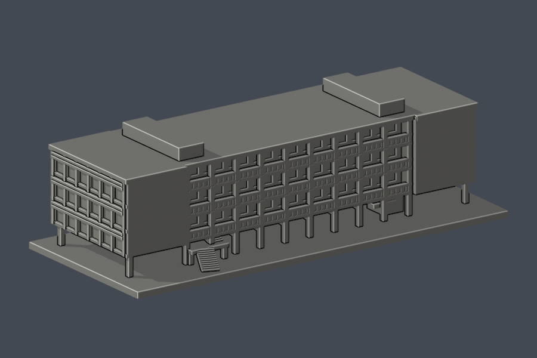
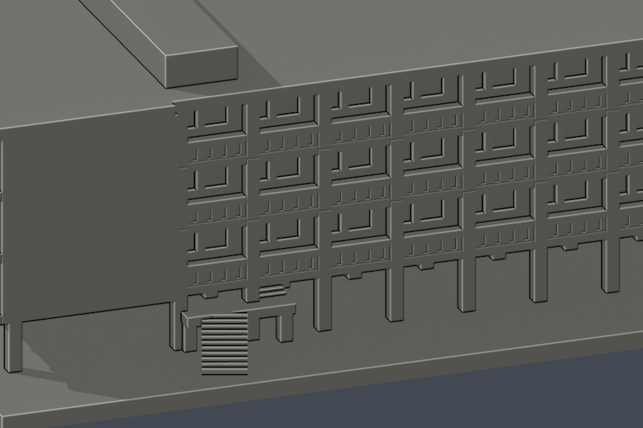
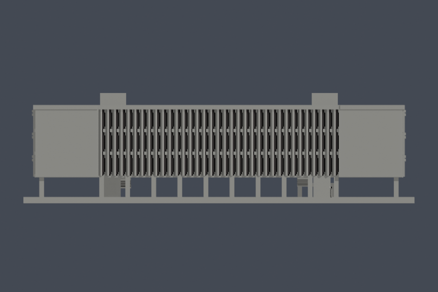
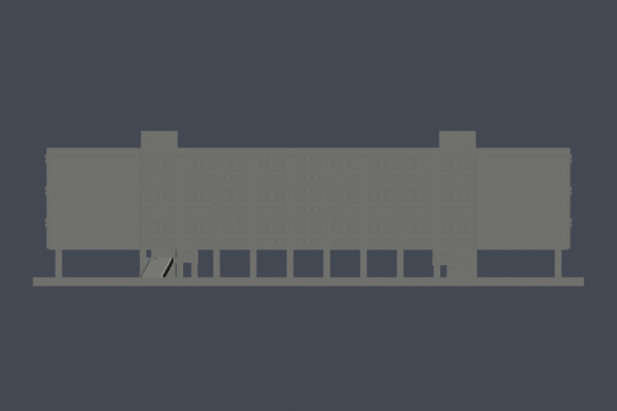
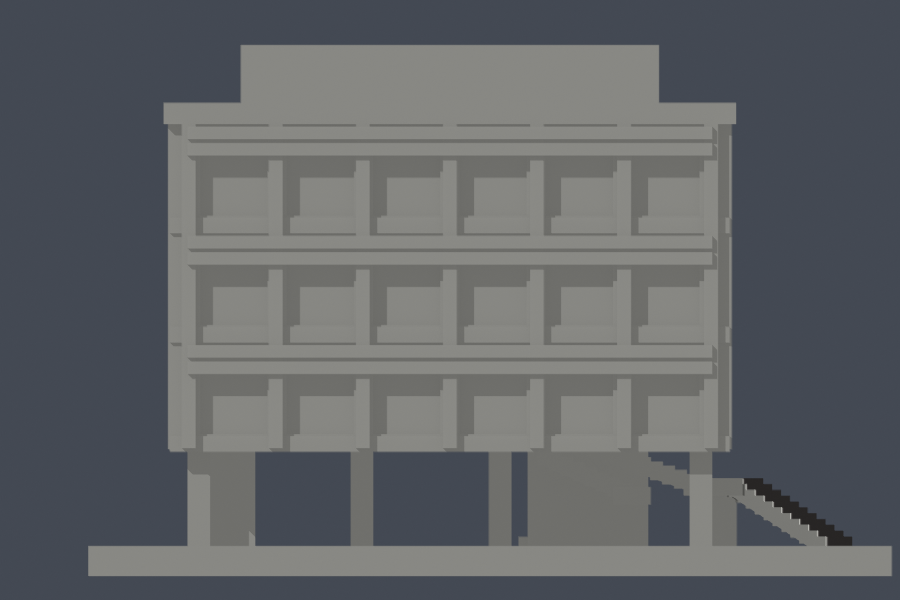
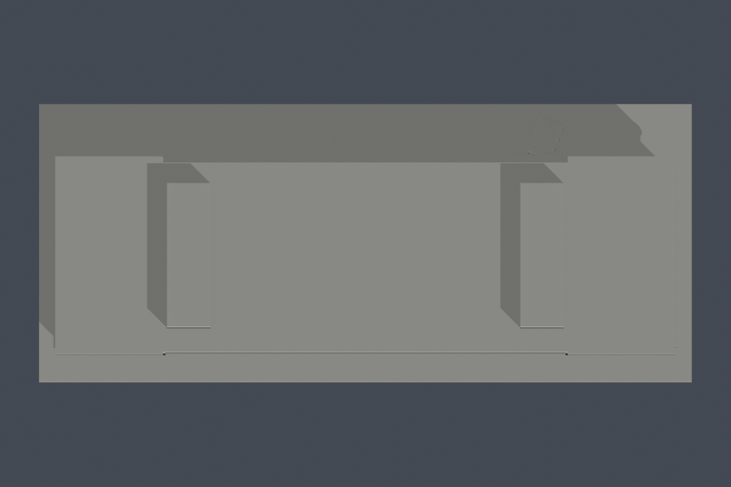

# 北護城區校區文教大樓｜1965原始主棟完整量體近似

## 模型預覽

| 模型預覽 | 模型預覽 | 模型預覽 |
| :---: | :---: | :---: |
| 南面斜視，實際STL  | 北面斜視，實際STL  |  |

這是一件依公開資料自行建立、供3D列印使用的完整四層主棟外形近似模型，不是全校區、精密測繪或2025修復後現況。模型年代為1965竣工原始形態，排除1966–1967及後續底層增建教室、現代電梯、相鄰體育館與宿舍等另外建物。

## 保留與近似

- 四層長條主體、略有前後位移的中段與兩端量體、底層開放柱廊及原有服務小室／梯核。
- 南側九主要柱跨、35片斜向遮陽板及其36分格節奏。斜板依圖像計數建立，為列印加厚；不冒稱精確構件測繪。
- 北側三層深開放走廊。欄杆以連續厚壁與淺溝紋簡化，沒有把整條廊帶封死；背後的門窗只作連接式浮雕。
- 東側原始1F至2F北向外伸折梯、平台及其下方空間。3–4F梯核主要位於主體內，不增造外梯塔。細扶手省略，踏步／結構板加厚；不主張完整室內樓梯測繪。
- 兩端六主要窗跨、水平遮陽帶、低平主屋面；保留兩座低長方服務屋突。屋突三向外包比例依校方正立面、端立面與原4F梯核位置近似，內部、設備及屋面排水未查明而不模型化。
- 主棟內沒有捏造天井。史料中的「中庭」在棟北側校園空地。
- 西側早期獨立照片缺乏；校方以東側代替並說明兩側相同。西面採原平面與端面圖支持的相同基本節奏，仍保留此證據限制。

## 尺寸與列印提醒

- 單位：毫米。含底座外包尺寸150 × 64 × 42.3 mm；各構件採圖像比例近似，沒有宣稱精確實際公尺或統一校園比例。
- 底座厚2.4 mm，底座朝下列印。底層大跨度、北側廊板、外梯及遮陽片等有懸空部位，請在自己的切片器檢視並安排支撐；不保證免支撐。
- 南側遮陽片厚度1.1 mm、底層柱1.8 mm；局部細節已厚化或省略。實際適用性仍取決於噴嘴、材料、層高與支撐設定。
- 數位檢查不是Cura／Prusa等實際工具路徑，也沒有實體試印；不能解讀為全面最小壁厚或保證可印。

## 檔案與重建

- [model.stl](model.stl)：實際交付單件網格
- [scene.blend](scene.blend)：由同一STL匯入、可編修的Blender網格，毫米場景
- [build_model.py](build_model.py)：原創參數幾何；[requirements.txt](requirements.txt)：固定Python套件版本
- [來源紀錄](sources.json)、[完整QA摘要](qa-summary.json)、[原網格與重建驗證](validation.json)
- [0.2mm逐層逐Polygon檢查](layer-component-check.json)、[空間射線與淨空量測](open-space-check.json)、[PNG重繪一致性](preview-check.json)
- [北面近照](previews/rear-detail.png)、[正立面](previews/south.png)、[背立面](previews/north.png)、[東側面](previews/east.png)、[俯視](previews/top.png)

| 模型預覽 | 模型預覽 | 模型預覽 |
| :---: | :---: | :---: |
| 北面近照  | 正立面  | 背立面  |
| 東側面  | 俯視  |  |

使用Python 3.12及Blender 4.3.2測試。先安裝requirements，執行build_model.py產生STL，再用Blender背景模式執行render_preview.py，接著執行clean_previews.py清除PNG中繼資料。執行validate_all.py重跑全部檢查。請在副本操作，勿更改已凍結原件。

## 數位檢查結果與界限

實際原STL水密、每邊兩面、vertex-link單一環、原始法向／繞序一致、正體積且只有一個連通表面殼。獨立重建STL SHA相同，saved Blend與STL三角形幾何一致，七張PNG與獨立從STL重繪的像素一致，PNG無私人檔案路徑中繼資料。

從z = 0.071 mm起，每0.2 mm檢查至頂部，共212層。每一個原始輪廓與合成Polygon均須有效；遇invalid直接非零退出，不修補後放行。逐原Polygon施行0.4 mm erosion和隨後opening，全部保留單一Polygon，零消失、零分裂。仍有38層形態opening面積損失超過1%，高度範圍z = 2.471–9.871 mm。峰值位於z = 2.471 mm，損失率0.029577555093557306（約2.9577555093557306%）；原截面211.35581966320058 mm²，損失6.251388400432278 mm²。這是保留警示的有限通過，不是零警告或全面可印保證。

### 薄構件與面積損失補充檢查

- 獨立逐原Polygon檢查仍為2525件零消失、零分裂。峰值層以柱／梯角損失為主。
- 最低單構件保留率0.9521964562239977（95.21964562239977%），對應外梯平台支柱的1.7 × 1.7 mm截面：x = 30.15–31.85 mm、y = 21.15–22.85 mm，z = 2.471 mm。此件原面積2.8900000000000095 mm²、損失0.138152241512647 mm²；檢查所得損失都在0.41 mm頂點鄰域內。
- 其他警示高度的斜梯截面仍有少量非角落損失。0.41 mm頂點鄰域外最大損失0.021926962348678636 mm²，不能把全部38層的損失說成只有方柱角落；完整位置與每件保留率列於[薄警示補充報告](thin-warning-supplement.json)。
- 南側35片斜翼於三個高度抽樣共105點，原STL法線厚度最小1.099998 mm；根部朝背牆的射線沒有提前離開實體，支持斜翼與主體融合，而非細薄懸接。
- 四段樓梯共116點的原STL法線厚度抽樣最小1.214771 mm，四段上端的踏階至平台內部線段皆未穿出表面。詳見[法線厚度與根部連續性](normal-thickness-check.json)，附可重跑的[抽樣射線腳本](check_normal_thickness.py)。
- 以上為指定點位的法線厚度與連通性檢查，不是全方向最小壁厚或完整工具路徑模擬。面積保留率與旋轉外接框寬度也不能替代最小壁厚。
- 底層、廊板、外梯和遮陽片請安排適當支撐，先在實際切片器逐層查看。上述毫米厚度只適用本交付尺寸；不得直接假設等比縮小後仍通過0.8 mm篩檢，縮放後應重跑數位QA並重新檢視切片。

射線直接量測此模型：北廊各層前緣至背牆約6.6 mm，欄杆內緣至背牆淨深約5.0 mm；樓板至上板淨高7.45 mm、欄杆上方淨高4.55 mm；1F通空淨高7.5 mm。這些是模型毫米淨空，不是建築現場測量值。

所有來源原照片／PDF只用於比對，未隨本包重新散布。本包沒有包含GitHub發布步驟；版本修改須另建新版。
