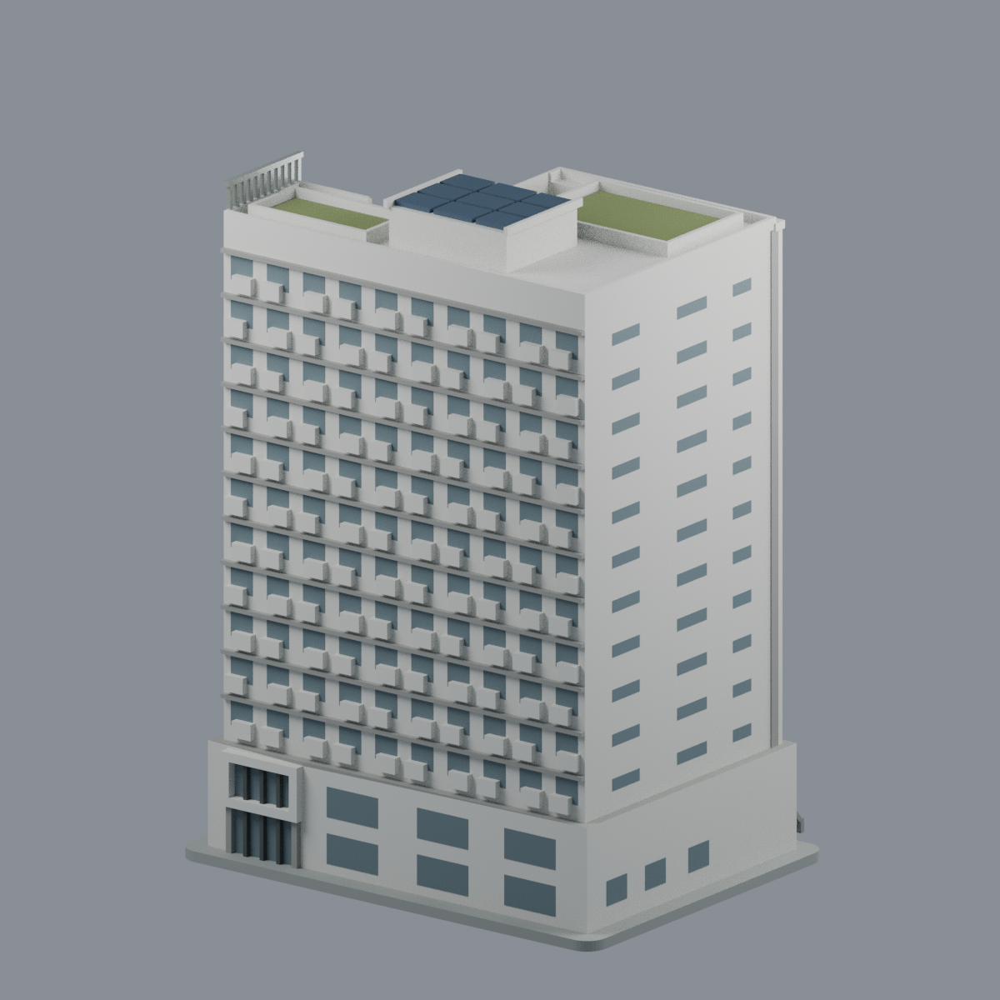
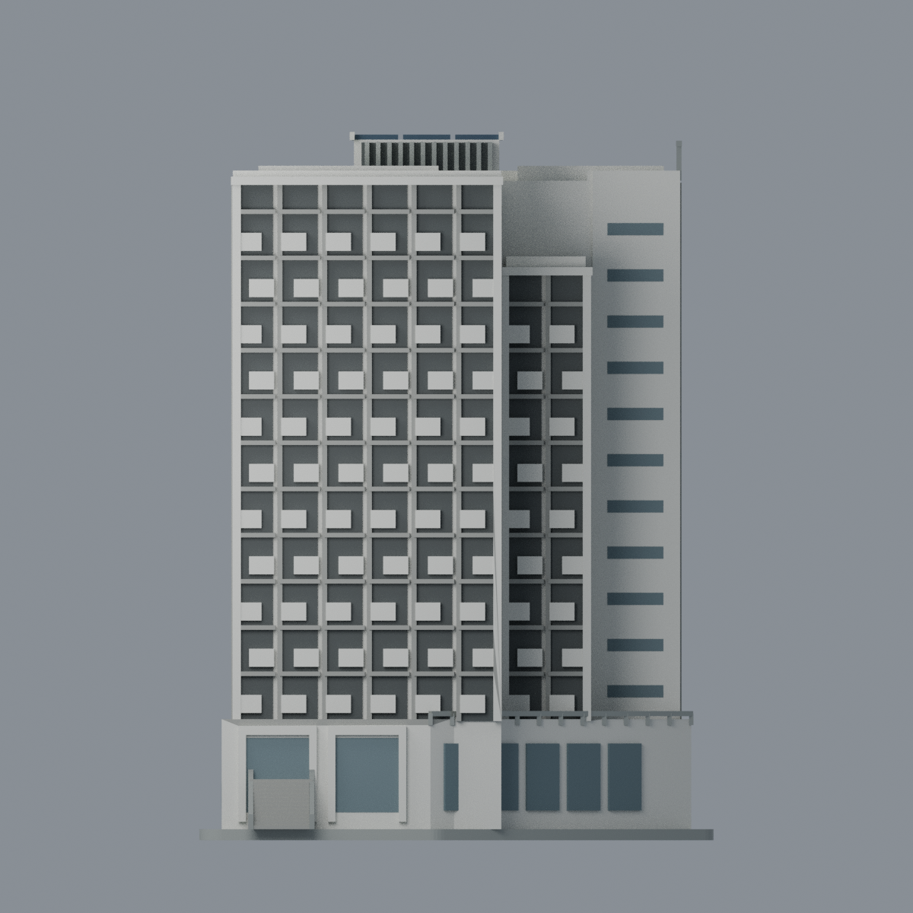
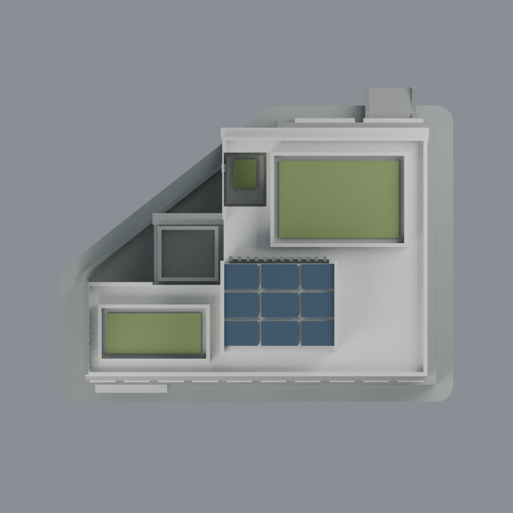
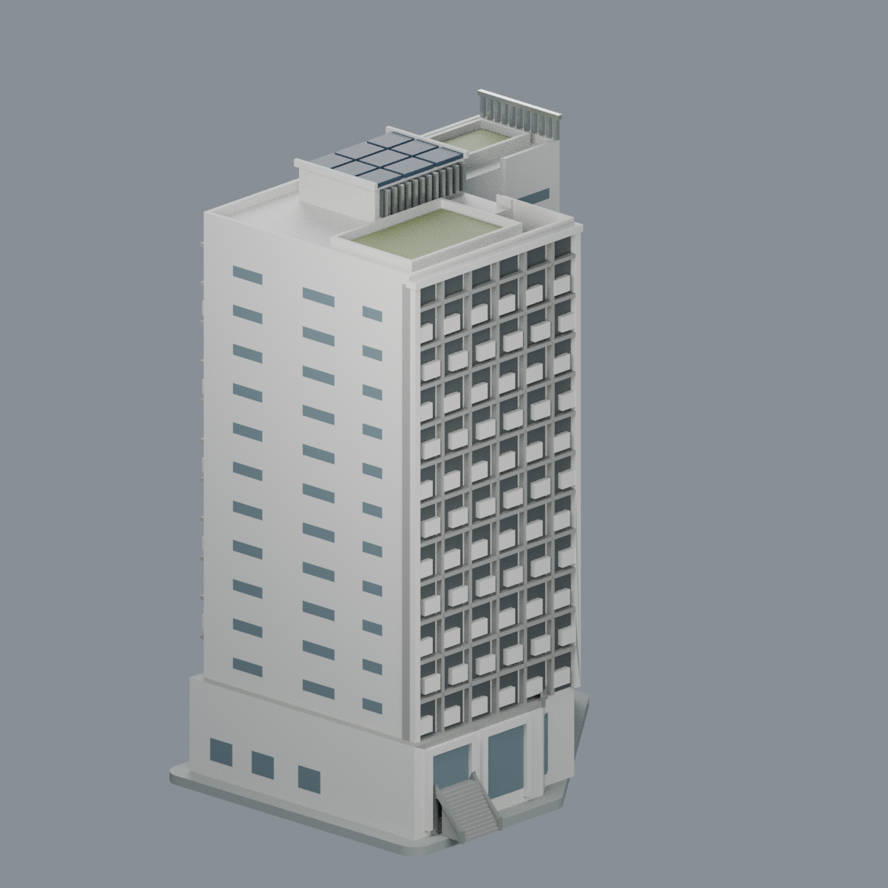

# 國立臺北護理健康大學｜石牌校區｜爾雅樓（第三學生宿舍）

2021 施工履歷竣工實拍所示完整地上主要外觀之多色可編輯近似模型。**不是學思樓（11F），不包含舊圓形體育館、蕙質／蘭心、白色大屋蓋或全校地形。** 爾雅為地上13層、地下2層；本模型不還原地下室。圖中展示封底不是實際地下樓板或地形。

## 同一實際mesh五視圖

| 前斜 | 後斜 | 正立面 |
| :---: | :---: | :---: |
|  |  |  |

| 屋頂 | 另一側斜視 |
| :---: | :---: |
|  |  |

## 檔案
- `scene.blend`：可編輯原始三角幾何及8材質；不是照片貼圖。
- `model.3mf`：毫米、多色basematerials、單一連通網格；可編輯材料。
- `model.stl`：相同幾何，STL無顏色、無透明度。
- `previews/`：同一最終mesh五視圖，無源照片／生成式修圖。
- `build_model.py`、`render_model.py`、`rebuild.py`：參數化重建與實mesh渲染。

## 來源與形體
親看施工履歷p16屋頂、p56前斜、p63前基部、p64前後基部、p58兩總覽；官網3F外緣與4/6/7F階梯平面互證。不規則退差主體（中段窄凸翼較主面低約兩層）、斜切低裙房、外階入口、後端已見厚白框上窗及下方落地門、錯列明暗窗格、窄橫窗短面、綠頂、屋頂凹口與抬高中央設備/PV區均保留。主體內部採封閉體積供切片器設定填充，不虛構逐間室內。

**近似限制：背長面中上部窗排、框格和體育館旁1/2F局部小開口未獲逐格完整實拍；依可見規律和平面近似，不宣稱四面每窗測繪。** 成功取得平面僅3/4/6/7F；不使用傳輸截斷的5/8–13F圖片。精確尺寸、樓層高、斜角、窗分格、PV片數、小機電、欄杆細數均非測量。履歷整案49.9m不能視作本棟精測高度。模型軸是展示座標，不標真北。

PDF製作2021-10-01，2021-10-23校方正式啟用命名；完工照原拍日期無EXIF可證。2024 archive是存檔時間不是攝影年。白／灰／深灰材色依日照照片；不將夜景黃光當棕色磚色票。玻璃以不透明藍灰縮尺表現。

## 列印與驗證
尺寸約138×111×190.1 mm（含展示底）。外階、窗框、屋頂邊緣有懸挑，**需要切片支撐評估；不是免支撐或已實印認證**。零件局部厚度／全層0.2mm切片由真實STL檢測；0.8mm侵蝕存活只是一個切片連通組件檢查，不能推成全表面最小壁厚保證。小比例縮放會使欄杆、窗格更脆。

依 `QA.md` 使用 manifold3d/numpy/trimesh/shapely/rtree 的Python、lib3mf的Python與Blender。獨立目錄重建檢查core四檔與五PNG逐bytes相同。來源原圖/PDF不隨包公開。見 `SOURCES.md`、`LICENSE`、`CHECKSUMS.sha256`。
