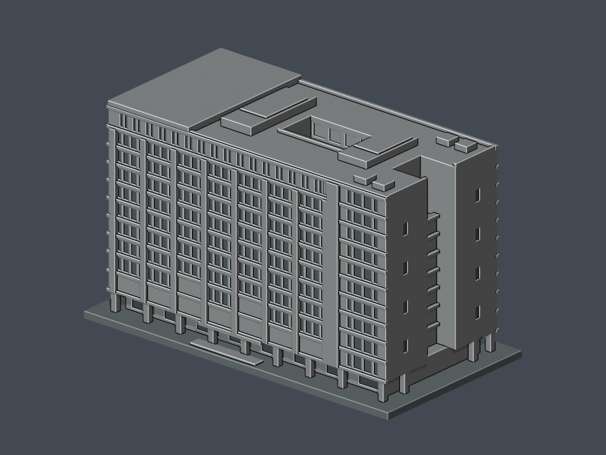

# 學思樓｜2021完工外觀來源限定近似

國立臺北護理健康大學・石牌校區。本件以2021施工方完工照片、校方7–10F平面及NLSC航照建立完整主體外觀近似；不是測繪、同年現況或全校完成。既有城區校區1965文教大樓是另一件建物，本件不增加學校覆蓋數。

| 北長面，實際STL | 南長面，實際STL |
|---|---|
|  |  |

[STL](model.stl) · [可編輯Blender網格](scene.blend) · [參數來源](build_model.py) · [北立面](previews/elevation.png) · [南立面](previews/rear-elevation.png) · [西端](previews/west.png) · [東端](previews/east.png) · [俯視](previews/top.png)

## 幾何範圍

- 保留兩長向翼、偏東矩形露天天井、3F頂／4F地坪以下實體裙部、兩端向外開放凹槽、回縮地面與柱廊、西端較高會議廳頂、兩處屋頂設備房及簡化太陽能面。
- 天井不是穿地洞。原STL垂直射線量得洞底z=27.2mm；井內淨寬31.5×16.4mm。設計剖解和實景支持洞底在3F頂，未取得標高工程剖面。
- 北面有四排小窗的獨立寬外框、上方長窗帶及兩排辦公窗；西側跨兩層的大格柵另處理。南面保留寬跨教室玻璃、大柱網及東側垂直交通帶，不鏡射北面。
- 端部格柵以帶凹紋的融合背板近似，背後凹槽仍連通下方空間；沒有封閉內腔殼。細金屬件、窗扇、室內小房間、機械設備未逐件重建。
- 凹面與框的預覽材質只協助閱讀，同一份STL的三角面沒有加代理幾何；列印仍為單一實體。

## 尺度與不確定性

毫米，含底座 **150×78×90.5mm**，底座朝下。選用主體76×36m的有界工作比例（約1:556），不是實測；公開OSM與航照支持約74–80×35–40m外包範圍，牆基與高屋面投影不可混為同一多邊形。

主屋面z=86.2mm，西會議頂z=89mm，設備頂90.5mm；扣底座後對應約46.2／47.8／48.6m的影像比例工作值。施工履歷49.9m是**整案表列總高，未分學思樓與爾雅樓**，不能稱本件已取得精確49.9m標高。11F+B2有校方及履歷支持，但不是以11個等高方盒相加。地下室不重建。

校方2022新聞空拍有左右反轉疑點，不用它決定東西。位置以NLSC、完整平面與施工履歷多角度一致關係控制。不同年代來源不代表2026實測；1–6F未取得逐層完整平面，低層外形依完工照片及設計剖解近似。

## 局部數位篩檢與列印警示

- 原STL每0.2mm逐層輪廓及各原Polygon分別作0.8mm erosion/opening，零消失、零分裂。每構件損失另外保存，不以整層平均遮掩局部問題。
- **22根地面方柱、890個跨層樣本**有超過1%的角損，不是890根柱。最差約2.0436738%，保留約97.9563262%；損失全部位於矩形四角0.41mm鄰域。逐樣本原STL X/Y法向寬皆至少約2.599998mm，向下連底座、向上連主體；詳[逐構件位置](feature-loss-locations.json)及[原面射線](architectural-ray-check.json)。這是經獨立原STL尺寸、根接及逐構件重現核可的具體角損例外，不稱零警告或全域最小壁厚合格。
- 端部格柵實際凹槽與背板法向≥1.2mm；南北窗凹深約0.5mm，窄框與背牆融合。真空間、凹深與根接均有原STL射線檢查，不只依預覽顏色。
- 柱廊、入口檐、端槽上方跨接及屋頂挑緣可能需要支撐。0.2mm數位截面不是Cura／Prusa工具路徑、全方向壁厚或實體試印保證。

## 重建、來源與QA

Python依[requirements.txt](requirements.txt)；Blender 4.3.2。先執行build_model.py，再以Blender執行render_preview.py，最後執行run_all_checks.py。驗證器不以repair修補不合法輸入。

[來源](sources.json) · [原STL拓樸／重建／Blend／PNG](validation.json) · [逐層輪廓](layer-opening-check.json) · [各原Polygon](layer-component-check.json) · [canonical v3](thin-feature-check.json) · [各構件損失](feature-loss-locations.json) · [空間與根接射線](architectural-ray-check.json) · [總QA](qa-summary.json) · [渲染manifest](render-manifest.json) · [SHA256](SHA256SUMS)

原始照片/PDF僅作來源核對，不在公開包重新散布。本件已完成獨立數位審核；遠端發布由專責流程處理。

獨立補充：453層1441原Polygon均無侵蝕／opening消失或分裂。890個警告截面樣本對應22根方柱，損失位於各矩形四角0.41mm鄰域（鄰域外數值殘差最高1.9762×10⁻¹⁶mm²，低於1×10⁻¹²mm²比較容差）；實際原三角面法線射線最小量得2.5999984mm，各樣本X/Y寬與上下根連接重現通過。此局部量測不是全模型最小壁厚，保留原完整形態損失分數；不得任意縮小，支撐與拆除方式仍須切片評估，尚未實體試印。
