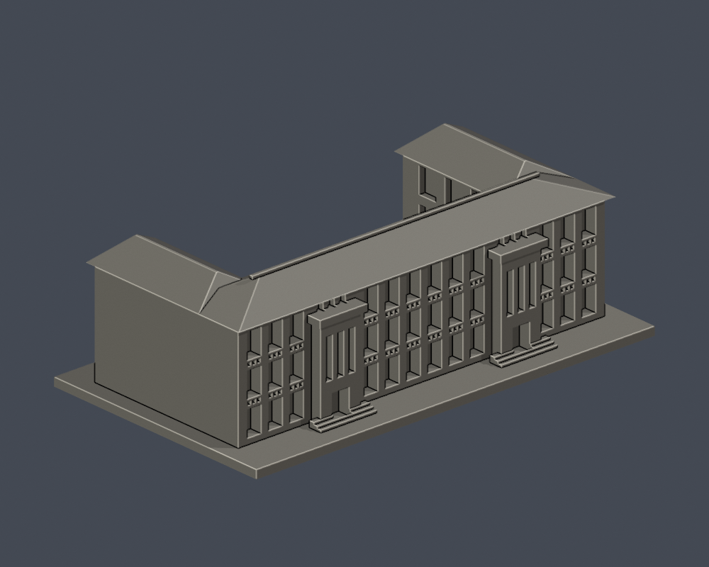
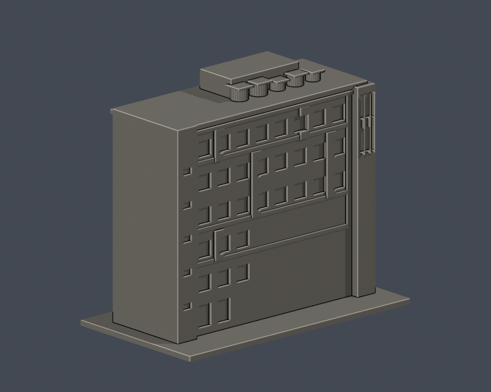
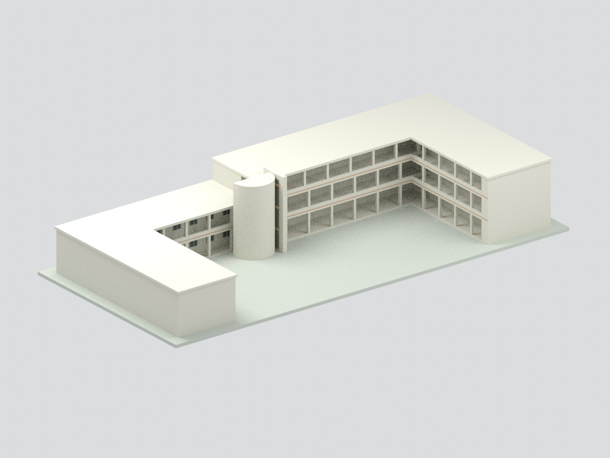
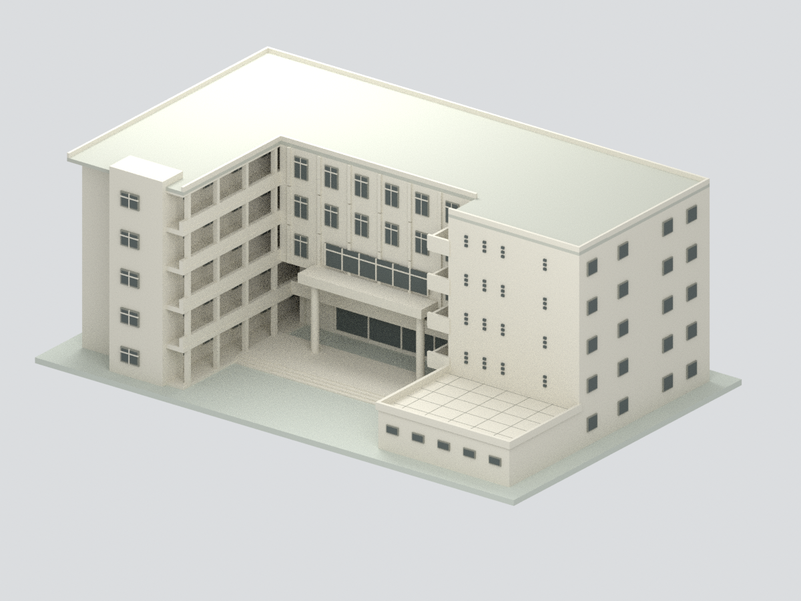
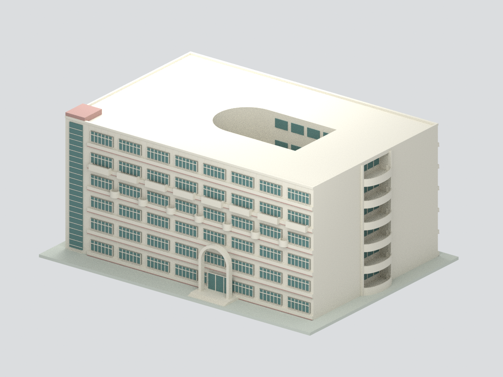

# 國立臺南大學建築模型

現收錄7件：紅樓、啟明苑入口端標段、新淑慎樓，2024年8月部分拆除前歷史美術館三翼，格致樓五層主體與中庭，文薈樓六層中庭主體，以及誠正大樓五層主體。前三件含底座最長150mm；歷史美術館約221.7mm、格致樓約183.05mm、文薈樓約188.8mm、誠正大樓約205.4mm，不同模型非統一比例、非實測、非全校完成。

2024年8月部分拆除前歷史美術館三翼：官方註記北翼及中翼於2024年8月拆除，南翼仍使用。本件為拆除前三翼有界外觀近似，不是2026現況、現存南翼或新教學研究大樓；絕對尺寸與窗列估計，未知外側中性封閉，0.075–0.15mm細件須放大加粗及切片支撐評估，未試印。

| 建築模型 | 建築模型 | 建築模型 |
| :---: | :---: | :---: |
|  **[紅樓](府城校區/buildings/nutn-red-building/README.md)** |  **[啟明苑入口端標段](府城校區/buildings/nutn-qiming-entrance/README.md)** |  **[新淑慎樓](府城校區/buildings/nutn-shushen-new/README.md)** |
|  **[國立臺南大學｜2024年8月部分拆除前歷史美術館三翼](府城校區/buildings/nutn-art-historical-three-wings/README.md)** |  **[國立臺南大學｜格致樓五層主體與中庭](府城校區/buildings/nutn-gezhi-courtyard/README.md)** |  **[國立臺南大學｜文薈樓六層中庭主體](府城校區/buildings/nutn-wenhui-courtyard/README.md)** |
|  **[國立臺南大學｜誠正大樓](府城校區/buildings/nutn-chengzheng-main/README.md)** |  |  |

[府城校區圖鑑](府城校區/README.md)／[續接與未完成範圍](CONTINUATION.md)

原照僅私用研究，公開預覽均由交付STL渲染。數位QA不等於切片器驗證或實體試印。啟明苑僅入口端；新淑慎樓背面未核證。

格致樓五層主體與中庭：官方1/4/5F內圖及年代未明照片導引的簡化外觀。48.30×30.20m為軸線非精確外牆包絡，層高/窗格與外側開窗估計，非2026現況測繪；細框約0.07–0.18mm需放大加粗與切片支撐評估，未試印。

文薈樓六層中庭主體：官方2025平面與年代未明照片支持的簡化外觀；主高24.63m有記載，54×36m足跡、分層、窗格估值。地下層、頂部設備/百葉與內院採光罩未完整重建，不是完整全貌、2026現況測繪或試印完成。

誠正大樓五層主體：官方2025平面及歷史照片支持的簡化外觀；71×32m主軸及23.75m樓高有依據，分層/窗格/部分對稱立面推定。屋頂中性封口不代表實際封閉；內部天井/地下層/屋頂設備未重建，不是2026現況測繪或試印完成。
