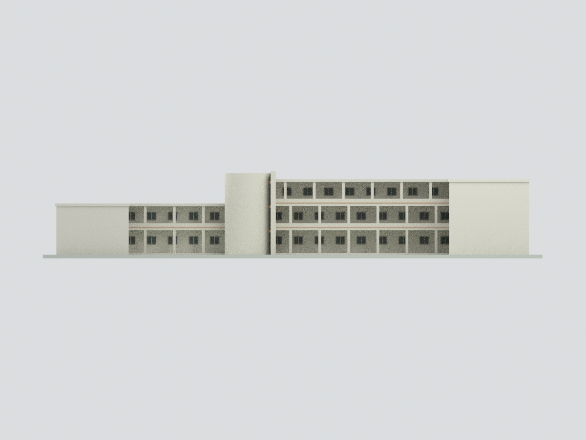
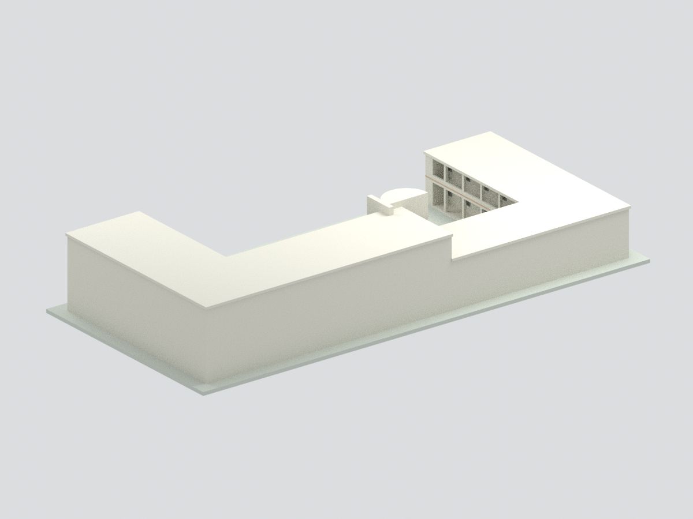
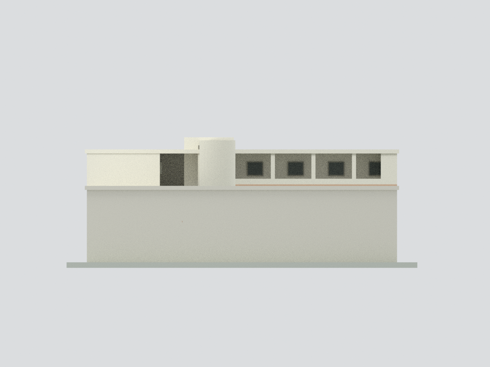
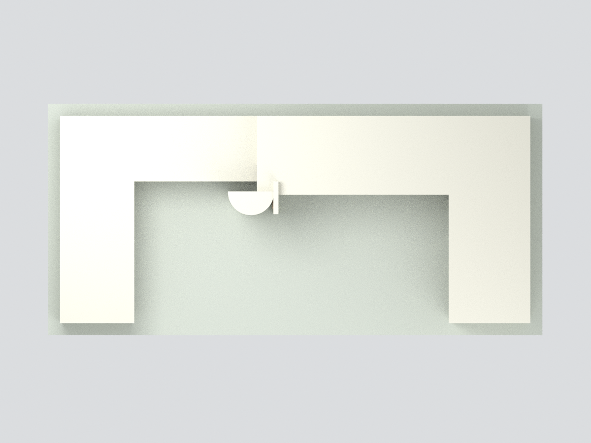
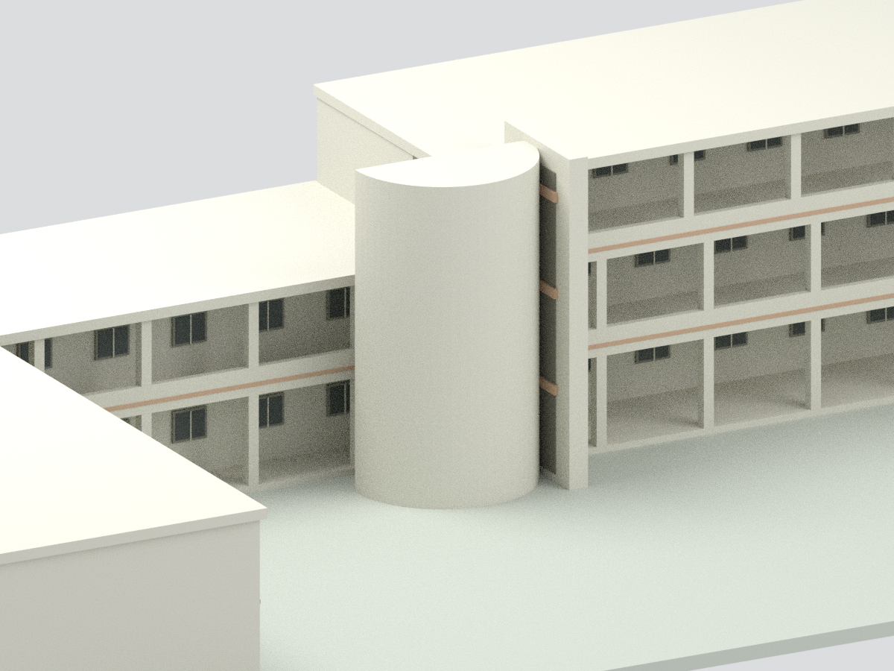

# 國立臺南大學｜2024年8月部分拆除前歷史美術館三翼

**這是北棟與中棟於2024年8月拆除前的歷史外觀近似模型，不是2026現況，也不是現存南棟單獨模型。** 官方現行系網註記北棟與中棟已拆除、南棟仍使用；同站保留的舊照片與平面用於本件歷史重建。

## 範圍與依據
- 官方1F/2F平面：U形三翼、中庭開口；3F僅右側L形。無北向箭頭，模型座標不是地理方位。
- 兩張官方中庭照片：白色走廊、淺杏色帶與中央曲面樓梯屏牆。曲面塔對應中央朝庭院凸出的梯間，非翼端獨立塔。
- 外側立面缺照片，採中性封閉，不表示現實無窗。屋頂設備、金字美術館題字、樹木、雕塑與室內未建。
- 平面為配置示意，無尺寸標註；絕對尺寸、層高、柱距、窗列/窗型、梯塔半徑均為近似。不能由本模型取得實測尺寸。
- 官方現頁面積893.2/357.82/1842.95㎡為各棟總面積，不是單層面積；本模型未以面積表反推精確尺度。

## 檔案
[STL](model.stl) · [多色3MF](model.3mf) · [Blender](scene.blend) · [建模程式](build_model.py) · [來源](SOURCES.md) · [幾何QA](QA.json)

| 歷史中庭總覽 | 正立面 | 背側中性面 |
| :---: | :---: | :---: |
|  |  |  |
| 翼端 | 平面頂視 | 中央梯塔 |
|  |  |  |

## 重建
Python 3，numpy、trimesh、manifold3d；Blender 4.3含numpy。於本目錄執行：python build_model.py、python validate_model.py；以Blender背景模式執行 render_model.py，--out指定本目錄。原創部件保存於construction-parts.json，Blender隱藏集合為前布林可編輯件，不是逐件列印包。無來源照片、外連材質或腳本嵌入BLEND。

## 列印與可信度限制
- 統一網格封閉/連通與格式核對僅為幾何完整性，**未實體試印**，不保證直接可印或免支撐。
- 顯示尺度約221.7×103.8×38.7mm；走廊懸板約0.72mm、細框/色帶約0.075–0.15mm，宜放大/加粗，依噴嘴、材料、支撐與切片檢查。
- 3MF為標準基礎材質色，不含特定切片機的噴頭配置；色表7項、實際表面6色。
- 本件不是現況調查、精確測繪、室內動線或建築法規/無障礙認證。
