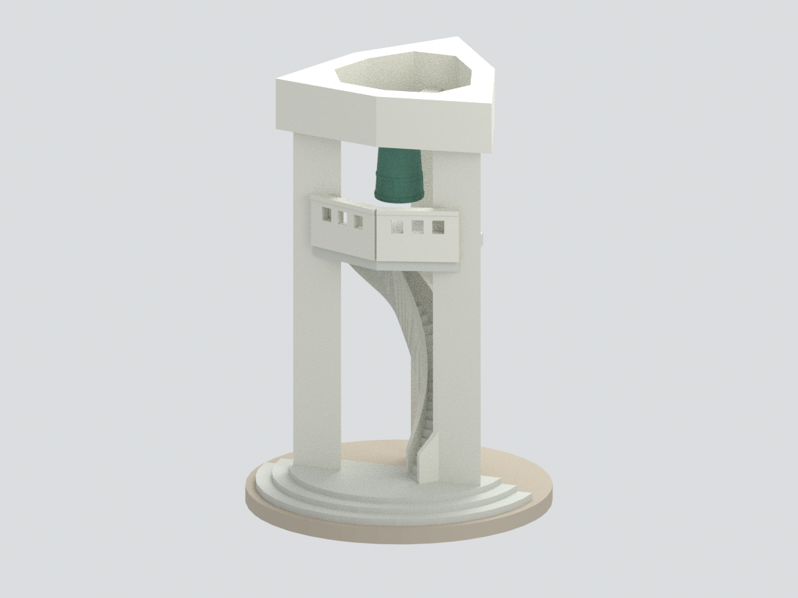
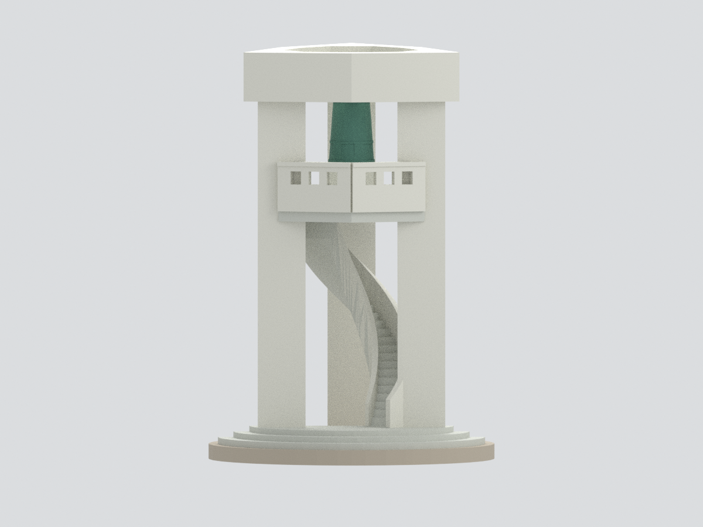

# 國立臺南大學｜府城校區｜百年鐘樓

**官方公開外觀照片導向的主要鐘架、鐘臺、旋梯與鐘體近似模型；不是實測或精確復原。**

以總務處完整外觀、南大風情建築相簿的正反角度及 2026 年鳴鐘活動照片交叉核對。主體保留三主要直立構件、中央折面的頂梁與鐘臺、前側方孔欄板、外露旋轉樓梯、懸鐘及前側弧形階梯。三柱配置、柱距、三向相連上框與後懸梁夾角與各尺寸均為照片推定，不是官方圖紙數據。

## 模型預覽

以下為本套件模型的實際渲染，非建築現場照片；建模範圍與限制仍以本文說明為準。

## 檔案
- `model.stl`：單一連通幾何。
- `model.3mf`：毫米單位、四類近似色彩。
- `scene.blend`：實際輸出網格與隱藏可編輯施工分件。
- `build_model.py` / `render_model.py`：可重建幾何與六張實際渲染。
- `previews/`：正面、正立面、另外兩個主要方向、頂視與近景。
- `QA.json` / `REBUILD-QA.json` 等：幾何、格式、重建與畫面檢驗。

## 必讀限制
- 以照片中可辨主要本體為範圍；不是完整校園或周邊地景模型。
- 上方是開放鐘架，**沒有擅加實體屋頂，也沒有套用四柱方亭**。
- 正面頂梁和鐘臺前緣的中央折面有照片依據；三柱角部採名義三角斷面；三向相連上框及後側平面閉合、實際連接細節作照片推定簡化。
- 旋梯採照片方向的部分旋轉，並保留連續扭轉底板。28 個踏步是作者減量近似，並非現場清點。旋轉角度、梯寬和板厚不是量測值。
- 前欄板每半側三孔是代表性減量，非確認的真實總孔數。後側落腳平台與欄板細節未完整復原。
- 鐘保留可辨外輪廓、空心底及代表性環帶。**省略文字、圖像浮雕、精細吊鉤和鐘飾**，不是原物沒有這些細節。
- 三層前弧階梯僅依外觀近似；花臺、植栽、告示碑、人物與周圍建築省略。圓底板是作者展示支撐，不代表實際完整基座範圍。
- 色彩為照片觀看近似，沒有校色或材質實測；不將圖片網址日期當作拍攝日期，也不保證模型反映最新整修狀態。
- 名義比例每單位轉為 12 mm，不宣稱真實比例尺。尚未試印或做建築結構安全驗證。

來源照片不附入公開模型包。詳見 [SOURCES.md](SOURCES.md)。
