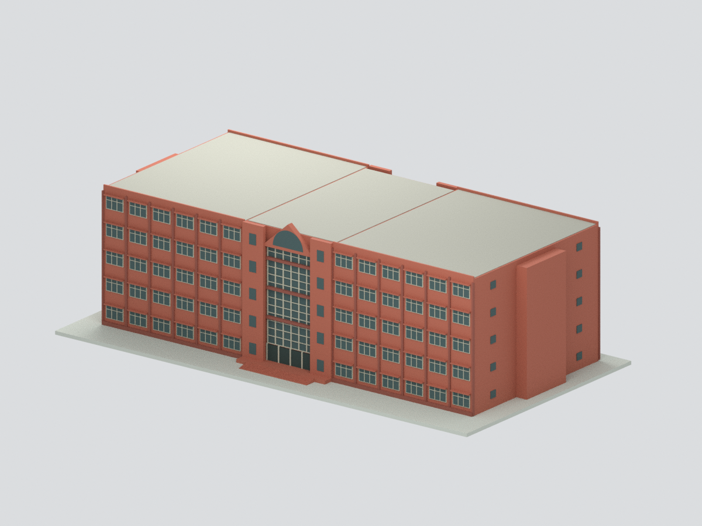
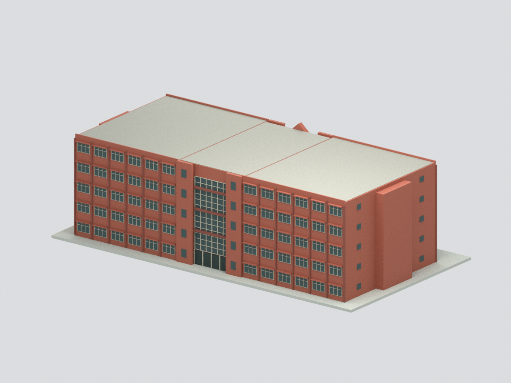
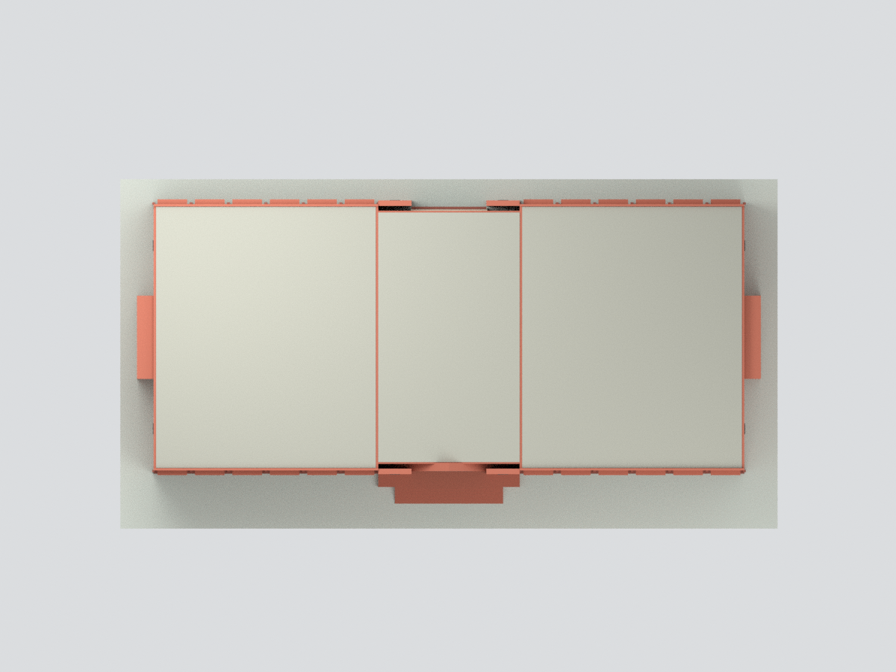
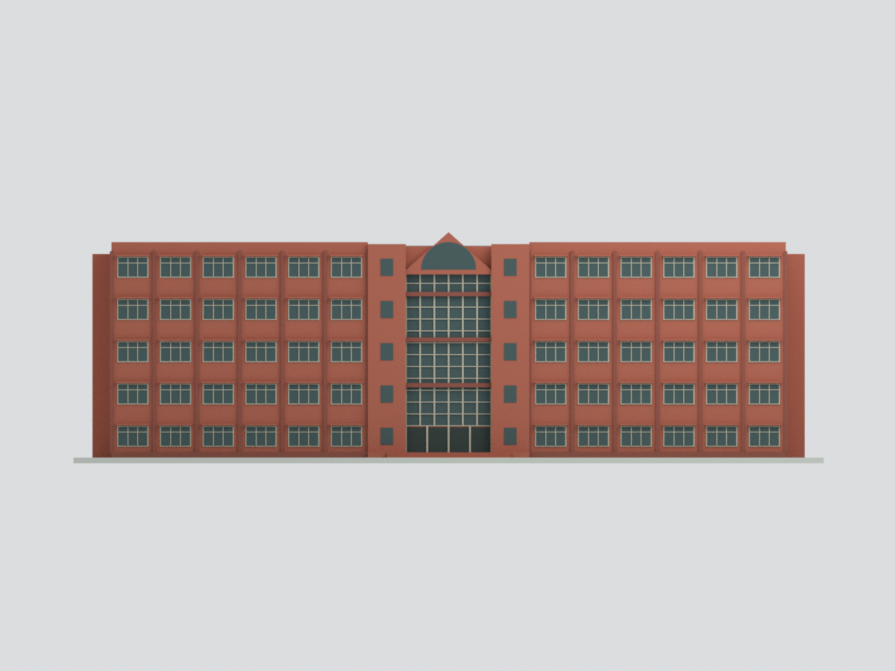
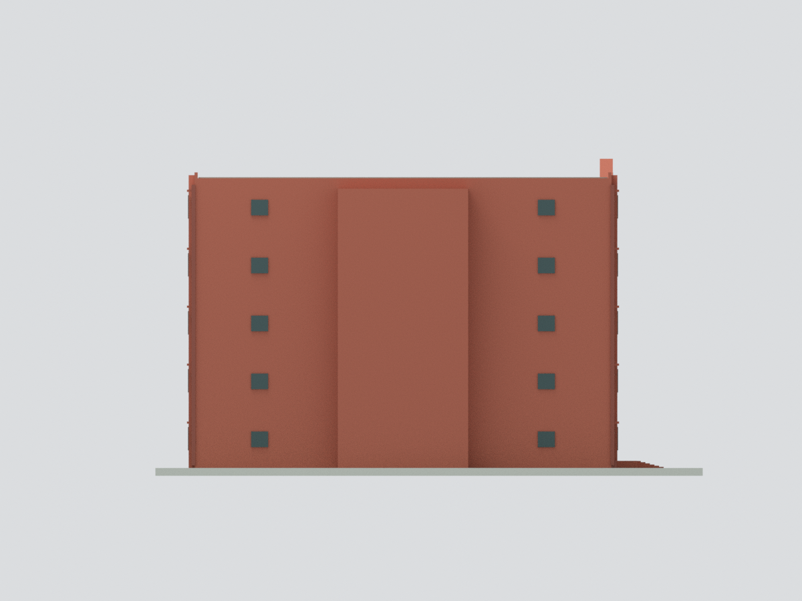
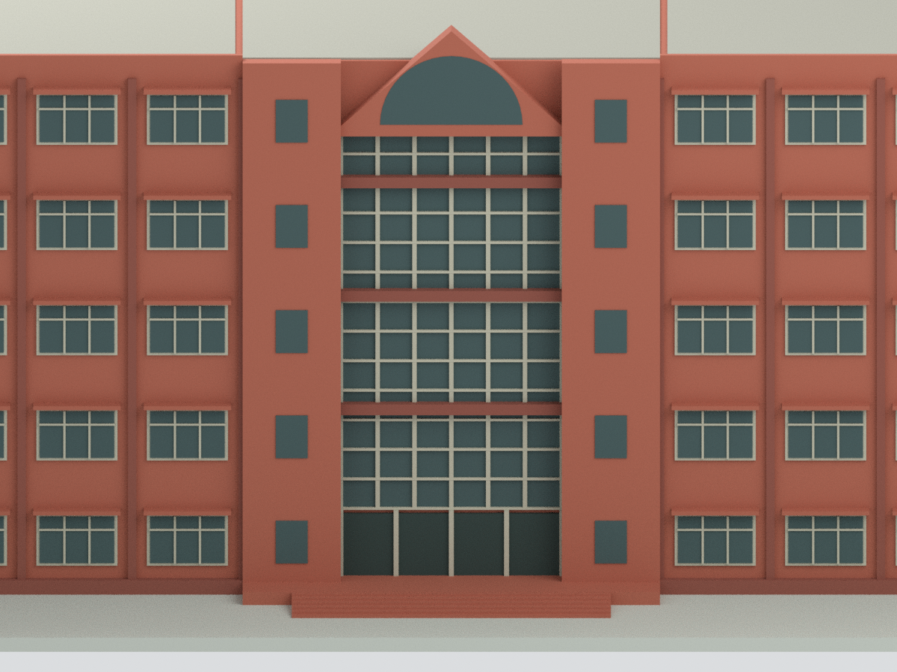

# 國立臺南大學｜誠正大樓

## 模型預覽

| 模型預覽 | 模型預覽 | 模型預覽 |
| :---: | :---: | :---: |
| 正面模型  | 背面模型（含近似細節）  | 俯視模型  |
| 正面立面模型  | 端部模型  | 入口細節模型  |

依校方歷史外觀照片及官方2025作業環境監測平面圖建立的**有限範圍外觀近似模型**；不是實測、竣工CAD、2026現況或試印認證。

## 已建內容
地上5層長方形雙翼、中央高玻璃連接廳、三角山牆與半圓扇窗、兩長立面分組窗列、兩端突出梯間、少量側窗、簡化入口台階與自製底座。地下1層、室內/中庭、附屬景觀未建。

## 尺度
2025圖面主軸2–17可讀合計71m，A–F合計32m；不是模型外緣總尺寸。官方歷史頁記地上5層、地下1層、樓高23.75m、占地2412.06m²，與主矩形2272m²加突出部相容。本模型採71×32m主矩形、中央17m廳及兩翼27m，最高山牆23.75m；高度數值有文獻依據，但等分樓層4.45m、屋頂分配、窗格、梯間、台階尺寸均估計。縮尺2.6mm/名義公尺（約1:384.6），含底座205.4×109.2×63.31mm。

## 已知限制
- 官方相簿部分圖片是1995舊圓形圖書館，已排除，未混入誠正大樓。採照片000102/000202及2003整修0701等誠正外觀；前兩張拍攝日未標明，0701標2003整修，非今日照片。
- 1F內部圓角空區不等於已證實露天天井；屋頂未查到可用平面或清晰頂視，**使用中性封閉頂面**，不聲稱實際屋頂封閉，也不把未知空區挖成洞。屋頂設備、女兒牆細部未還原。
- 正面玻璃、五層、三角山牆、磚紅色與窗節奏有照片依據；後廳、側窗鏡像、突出梯間高度、窗扇分割是有限資訊下簡化。側端不是全立面精確重建。複雜多折線側台階省略，中央入口台階簡化。
- 1991建成紀錄、歷史照片與2025監測圖並非同一時刻；不主張2026現況。校史原文樓高未拆解女兒牆/山牆，模型分配屬近似。
- STL/3MF為實體展示外殼，室內不開放；小窗框最細約0.234mm，不能依拓樸通過推定適合列印。未切片、未驗證最小壁厚、支撐或實體試印。

## 重建與檔案
STL、3MF、mesh-data.npz共用同一表面。scene.blend可見網格匹配，附隱藏可編輯元件。六張預覽皆由實際模型渲染，沒有貼官方照片。參考圖/PDF不包含於公開包。

完整依賴和命令見 REBUILD.md。幾何/格式QA與外觀證據審查是不同範圍；本機封包不代表已上傳GitHub。
