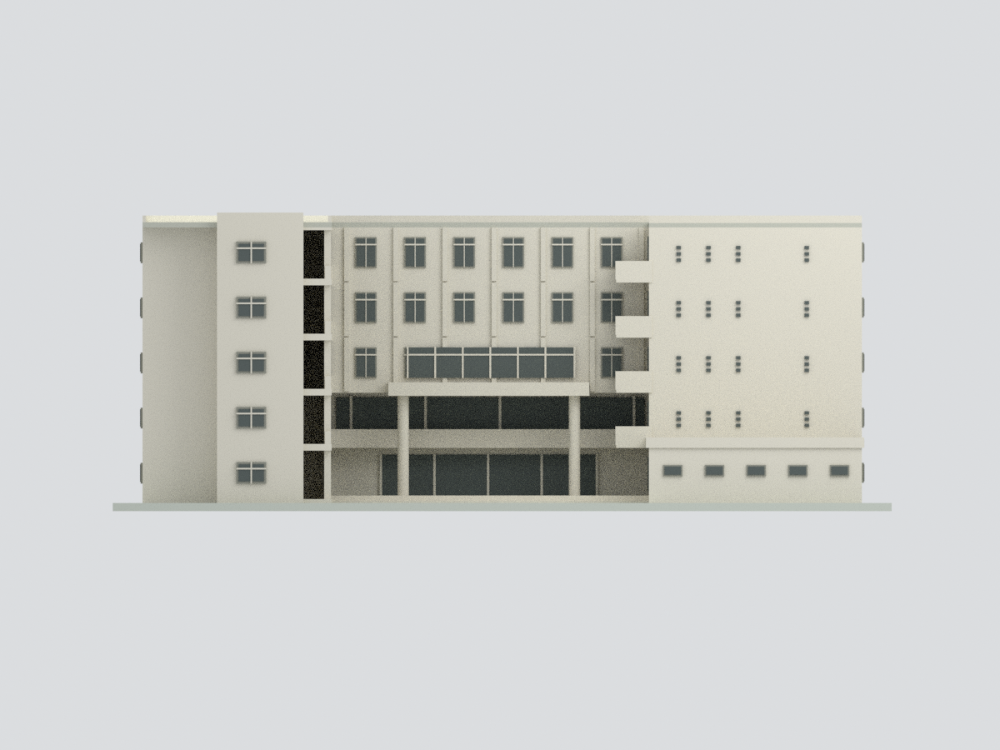
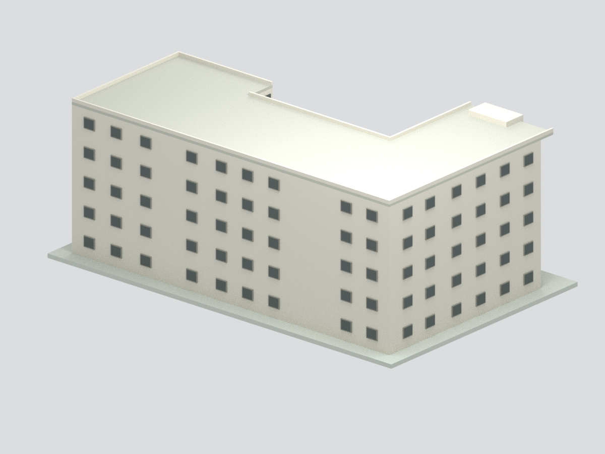
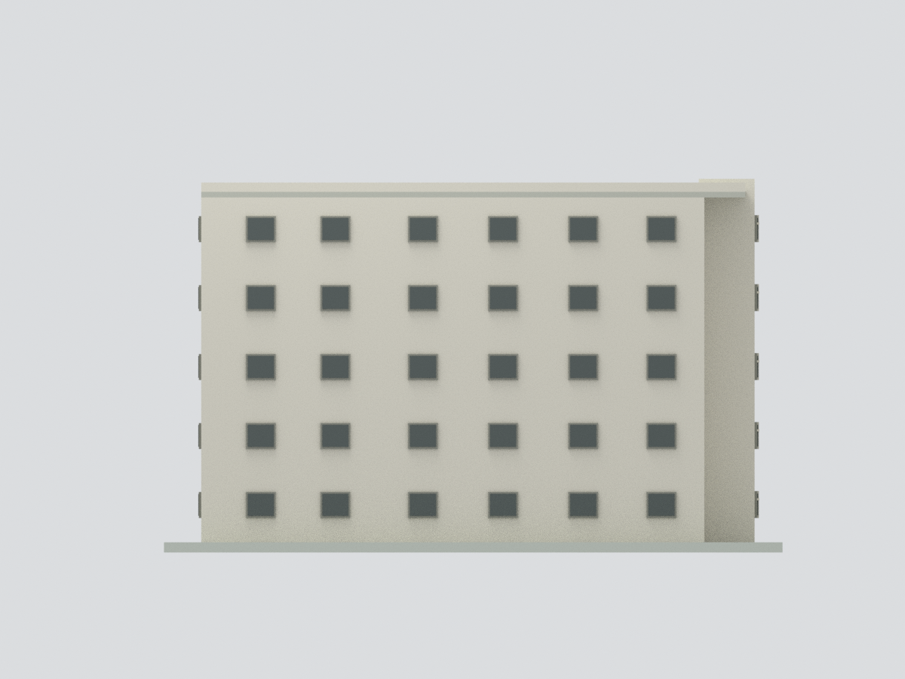
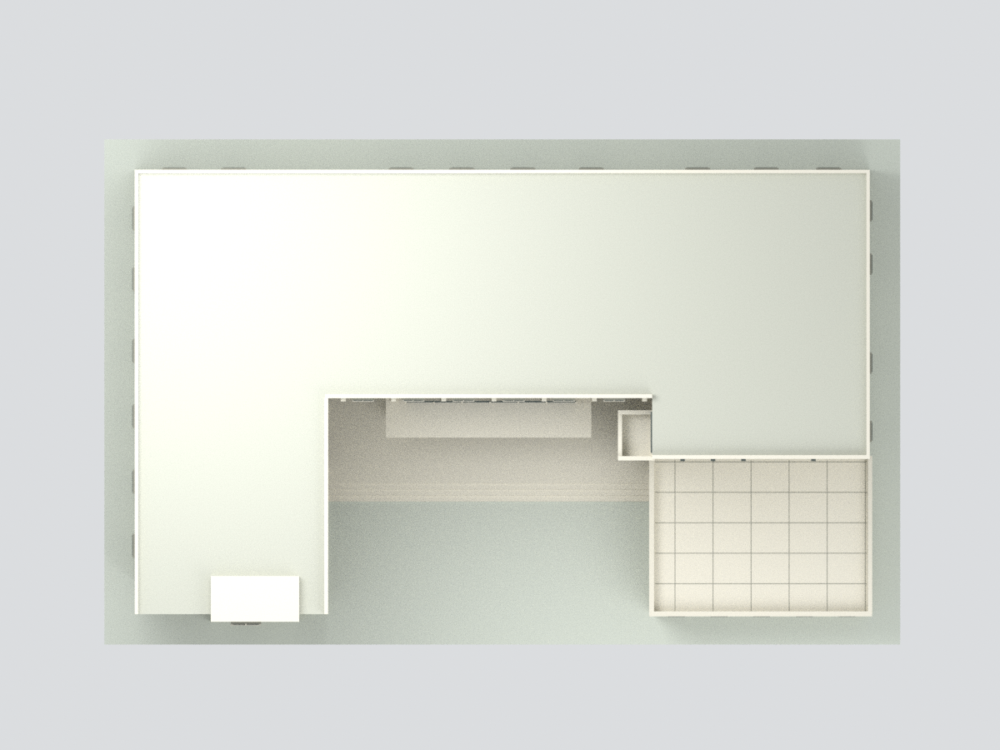
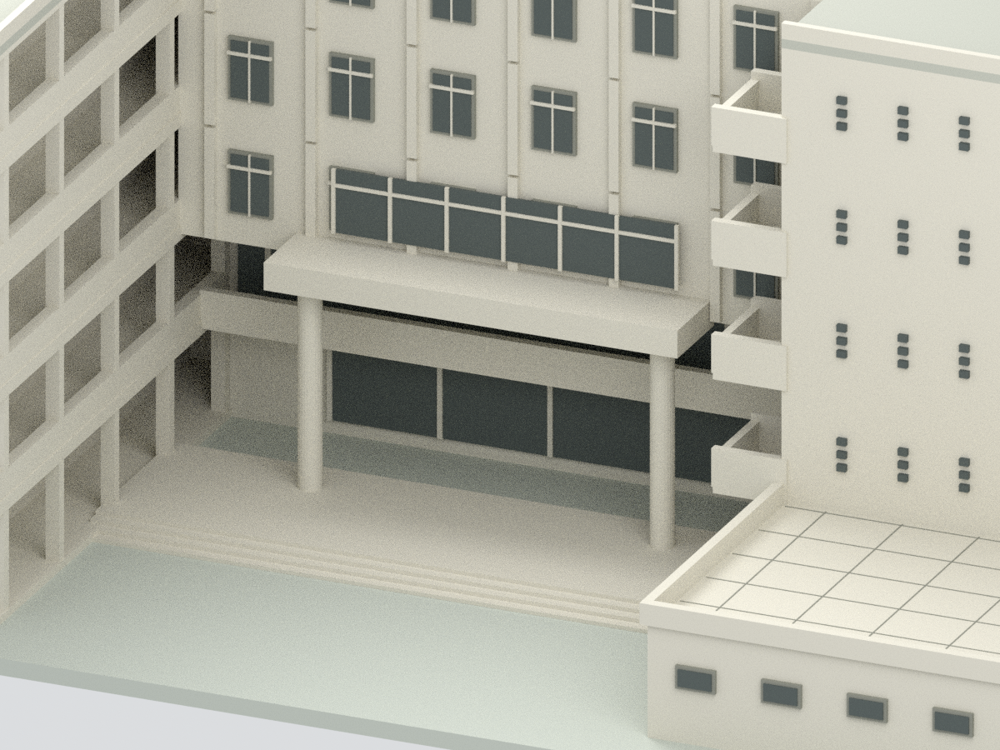

# 國立臺南大學｜格致樓五層主體與中庭

## 模型預覽

| 中庭總覽 | 正立面 | 背側示意 |
|---|---|---|
|  |  |  |
| 左端 | 頂視 | 入口細節 |
|  |  |  |

官方平面與歷史官方照片支持的外觀近似模型，**不是2026現況調查，也不是精密測繪**。五層非對稱U形、圖左開放走廊、圖右較短翼與前端低翼、入口挑空粗圓柱及右側懸挑陽台已建。

## 依據與尺度
- 官方報告內1F、4F、5F平面與五張校方相簿照片。PDF頁48/49/50外部標題錯置，依圖內「壹樓／肆樓／伍樓」和C1xx/C4xx/C5xx辨認，不採錯誤外caption。
- 可讀總軸線48.30×30.20m並非外牆精確包絡；模型主體使用48.30×29.20m與前端凸出示意。尺寸不是測量值。層高3.70m、窗格和部件尺寸估計。
- 圖面無可靠北箭頭，「圖左／圖右／圖上」不是地理方位。
- 外部開窗參照平面簡化排列；沒有多面實測，背立面窗型、屋頂設備、細小磁磚與室內未精確復原。未做大片未知無窗牆，但也不將推估開窗當照片實證。

## 檔案
[STL](model.stl) · [5色3MF](model.3mf) · [可編輯Blender](scene.blend) · [來源](SOURCES.md) · [QA](QA.md)

## 重建與列印限制
Python3 + numpy/trimesh/manifold3d執行build_model.py、validate_model.py；Blender背景執行render_model.py。統一網格與隱藏原創部件一併保存於BLEND，來源照片/PDF未嵌入。3MF標準基本材質，7色表項實際使用5色（apricot/shadow為未使用保留項，不是本棟已證實材料），不含噴頭配置。

模型含展示底板約183.05×116.20×70.17mm；3.5mm代表1m（約1:286），不是可回推實測尺寸。細凸框約0.07–0.18mm，部分樓板約0.6–0.9mm；需切片檢查、加粗或放大並配置支撐。封閉連通僅證明幾何完整性，**未實體試印，不保證直接可印**。
