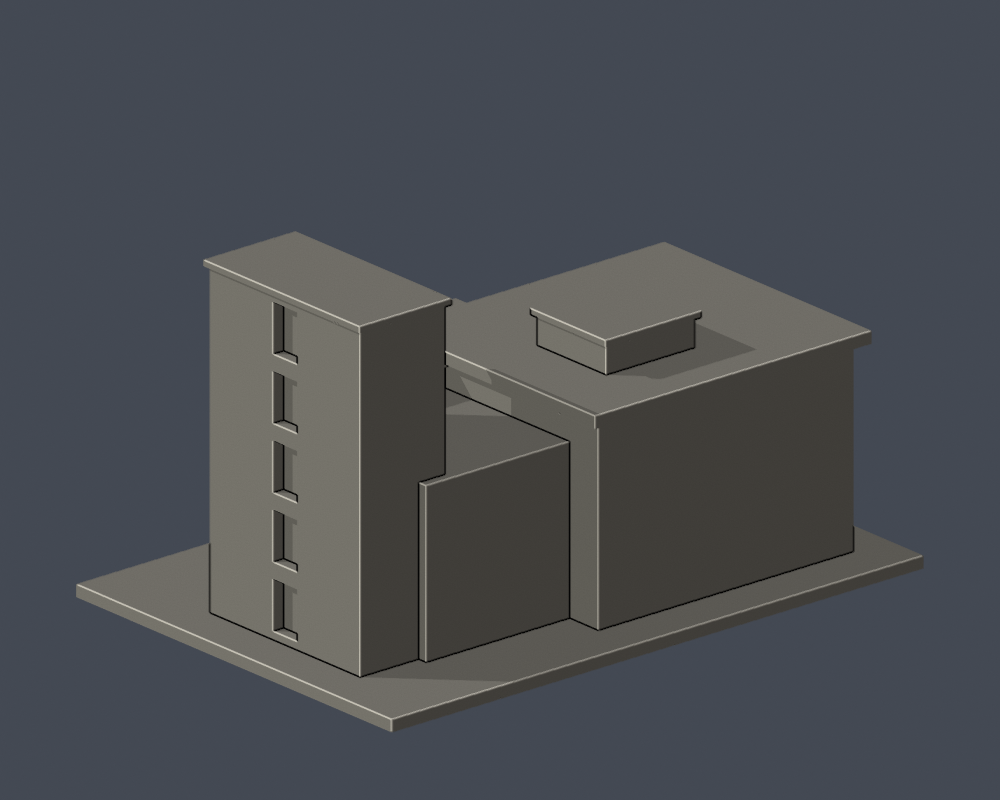

# 啟明苑入口端標段｜國立臺南大學

府城校區／啟明苑入口端，後方長向廳體未全納入。逐件獨立縮放，含底座最長150mm；非各館同一比例。尺寸：150.00 × 105.00 × 84.50 mm。

| 實際STL正面 | 實際STL背面 |
|---|---|
|  |  |

[實際STL頂視](previews/top.png)

## 外觀與模型範圍
高磚塔、低廳量體、大玻璃入口、挑高門廊、上層深凹走廊、彎曲突出陽台、懸挑大簷及屋頂低機房。

僅入口端標段，長向廳體向後截斷；不是全館。端部深度、後截面及未見細節近似，未取得完整背面照片；側帶窗以可見外觀概括。

官方舊照片可追至2011年前更新，拍攝日期未註明。2026官方校圖仍列本建物，但不據此保證所有外觀細節皆為2026現況。 [官方主要照片](https://www.nutn.edu.tw/gac780/picture/01/p017.htm)／[來源及近似限制](sources.json)。來源照片與校圖僅私用研究，不隨模型公開；此處預覽均由實際交付STL渲染。

## 檔案
- [STL](model.stl)／[可編輯Blender場景](scene.blend)／[Python重建](build_model.py)／[依賴](requirements.txt)
- [原STL幾何、法向與重建一致性](validation.json)
- [0.2mm逐層閉合/各輪廓/合成多邊形有效性](contour-validity-check.json)
- [0.8mm薄特徵數位篩查](thin-feature-check.json)

## 檢查與列印限制
原始STL通過水密、每邊兩面、頂點link單循環、正體積、原始法向與繞向、單一表面且無孤立內腔殼；獨立重建SHA與保存Blend三角形一致。檢查不以repair掩蓋錯誤。0.2mm層高的輪廓graph degree2、每個多邊形與合成多邊形有效。

0.8mm XY薄特徵篩查以canonical shared-edge內插，每1mm高度取樣；0層開運算面積損失超過1%，包含尖角、簷口等，不能當作噴嘴路徑可印證明。這些是數位QA，沒有真正切片器驗證或實體試印。建議底座朝下、0.4mm噴嘴與0.2mm層高作切片起點；門廊/陽台/屋簷/窗洞上沿需逐一檢視橋接、局部支撐與移除空間；不保證免支撐。細窗格與欄板孔在小比例下有列印限制。

## 重建
Python 3.12安裝requirements.txt後執行build_model.py。Blender背景執行render_preview.py取得scene.blend與actual-STL預覽。依次執行validate_model.py、check_contour_validity.py、check_thin_features.py，全部exit0且validation.json的checks全true才可交付。

STL SHA-256：018cfe0b9836d70c3952acacf7644c61ad75feddf1b1aa2490bdca1ba13e4409

[校區圖鑑](../../README.md)／[學校](../../../README.md)
