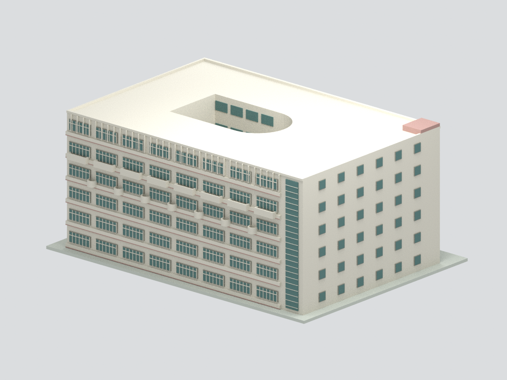
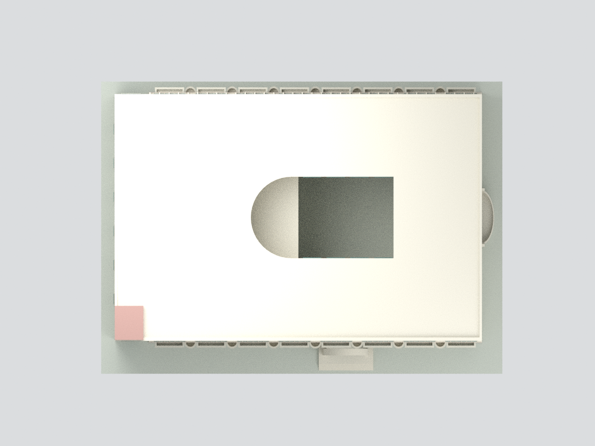
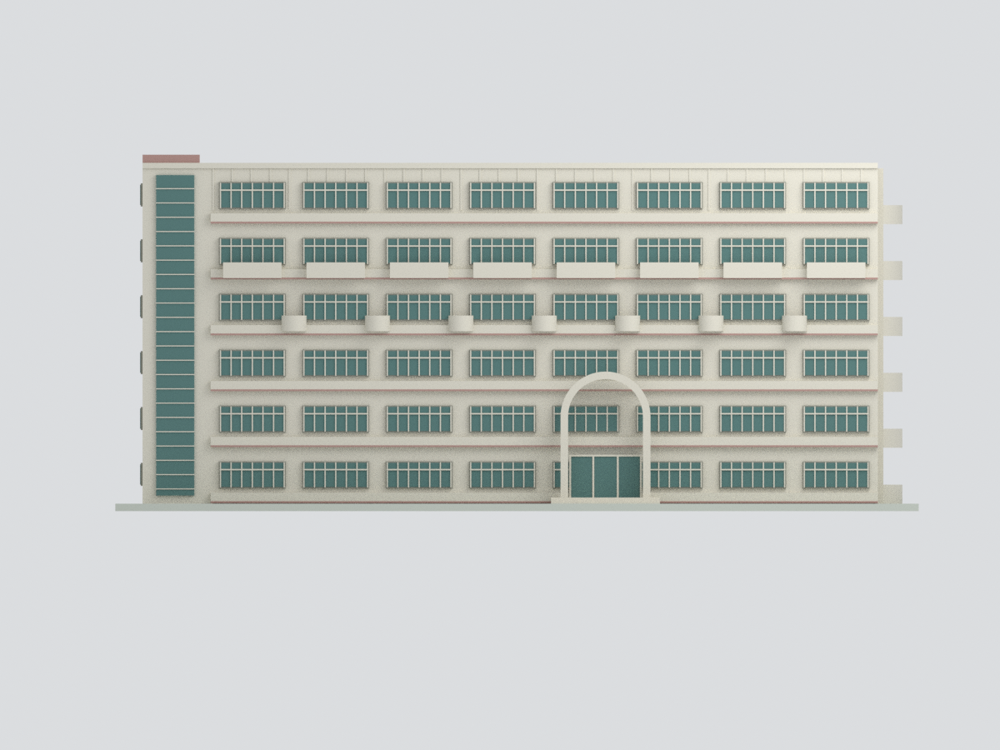
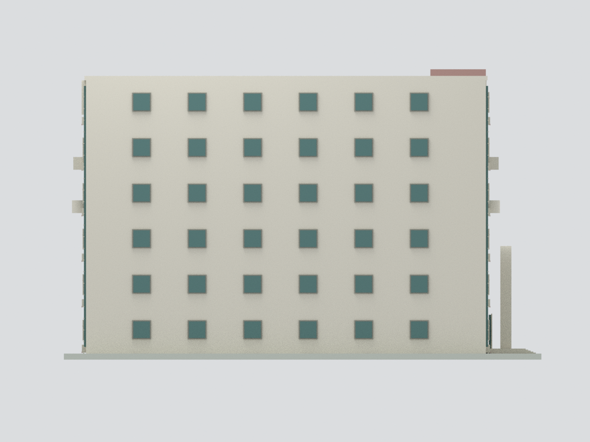
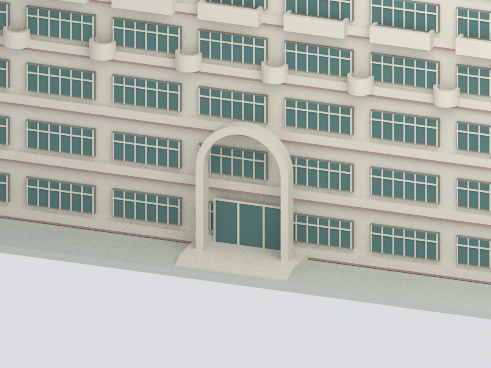

# 國立臺南大學｜文薈樓六層中庭主體

## 模型預覽

| 模型預覽 | 模型預覽 | 模型預覽 |
| :---: | :---: | :---: |
| 正面模型<br> | 背面模型（含近似細節）<br> | 俯視模型<br> |
| 中庭立面模型<br> | 端部模型<br> | 入口細節模型<br> |

依校方歷史照片與2025作業環境監測平面圖製作的**有來源限制之外觀近似模型**，不是測繪成果、2026現況、精確建築模型或已試印產品。

## 範圍
地上六層主量體、1–4F矩形中庭與5–6F擴大弧形中庭、兩長立面窗帶、四樓七個小弧形陽台、五樓八組長陽台、正面拱形入口、端部凹入樓梯窗帶及曲面開放陽台。地下二層均未重建，照片中局部露出的地下層立面亦省略；展示底板不是地形。

## 尺度與不確定性
校方歷史頁明載地上六層、地下二層、樓高24.63m、占地1961.95m²；1997-09-28啟用。本模型主體採24.63m參考，六層等分為示意，非實測樓層高度。平面名義54×36m僅從未標尺寸平面比例估計，不以占地面積反算精確尺寸。3.2mm/名義公尺；含底座約188.8×137.6×83.8mm。左樓梯頂凸出、欄板、拱門、窗細節尺寸近似。

照片拍攝日期未查明；2025監測平面不是竣工CAD。不同年代資料組合不宣稱同一時間現況。短端下層窗格/陽台沿平面分層近似（近照只清楚呈現上部），陽台圓角、窗扇均有簡化；屋頂機電、空調、招牌、室內、地下層和庭院植栽未製作；照片中可見的短端上部百葉、屋頂設備箱及內院採光罩亦未完整重建，不能稱完整全貌復原。未見細節保持簡化，不代表確知不存在。屋頂為平整示意，不能當作實際屋頂設備配置。

## 檔案與QA
model.stl / model.3mf 為同一連通實體；scene.blend 為實際三角面與隱藏可編輯構件，六張預覽為該模型實際渲染，無貼參考照片。build_model.py重新產生模型；validate_model.py查格式與拓樸；render_model.py/verify_scene.py需Blender與numpy。

QA僅保證檢查項目的幾何/格式一致；沒有切片、支撐、最小壁厚或實體試印驗證。細框與拱門需依印表機放大或加粗。原始參考照片/PDF未隨包公開。

## 重建環境與命令
使用Python 3.12、numpy、trimesh、manifold3d（標準庫 pathlib/json/zipfile/xml.etree 不需另裝）；本次trimesh 5.2.0。Blender 4.3.2用於渲染及讀回驗證，其Python需可import numpy。先在獨立目錄重建，避免覆寫已封存交付包：

```sh
python3 -m venv .venv
.venv/bin/python -m pip install numpy trimesh manifold3d
.venv/bin/python build_model.py
.venv/bin/python validate_model.py
blender -b -t 4 --python render_model.py
blender -b scene.blend -t 2 --python verify_scene.py
```

以上重建STL/3MF/NPZ/構件與六張預覽；原始來源不是執行依賴。視覺審核、manifest/SHA256SUMS與發布驗證須另外重做，不可沿用舊通過證明冒稱新版本已審。
