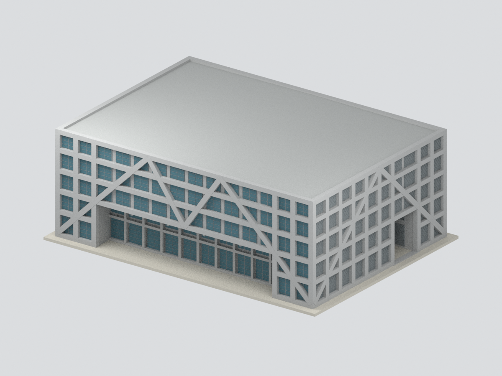

# 國立臺南第一高級中學建築研究模型

現行收錄 **2 套模型包**；套件數不等於完整建築棟數，亦非全校／校區完成。

**既有小禮堂模型是2003調查報告記錄的歷史外觀，包含沿用2000年的四向立面，不是今日修復現況。** 原臺南州立臺南第二中學校講堂為此建物歷史名稱，非今日臺南二中講堂。名義1:150；主高堂約26.8×14.4m為圖面比例估算，與正文「全棟23×14m」矛盾保留，不擅稱後者是觀眾席或不含舞台。涵蓋主堂、南八拱廊與東後台，不延伸校園連廊；封閉浮雕門窗、色彩及細件簡化。未實體試印，格式與網格檢查不代表列印成功。

| 建築模型 | 建築模型 | 建築模型 |
| :---: | :---: | :---: |
|  **[臺南一中小禮堂｜2003 調查報告外觀](校本部/buildings/tnfsh-small-hall-survey-2003/README.md)** [STL](校本部/buildings/tnfsh-small-hall-survey-2003/model.stl) · [彩色3MF](校本部/buildings/tnfsh-small-hall-survey-2003/model.3mf) · [Blender](校本部/buildings/tnfsh-small-hall-survey-2003/scene.blend) |  **[綜合體育館｜2012完工／2013供圖外觀](二部園區/buildings/tnfsh-gymnasium-2012/README.md)** [STL](二部園區/buildings/tnfsh-gymnasium-2012/model.stl) · [彩色3MF](二部園區/buildings/tnfsh-gymnasium-2012/model.3mf) · [Blender](二部園區/buildings/tnfsh-gymnasium-2012/scene.blend) |  |

來源照片與掃描圖不隨公開包配送；上圖為本模型實際 Blender 渲染。

[校本部圖鑑](校本部/README.md) · [回總目錄](../README.md)

## 二部園區新增模型範圍

**綜合體育館採2012年完工、2013年建築師供圖所呈現的外觀，不是目前現況、精密竣工模型或施工圖。** 僅含獨立地上主體，地下層、入口坡道、外部階梯延伸及地形均排除。名義1:250，部分尺寸與表面細分為建模簡化；沒有實體試印，薄百葉、細件、懸挑與支撐需依實際設備和切片設定評估。

[二部園區圖鑑](二部園區/README.md)
