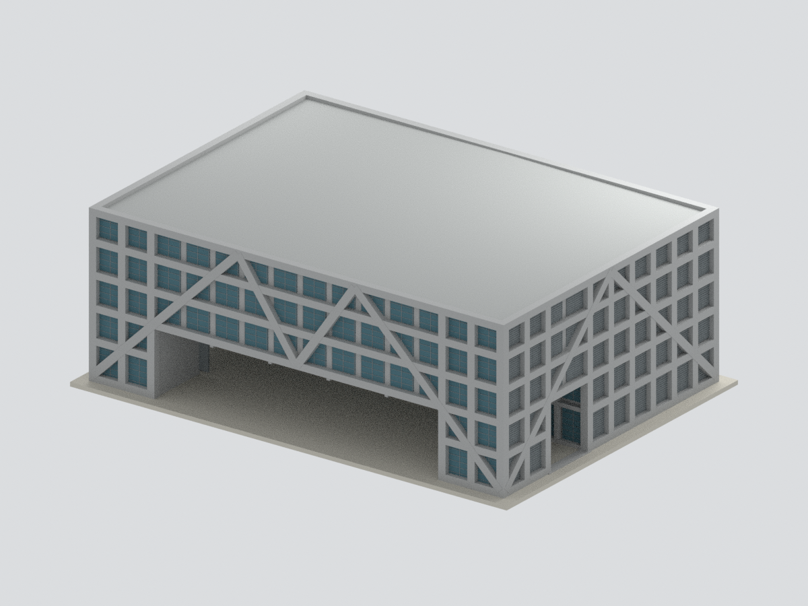
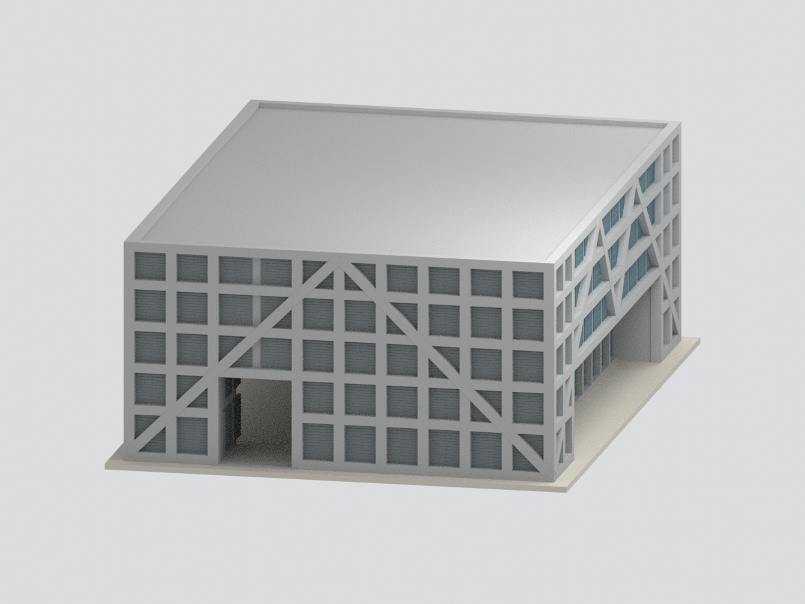
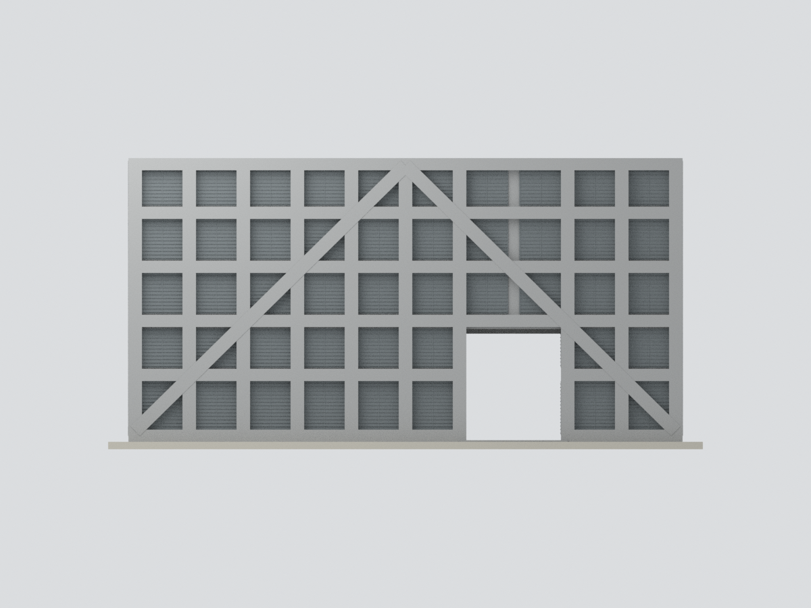
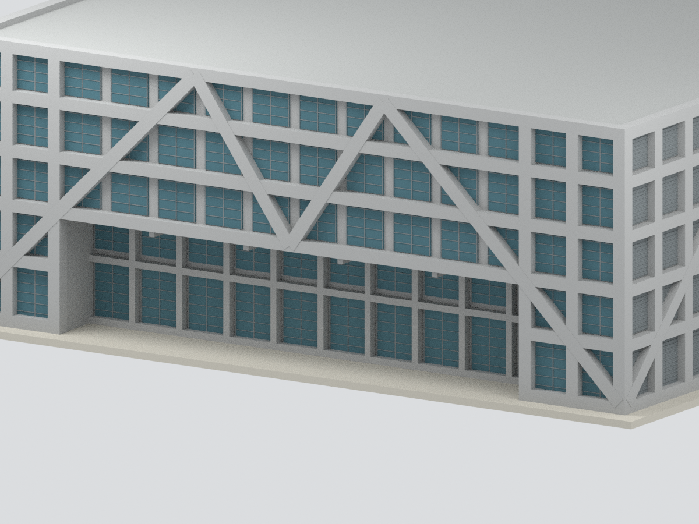

# 國立臺南第一高級中學｜二部園區綜合體育館

**2012 年完工、2013 年建築師供圖所呈現之外觀模型**。不是目前現況紀錄、精密竣工模型或施工圖；與一部園區的群英堂、小禮堂為不同建築。

## 模型與下載

- 名義比例 **1:250**；主體尺寸 **57 × 41 × 21 m**，對應約 **228 × 164 × 84 mm**，不含另製支撐底座；含底座整體包絡約 **240 × 176 × 86.2 mm**。
- [STL](model.stl) · [3MF](model.3mf) · [Blender 場景](scene.blend) · [重建程式](build_model.py)
- [尺寸與限制](parameters.json) · [來源紀錄](provenance.json)
- 座標為局部建築軸向：X 東、Y 北、Z 上；非地理定位測量。

## 外觀範圍

呈現完整地上主體、清水混凝土方格及斜撐、北側半戶外球場的大開口、南側約 4 m 深凹入入口、東西側入口與主要玻璃／百葉配置。北側中央約 40 m 跨、16 m 深的半戶外空間保留為真正開口，不以玻璃封閉；南北長面主要玻璃、東西短面主要百葉。

屋頂依剖面採低坡簡化與平頂輪廓女兒牆；立面圖的避雷保護三角線不是屋頂，不予實體化。

## 證據與尺度

1. [QLAB 建築師官方作品頁](https://www.qlabarchitects.com/project5/tainan-tfsh-sports-gym)：名稱、二部園區位置、結構與空間設計。
2. [QLAB 官方實績摘要 PDF](https://www.qlabarchitects.com/s/TNFSH-Gymnasium.pdf)：B1F～5F、建築高 21 m，施工 2010.05–2012.12；總樓地板面積 8,743 m²。
3. [ArchDaily 建築師供圖專案（2013-05-26）](https://www.archdaily.com/376726/ntfsh-gymnasium-qlab)：14 張平立剖／屋頂圖與竣工外觀照片交叉核對。四立面標 5700／4100 cm，半軸格 400 cm；樓層標高 +500／+900／+1300／+1700／+2040 cm，頂部約 +2100 cm。細部厚度、百葉間距及顏色為模型化詮釋，不是全部精密尺寸。
4. [校方校園配置頁](https://www.tnfsh.tn.edu.tw/Eng/content/index.aspx?Parser=1,15,324)：校園圖分別標示 Gym 與 Chun-ying Hall，兩者分居勝利路兩側。

**來源檔名勘誤：**供圖下載名 `Basement_Plan.jpg` 的實際內容是屋頂平面（洩水方向、檢修走道、避雷針）；`Ground_Floor_Plan.jpg` 才是地下停車場平面。圖意以實際圖面為準，不能依檔名互換構造。屋頂方格不解讀為露天空洞。ArchDaily 的面積數字與建築師摘要不一致，本模型不用該異常數字；2013 為專案發表年份，非完工年份。

## 明確限制

- **尚未實體試印，非免支撐模型**。北側半戶外大跨開口需要切片時規劃支撐；依設備亦可能需分件或調整方向。部分細百葉／窗框約 **0.18 mm**，有製程解析度與脆弱性限制，尤其一般 FDM 不一定能可靠成形；請依設備調整或放大。
- 玻璃以不透明色面表示；不重建隱藏室內、觀眾席、設備或地下室。
- 百葉、窗框深度及屋頂低坡作適度簡化；未逐一復刻混凝土模板螺栓孔。
- 排除外伸地下車道、入口外部階梯／坡道、周邊校園、道路、景觀及實際地形坡差。平底座為模型支撐，不是測繪地坪。
- 不建置 9 m 避雷針、避雷保護範圍示意線或未確認屋頂設備。
- 高度 21 m 為名義 GL 基準；來源另有 1F −5 cm、總高鏈 2105 cm 及周邊高程差，不代表各地面點至屋頂皆恰為 21 m。
- 本頁不宣稱 QA、發布或遠端讀回已通過；請以包內各項實際檢查紀錄及發布回執為準。

## 模型渲染視角

以下僅為本模型渲染，非來源照片或竣工現場照片。

| 南向正立面 | 北側 |
|---|---|
|  |  |

| 端部視角 | 側向立面 |
|---|---|
|  |  |

| 俯視 | 入口細節 |
|---|---|
|  |  |

原始照片、PDF 與圖面僅供來源查核，不嵌入或隨本模型包重新散布；各來源權利仍屬原權利人。

Blender 場景採 Blender 4.3.2 原生壓縮儲存；可直接開啟。壓縮後已實際重開驗證網格頂點、面與材質索引未變，七張既有預覽的網格／腳本綁定亦重新通過。
