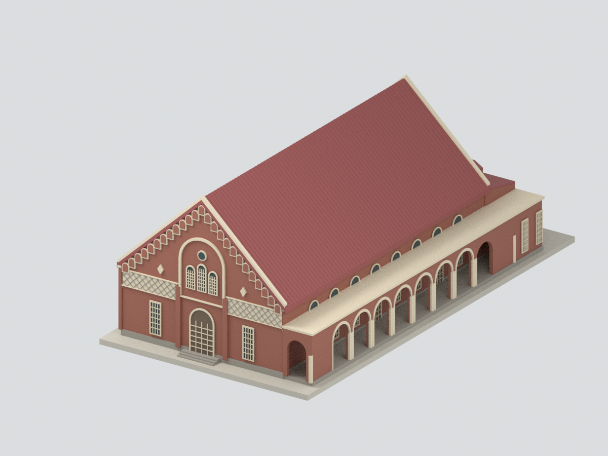

# 臺南一中｜校本部建築研究模型

現行收錄 **1 套模型包**；套件數不等於完整建築棟數，亦非全校／校區完成。

**本件是2003調查報告記錄的歷史外觀，包含沿用2000年的四向立面，不是今日修復現況。** 原臺南州立臺南第二中學校講堂為此建物歷史名稱，非今日臺南二中講堂。名義1:150；主高堂約26.8×14.4m為圖面比例估算，與正文「全棟23×14m」矛盾保留，不擅稱後者是觀眾席或不含舞台。涵蓋主堂、南八拱廊與東後台，不延伸校園連廊；封閉浮雕門窗、色彩及細件簡化。未實體試印，格式與網格檢查不代表列印成功。

| 建築模型 | 建築模型 | 建築模型 |
| :---: | :---: | :---: |
|  **[臺南一中小禮堂｜2003 調查報告外觀](buildings/tnfsh-small-hall-survey-2003/README.md)** [STL](buildings/tnfsh-small-hall-survey-2003/model.stl) · [彩色3MF](buildings/tnfsh-small-hall-survey-2003/model.3mf) · [Blender](buildings/tnfsh-small-hall-survey-2003/scene.blend) |  |  |

來源照片與掃描圖不隨公開包配送；上圖為本模型實際 Blender 渲染。

[回學校圖鑑](../README.md)
